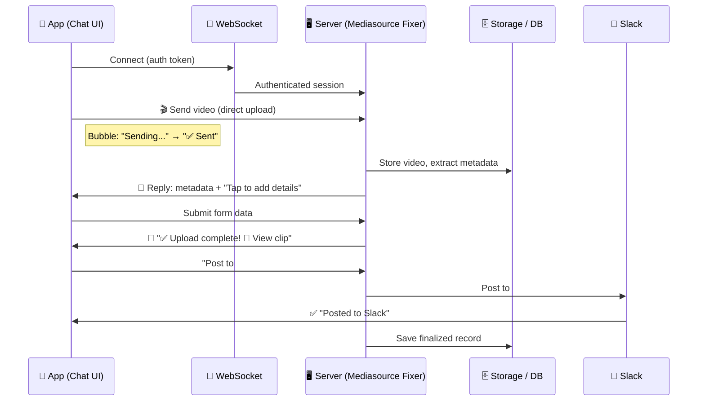
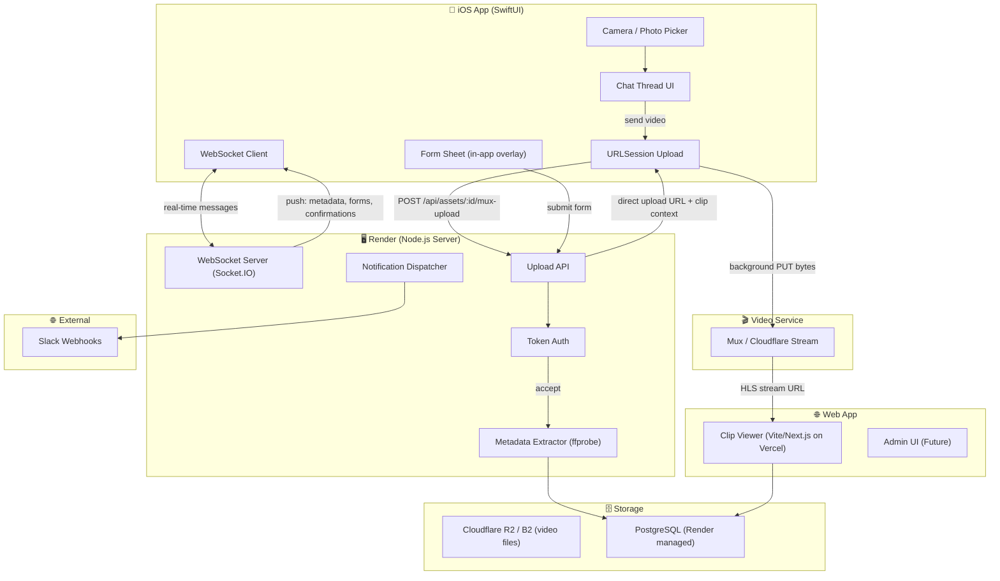
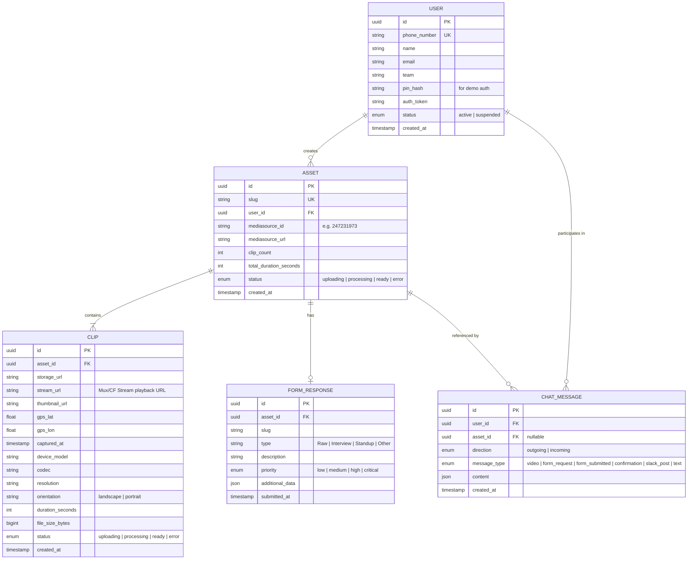

May 12, 2026 - 3:52pm - GitHub Copilot (GPT-5.3-Codex)

# Direct Video Uploader — Project Specification (v4)

> **Server Contact:** `Mediasource Fixer` / `800-123-4567`
> **Platform:** iOS (registered work phones only)
> **Design Principle:** The app looks and feels like Apple Messages. The user "texts" a video to the server. Under the hood, it's a direct background upload to Mux with a WebSocket control plane.

# cd admin && npm run build

---

## Changelog (v3 → v4)

- **Branding:** Server contact renamed from "Video Upload Server" to **Fixer**.
- **Chat Demo:** Interactive HTML demo (`chat-demo.html`) built with step-by-step controls, Slack sidebar mockup, metadata/form sheets, and orientation-aware video thumbnails.
- **Slack Integration:** Users can trigger a Slack post from the chat (e.g., `#team-alerts @carrie.smith`). The demo simulates a `#team-alerts` channel message with a threaded reply.
- **WebSocket Architecture:** Server connection uses **WebSockets** (not hardcoded polling) for real-time bidirectional messaging between the app and server.
- **Demo-First Approach:** Planning shifted to a **live proof-of-concept demo** before full production. No custom video server — leverage existing streaming/storage services.
- **iOS Demo:** Native iOS app demo planned (SwiftUI + WebSocket client).
- **Hosting:** Render (persistent server + database) identified as primary demo host.
- **Admin UI:** Planned for Phase 2 to manage users, devices, and app backend.
- **Simple Auth for Demo:** Token-based auth (no full JWT/device enrollment for demo).
- **Upload Observability (May 11):** Added upload correlation IDs and timestamp telemetry across iOS uploader, `/api/assets/:id/mux-upload`, and Mux webhooks (`video.upload.asset_created`, `video.asset.ready`).
- **Expanded RBAC (May 12):** Introduced dashboard/org role model (`SUPER_ADMIN`, `ORG_ADMIN`, `EDITOR`, `VIEWER`) with legacy-role normalization (`ADMIN`/`USER`) and org-scoped admin access controls.
- **SSO Foundation (May 12):** Added SSO metadata + callback endpoints (`/api/auth/sso/metadata`, `/api/auth/sso/saml`), organization-level SAML config fields, admin org SSO config UI, and iOS SSO-org detection with `ASWebAuthenticationSession` login handoff.

---

## 1. The Core Idea

**The app IS a text conversation with the server.**

The user opens the app and sees a chat thread with **Mediasource Fixer** (`800-123-4567`). They tap the camera/photo button, pick a video, and hit send. The video uploads directly to the server at full resolution via a background upload. The server "replies" in the same chat thread with metadata, a form link, and confirmation. Done.

From the user's perspective, they're texting. From the server's perspective, it's receiving structured API uploads over a WebSocket connection.



---

## 2. Why This Approach

| Question              | Answer                                                                                                               |
| --------------------- | -------------------------------------------------------------------------------------------------------------------- |
| **Why not MMS?**      | MMS caps at ~3.5 MB. Even a short HD video is 10–50 MB. MMS is out for production quality.                           |
| **Why not iMessage?** | iMessage goes through iCloud. Twilio can't receive iMessage.                                                         |
| **Why a chat UI?**    | Most natural mobile interaction. Send → receive → reply. No menus, no learning curve.                                |
| **Why WebSockets?**   | Real-time bidirectional communication. Server can push messages, forms, and confirmations instantly without polling. |

---

## 3. User Experience — The Chat Thread

### 3.1 What the User Sees

The app opens to a single chat thread with **Mediasource Fixer**. It looks exactly like an iMessage conversation. The header displays the camera-icon avatar, name, and phone number in a profile layout (avatar left, text stacked right).

### 3.2 Interaction Model

| User Action            | What Happens                                                                                  |
| ---------------------- | --------------------------------------------------------------------------------------------- |
| **Tap 📷 button**      | Opens iOS photo/video picker. User selects one or more videos.                                |
| **Tap ⬆ Send**         | Videos appear as outgoing bubbles with thumbnails + progress. Background uploads start.       |
| **Uploads complete**   | Bubbles update: "Sending..." → "✅ Sent". Server processes the video.                         |
| **Server replies**     | Incoming bubble with metadata summary + "Tap to add details" button.                          |
| **Tap "Add details"**  | Form sheet slides up from the bottom (in-app overlay). Pre-filled with metadata.              |
| **Form submitted**     | Outgoing bubble shows form summary. Server confirms.                                          |
| **Type Slack command** | User types `#team-alerts @carrie.smith` → server posts to Slack. Confirmation bubble appears. |
| **Tap asset URL**      | Opens the clip viewer (web app or in-app browser).                                            |

### 3.3 Chat Bubble Types

| Direction             | Bubble Type        | Content                                                                     |
| --------------------- | ------------------ | --------------------------------------------------------------------------- |
| **Outgoing** (blue)   | Video message      | Thumbnail (orientation-aware: 16:9 or 9:16), duration, progress → "✅ Sent" |
| **Outgoing** (blue)   | Form submission    | Summary of submitted form data                                              |
| **Outgoing** (blue)   | Slack command      | `#team-alerts @carrie.smith`                                                |
| **Incoming** (gray)   | Greeting           | "🙋‍♂️ Good Morning David! I am ready for your video."                         |
| **Incoming** (gray)   | Metadata + form    | Metadata summary, Mediasource link, "Tap to add details" CTA                |
| **Incoming** (gray)   | Confirmation       | "🙌 High Five!" + Mediasource link                                          |
| **Incoming** (gray)   | Processing         | Thumbnail + "📋 I am processing your video" + action buttons                |
| **Incoming** (purple) | Slack confirmation | "✅ Posted to #team-alerts in Slack (Mentioned @carrie.smith)"              |

### 3.4 Video Orientation Support

The UI handles both **horizontal** (16:9) and **vertical** (9:16) video thumbnails via CSS classes:

```html
<div class="video-bubble horizontal">
  <!-- 16:9 landscape -->
  <div class="video-bubble vertical"><!-- 9:16 portrait/story --></div>
</div>
```

### 3.5 Slack Integration (In-Chat)

The user can post the Mediasource URL and metadata to Slack directly from the chat:

1. User types `#team-alerts @carrie.smith` and sends
2. Server posts to the `#team-alerts` Slack channel with the asset link and metadata
3. The mentioned user (`@carrie.smith`) receives a notification and can reply in-thread
4. A confirmation bubble appears in the chat: "✅ Posted to #team-alerts in Slack"

---

## 4. Video Upload Pipeline

### 4.1 How the Upload Really Works

The upload uses a **WebSocket connection** for the control plane (messages, status updates, forms) and a **background direct PUT upload to Mux CDN** for the video payload:

```
┌──────────────────────────────────────────────────────────┐
│  Under the Hood                                           │
│                                                           │
│  1. App connects to server via WebSocket (auth token)     │
│  2. User selects video in photo picker                    │
│  3. App shows outgoing bubble with thumbnail + "Sending…" │
│  4. App requests Mux direct upload URL from server:       │
│     POST /api/assets/:id/mux-upload                       │
│  5. Background URLSession uploads bytes directly to Mux   │
│  6. Mux webhooks update clip/asset state on server        │
│  7. Server emits mux:ready via WebSocket                  │
│  8. On completion → WebSocket message triggers the        │
│     "server reply" bubble in the chat UI                  │
└──────────────────────────────────────────────────────────┘
```

| Feature               | Detail                                                              |
| --------------------- | ------------------------------------------------------------------- |
| **Full resolution**   | No compression. Original video uploaded as-is.                      |
| **WebSocket control** | Real-time bidirectional messaging for status, forms, confirmations. |
| **Background upload** | iOS `URLSession` with shared `background` session coordinator.      |
| **Retry behavior**    | Error-class retries with jitter backoff + stale URL refresh.        |
| **No duplicates**     | In-flight dedupe guard + server-side idempotent mux-upload reuse.   |
| **Progress tracking** | Real-time progress bar in the chat bubble.                          |
| **Observability**     | Queue wait, transfer duration, retries, task metrics, correlation IDs. |

### 4.2 Server-Side Ingestion

| Stage         | Detail                                                                               |
| ------------- | ------------------------------------------------------------------------------------ |
| **Receive**   | Accept upload-intent request (`/mux-upload`) and validate auth token.                |
| **Allocate**  | Create clip row + Mux direct upload URL + correlation telemetry payload.             |
| **Upload**    | iOS uploads bytes directly to Mux CDN (server is control plane only).                |
| **Extract**   | Run metadata extraction — GPS, timestamp, device model, codec, resolution, duration. |
| **Webhook**   | Process `video.upload.asset_created` and `video.asset.ready` events.                 |
| **Reply**     | Send scoped `mux:ready` WebSocket event with upload telemetry correlation object.    |

---

## 5. Authentication (Demo vs. Production)

### 5.1 Demo: Simple Token Auth

For the proof-of-concept demo, authentication is simplified:

| Component                | Demo Approach                                                     |
| ------------------------ | ----------------------------------------------------------------- |
| **Login**                | Simple phone number + PIN or magic link                           |
| **Token**                | Short-lived token issued on login, sent with WebSocket connection |
| **User lookup**          | Server matches token → user profile (name, team, phone#)          |
| **No device enrollment** | Skipped for demo — any authenticated user can send                |

### 5.2 Production: Full Device Registration (Future)

| Attribute            | Description                                    |
| -------------------- | ---------------------------------------------- |
| **Phone Number**     | E.164 format                                   |
| **Device Vendor ID** | `identifierForVendor` — stable per app install |
| **Push Token**       | APNs token for server → app messages           |
| **User Name**        | Employee name                                  |
| **Email**            | For email notifications                        |
| **Team**             | For routing (Slack channel, email group)       |
| **Status**           | `active` · `suspended` · `revoked`             |

---

## 6. Metadata Extraction

The server extracts metadata from the uploaded video:

| Metadata Field        | Source                    | Example                     |
| --------------------- | ------------------------- | --------------------------- |
| **GPS Lat/Lon**       | QuickTime metadata        | `40.7128, -74.0060`         |
| **Capture Timestamp** | QuickTime `creation_time` | `2026-03-01T14:32:07-05:00` |
| **Phone Model**       | Device header             | `iPhone 15 Pro`             |
| **OS Version**        | Device header             | `iOS 19.3`                  |
| **Codec**             | `ffprobe` stream info     | `HEVC / H.265`              |
| **Duration**          | `ffprobe` format info     | `00:00:47`                  |
| **Resolution**        | `ffprobe` stream info     | `3840×2160`                 |
| **File Size**         | Upload payload            | `287 MB`                    |
| **Orientation**       | QuickTime rotation matrix | `Landscape` or `Portrait`   |

---

## 7. Context Form (In-App Chat Sheet)

When the server finishes processing, it sends a reply via WebSocket. Tapping "Add details" slides up a form sheet overlay inside the app.

### 7.1 Form Fields

| Field                     | Pre-Filled? | Editable? | Source                                                 |
| ------------------------- | :---------: | :-------: | ------------------------------------------------------ |
| **Clip Thumbnail**        |     ✅      |    ❌     | Server poster frame                                    |
| **Clip Count + Duration** |     ✅      |    ❌     | `1 Clip · 0:47`                                        |
| **Capture Date / Time**   |     ✅      |    ❌     | Video metadata                                         |
| **GPS Location**          |     ✅      |    ✅     | Video metadata                                         |
| **Sender**                |     ✅      |    ❌     | User profile (e.g., `David Burgess (505)503-4455`)     |
| **Slug**                  |     ✅      |    ✅     | Auto-generated from filename (e.g., `Santana Standup`) |
| **Type**                  |     ❌      |    ✅     | Dropdown: Raw, Interview, Standup, Other               |
| **Description**           |     ❌      |    ✅     | Free text                                              |
| **Priority**              |     ❌      |    ✅     | Low / Med / High / Critical                            |

### 7.2 Metadata Viewer Sheet

A separate sheet displays the full technical metadata for the clip:

- GPS Location, Capture Time, Device, OS Version
- Codec, Resolution, Duration, File Size
- Orientation, Sender, Phone
- Link to Mediasource asset

---

## 8. Notifications & Confirmations

### 8.1 In-App Chat Notifications

All server responses appear as chat bubbles in the thread — the primary notification channel, delivered via WebSocket.

### 8.2 External Notification Matrix

| Event                  | SMS (Twilio) |   Email    |        Slack         | Webhooks |
| ---------------------- | :----------: | :--------: | :------------------: | :------: |
| Upload received        |      —       |     —      |          —           |    —     |
| Upload + form complete | ✅ asset URL | ✅ summary |  ✅ `#team-alerts`   |    ✅    |
| Upload failed          |      —       |  ✅ error  |     ✅ `#errors`     |    ✅    |
| Slack post trigger     |      —       |     —      | ✅ channel + mention |    —     |

### 8.3 Slack Integration

```
🎬 New Video Upload
👤 David Burgess (505-503-4455)
📍 40.7128, -74.0060 (View on Map)
🕐 Mar 1, 2026 2:32 PM
🔗 mediasource.com/247231973
@carrie.smith please verify metadata.
```

Thread reply from `@carrie.smith`:

```
On it, Dave. Location data looks correct.
```

---

## 9. Proposed Tech Stack (Demo)

| Layer              | Technology                                        | Rationale                                                                                                      |
| ------------------ | ------------------------------------------------- | -------------------------------------------------------------------------------------------------------------- |
| **iOS App**        | **Swift / SwiftUI**                               | Native chat UI, `URLSession` background uploads, WebSocket client.                                             |
| **WebSocket**      | **Socket.IO** or native `URLSessionWebSocketTask` | Real-time bidirectional messaging. Socket.IO has good Node.js + Swift support.                                 |
| **Server**         | **Node.js (Fastify or Express)**                  | WebSocket support, good ecosystem, fast prototyping. Handles real-time events well.                            |
| **Database**       | **PostgreSQL** (on Render)                        | Persistent relational data. Render provides managed Postgres.                                                  |
| **Video Storage**  | **Cloudflare R2** or **Backblaze B2**             | S3-compatible, cost-effective for demo. No egress fees (R2) or low-cost (B2).                                  |
| **Video Playback** | **Mux** or **Cloudflare Stream**                  | Managed video streaming service. Handles transcoding, thumbnails, HLS playback. No custom video server needed. |
| **Metadata**       | `ffprobe` (FFmpeg)                                | Video metadata extraction on the server.                                                                       |
| **Auth (Demo)**    | **Simple token** (JWT lite)                       | Phone# + PIN login, token-based session.                                                                       |
| **Slack**          | **Slack API (Incoming Webhooks)**                 | Post messages to channels. Simple webhook integration.                                                         |
| **Web App**        | **Next.js** or **Vite + React**                   | Clip viewer page + future admin UI.                                                                            |
| **Hosting**        | **Render**                                        | Persistent server (Web Service), managed PostgreSQL, supports WebSockets.                                      |

### Why Render (not Vercel)?

| Requirement                | Vercel                          | Render                             |
| -------------------------- | ------------------------------- | ---------------------------------- |
| WebSocket support          | ❌ Serverless functions timeout | ✅ Full persistent server          |
| Background workers         | ❌ Limited                      | ✅ Background workers available    |
| Persistent DB              | ⚠️ External only                | ✅ Managed PostgreSQL built-in     |
| Video processing (ffprobe) | ❌ No shell access              | ✅ Full Docker/environment control |
| Long-running connections   | ❌ Max 30s on serverless        | ✅ No timeout constraints          |

> **Vercel** can still host the **static web app** (clip viewer, admin UI). But the **server + WebSocket + DB + video processing** should live on **Render**.

### Video Storage & Playback — No Custom Video Server

You don't need to build a video server. Use a **managed streaming service**:

| Service                         | Cost                | What It Does                                                                |
| ------------------------------- | ------------------- | --------------------------------------------------------------------------- |
| **Mux**                         | Pay-per-minute      | Upload → auto-transcode → HLS stream → thumbnail generation → player embed. |
| **Cloudflare Stream**           | $5/mo + $1/1000 min | Upload → transcode → stream → thumbnail. Good for demos.                    |
| **Backblaze B2 + raw playback** | Near-free           | Just store the file and serve it directly. No transcoding.                  |

**Recommendation for demo:** **Mux** (free tier: 10 videos) or **Cloudflare Stream** ($5/mo) for the best demo experience with zero custom video infra.

---

## 10. Architecture Diagram (Demo)



---

## 11. Data Model



### 11.1 Prisma ↔ PostgreSQL Name Mapping

Prisma uses **PascalCase** model names and **camelCase** field names. PostgreSQL uses **snake_case** for everything. The Prisma schema uses `@@map()` and `@map()` decorators to bridge this gap.

> ⚠️ **When writing raw SQL** (e.g., `prisma.$queryRawUnsafe()`), you MUST use the PostgreSQL names, not the Prisma names. See `server/prisma/schema.prisma` for all `@map()` / `@@map()` annotations.

| Layer                    | Uses                                | Example                                                   |
| ------------------------ | ----------------------------------- | --------------------------------------------------------- |
| **Prisma ORM** (queries) | camelCase fields, PascalCase models | `prisma.user.findMany({ where: { phoneNumber: '...' } })` |
| **PostgreSQL** (raw SQL) | snake_case tables & columns         | `SELECT * FROM users WHERE phone_number = '...'`          |
| **API responses** (JSON) | camelCase keys                      | `{ "phoneNumber": "...", "mediasourceId": "..." }`        |
| **API routes** (URLs)    | kebab-case paths                    | `/api/admin/simulate-upload`                              |

#### Model → Table Reference

| Prisma Model   | PostgreSQL Table |
| -------------- | ---------------- |
| `User`         | `users`          |
| `Asset`        | `assets`         |
| `Clip`         | `clips`          |
| `FormResponse` | `form_responses` |
| `ChatMessage`  | `chat_messages`  |

#### Common Field → Column Gotchas

| Prisma Field      | PostgreSQL Column        | Notes                             |
| ----------------- | ------------------------ | --------------------------------- |
| `totalDuration`   | `total_duration_seconds` | Name includes units in DB         |
| `fileSize`        | `file_size_bytes`        | BigInt, name includes units in DB |
| `extra`           | `additional_data`        | Completely different name         |
| `duration` (Clip) | `duration_seconds`       | Name includes units in DB         |

---

## 12. API Surface

| Method       | Endpoint                     | Auth | Description                                 |
| ------------ | ---------------------------- | ---- | ------------------------------------------- |
| **Auth**     |                              |      |                                             |
| `POST`       | `/api/auth/login`            | —    | Phone# + PIN → JWT token                    |
| `GET`        | `/api/auth/me`               | JWT  | Current user profile                        |
| **Assets**   |                              |      |                                             |
| `POST`       | `/api/assets`                | JWT  | Create a new asset (returns `assetId`)      |
| `POST`       | `/api/assets/:id/mux-upload` | JWT  | Create/reuse Mux direct upload URL + telemetry correlation payload |
| `GET`        | `/api/assets/:id`            | JWT  | Get asset details + clip metadata           |
| `GET`        | `/api/assets/mine`           | JWT  | Get authenticated user's asset archive list |
| `POST`       | `/api/assets/:id/form`       | JWT  | Submit completed context form               |
| `POST`       | `/api/assets/:id/slack`      | JWT  | Post asset to Slack channel                 |
| **Messages** |                              |      |                                             |
| `GET`        | `/api/messages`              | JWT  | Chat message history                        |
| **Admin**    |                              |      |                                             |
| `GET`        | `/api/admin/stats`           | —    | Dashboard stats (users, assets, messages)   |
| `GET`        | `/api/admin/users`           | —    | List all users                              |
| `POST`       | `/api/admin/users`           | —    | Create a user                               |
| `PATCH`      | `/api/admin/users/:id`       | —    | Update user status/team                     |
| `GET`        | `/api/admin/assets`          | —    | List assets with clips + form responses     |
| `POST`       | `/api/admin/cleanup-assets`  | —    | Delete stale UPLOADING assets with no clips |
| `POST`       | `/api/admin/sync-mux-status` | —    | Force-sync stuck Mux processing statuses    |
| `POST`       | `/api/admin/nuclear-reset`   | JWT  | Wipe all data + Mux assets, preserve users  |
| `PATCH`      | `/api/assets/:id/transcript` | JWT  | Save transcript text + timestamped segments |
| **System**   |                              |      |                                             |
| `GET`        | `/api/health`                | —    | Server health check                         |
| `GET`        | `/api/admin/status`          | —    | Triad health (database, server, iOS, admin) |
| `POST`       | `/api/webhooks/mux`          | —    | Mux webhook receiver (`upload.asset_created`, `asset.ready`, `asset.errored`) |
| `GET`        | `/api/mux/status/:clipId`    | —    | Polling fallback for clip readiness checks  |
| `GET`        | `/api/mux/env-key`           | —    | Public Mux environment key for player usage |
| `WS`         | `/socket.io/`                | JWT  | WebSocket connection (Socket.IO)            |
| `GET`        | `/`                          | —    | Admin dashboard UI                          |

---

## 13. iOS Demo — Verified Components

The iOS demo is a **SwiftUI app** that replicates the `chat-demo.html` experience natively. The core upload flow has been **verified end-to-end on a physical iPhone** (Mar 3, 2026):

| Component             | Implementation                                                                        | Status       |
| --------------------- | ------------------------------------------------------------------------------------- | ------------ |
| **Chat UI**           | Custom SwiftUI chat view (pure SwiftUI, no third-party)                               | ✅ Verified  |
| **WebSocket**         | `URLSessionWebSocketTask` with manual Socket.IO/Engine.IO 4 protocol framing          | ✅ Stable    |
| **Video picker**      | SwiftUI `PhotosPicker` with PHAsset fast-path metadata extraction                      | ✅ Verified  |
| **Video upload**      | `VideoUploadService` direct upload flow: `/mux-upload` → background PUT to Mux CDN   | ✅ Verified  |
| **Background upload** | Shared `URLSessionConfiguration.background` coordinator + relaunch reconciliation      | ✅ Verified  |
| **Retry/Dedupe**      | Error-class retry policy + in-flight duplicate guard                                   | ✅ Verified  |
| **Upload telemetry**  | Queue wait, transfer duration, retries, URLSessionTaskMetrics, correlation IDs        | ✅ Verified  |
| **Form sheet**        | SwiftUI `.sheet()` modifier with pre-filled form fields                               | ✅ Verified  |
| **Metadata display**  | SwiftUI list view with key-value pairs                                                | 🟡 Untested  |
| **Thumbnails**        | `AVAssetImageGenerator` for local preview; server poster frame for received assets    | 🔲 Not built |

### 13.1 Correlation Telemetry (May 11 Build-out)

- iOS sends `X-Upload-Correlation-Id` and `X-Upload-Started-At-Ms` on `POST /api/assets/:id/mux-upload`.
- Server mirrors correlation info in the `/mux-upload` response `telemetry` object and injects it into Mux passthrough metadata.
- `video.upload.asset_created` and `video.asset.ready` webhook handlers compute timestamp deltas and emit `uploadTelemetry` on `mux:ready`.
- iOS logs correlation details from `mux:ready` payload and stores upload telemetry in `UploadQueueStore` for restore/debug use.

### Engine.IO 4 Protocol Note

The native WebSocket client implements Engine.IO 4 protocol manually. Key behavior:

- **Pings are server-initiated** — the client must NOT send its own ping timer
- Client responds to server `"2"` (ping) with `"3"` (pong)
- Upgrade sequence: `"2probe"` → `"3probe"` → `"5"` → `"40{auth}"` (one-time only)
- An `isUpgraded` flag prevents double-upgrade on subsequent `"3probe"` messages

---

## 14. Web App — Clip Viewer (Minimum)

A lightweight web page to view a clip and its metadata:

| Feature              | Detail                                                                    |
| -------------------- | ------------------------------------------------------------------------- |
| **Video player**     | Embedded Mux/CF Stream player (HLS)                                       |
| **Metadata panel**   | GPS map pin, capture time, device, codec, resolution, duration, file size |
| **Form data**        | Slug, type, description, priority                                         |
| **Mediasource link** | Direct link to the full Mediasource asset page                            |
| **Share**            | Copy link button                                                          |

Hosted on **Vercel** as a static Next.js/Vite app that reads from the PostgreSQL database or API.

---

## 15. Open Questions & Decisions

| #   | Question                     | Options                                       | Recommendation                                                 |
| --- | ---------------------------- | --------------------------------------------- | -------------------------------------------------------------- |
| 1   | **WebSocket library?**       | Socket.IO vs. native WS vs. Ably/Pusher       | Socket.IO — best Node.js/Swift ecosystem, handles reconnection |
| 2   | **Video streaming service?** | Mux vs. Cloudflare Stream vs. raw S3 playback | Mux (free tier for demo, best DX) or CF Stream ($5/mo)         |
| 3   | **Video storage?**           | Cloudflare R2 vs. Backblaze B2 vs. S3         | R2 — no egress fees, S3-compatible                             |
| 4   | **iOS chat UI?**             | MessageKit (UIKit) vs. custom SwiftUI         | Custom SwiftUI — more control, modern, no UIKit bridge         |
| 5   | **Admin UI framework?**      | Next.js vs. Vite + React                      | Next.js — SSR + API routes, good for dashboard                 |
| 6   | **Demo auth?**               | PIN + phone# vs. Magic link vs. OAuth         | PIN + phone# — simplest for demo, no email setup               |
| 7   | **Hosting split?**           | All on Render vs. Render + Vercel             | Render for server/DB/WS, Vercel for web app (optional)         |

---

Planning pointer: See `docs/SECURE_MULTICLIP_SHARE_PLAN.md` for the parked secure multi-clip share links roadmap.

_Spec v8 — May 11, 2026 — URLSessionTaskMetrics capture, iOS/server correlation IDs, webhook telemetry propagation, direct Mux upload API surface refresh_
