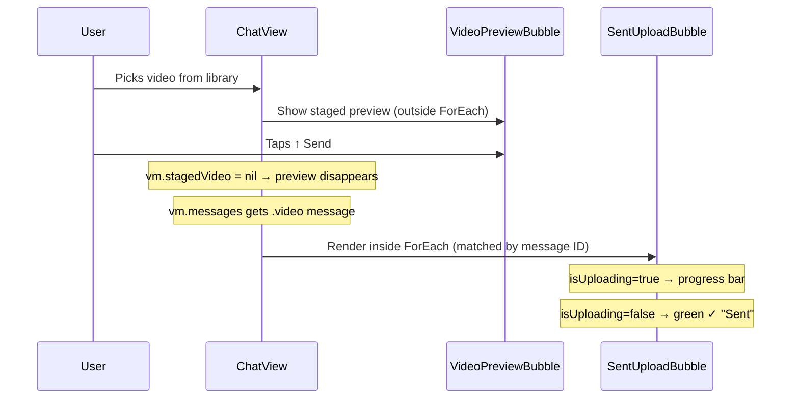

# Merging VideoPreviewBubble & SentUploadBubble

## Current Flow



The two bubbles live in **different places** in `ChatView`:
- `VideoPreviewBubble` → rendered **after** the `ForEach`, keyed by `"staged-video-preview"`
- `SentUploadBubble` → rendered **inside** the `ForEach`, matched when `message.messageType == .video && isOutgoing`

## Side-by-Side Comparison

| Aspect | VideoPreviewBubble | SentUploadBubble |
|---|---|---|
| **Thumbnail** | `stagedVideo.thumbnail` | `thumbnail: UIImage?` |
| **Filename** | `stagedVideo.fileName` | `fileName: String` |
| **Date** | `stagedVideo.createdDate` | `createdDate: String?` |
| **Location** | `stagedVideo.metadata.gpsLat != nil` | `hasLocation: Bool` |
| **Trailing widget** | Transcribe toggle + Send ↑ button | ProgressView (uploading) or ✓ (sent) |
| **Cancel X** | Overlaid on thumbnail | Not present |
| **Progress bar** | Not present | Bottom progress bar + percentage |
| **Bottom label** | `"Tap ↑ to upload"` | `"Uploading…"` or `"Sent"` |
| **Border color** | `Theme.blue.opacity(0.3)` | `Theme.green.opacity(0.3)` |
| **Background** | `Theme.videoBubbleGradient` | `Theme.videoBubbleGradient` |
| **Layout** | `HStack { Spacer(60) · content }` | `HStack { Spacer(60) · content }` |

> [!IMPORTANT]
> The layout skeleton is **identical**: thumbnail → HStack with file info + trailing action → bottom label. The only things that change are the trailing action widget, the cancel overlay, the progress bar, and the border/label text.

## Proposed Design: Single `VideoBubble` with Phase Enum

```swift
enum VideoBubblePhase {
    case staged          // Preview — show cancel X, transcribe toggle, send button
    case uploading       // Progress bar + spinner, no cancel
    case sent            // Green ✓, "Sent" label
}
```

### Unified View Signature

```swift
struct VideoBubble: View {
    let phase: VideoBubblePhase
    let thumbnail: UIImage?
    let fileName: String
    let createdDate: String?
    let hasLocation: Bool

    // Phase-specific (only used during .staged)
    var onSend: ((_ transcribe: Bool) -> Void)?
    var onCancel: (() -> Void)?

    // Phase-specific (only used during .uploading)
    var uploadProgress: Double = 0
}
```

### What Changes Per Phase

| Element | `.staged` | `.uploading` | `.sent` |
|---|---|---|---|
| Cancel X overlay | ✅ shown | ❌ hidden | ❌ hidden |
| Trailing widget | Transcribe + Send ↑ | ProgressView spinner | ✓ checkmark |
| Progress bar | ❌ | ✅ | ❌ |
| Border color | blue | blue | green |
| Bottom label | "Tap ↑ to upload" | "Uploading… XX%" | "Sent" |

### What Stays the Same (No Branching)

- Thumbnail rendering (identical)
- Filename text (identical)
- Date text (identical)
- GPS badge (identical — just `Bool` input)
- Outer layout: `HStack { Spacer(60) · VStack · }`
- Background gradient
- Corner radius / clip shape

## Wiring Changes in ChatView

Currently there are **two render sites**. The merged approach would:

1. **Remove** the standalone `VideoPreviewBubble` block after `ForEach` (lines 63–76)
2. **Move the staged preview into** a new item at the bottom of the list (or keep it outside `ForEach` — either works)
3. **Replace** `SentUploadBubble(...)` with `VideoBubble(phase: ..., ...)`
4. **Compute the phase** from existing ViewModel state:

```swift
// For staged (outside ForEach, same position):
VideoBubble(
    phase: .staged,
    thumbnail: staged.thumbnail,
    fileName: staged.fileName,
    createdDate: staged.createdDate,
    hasLocation: staged.metadata.gpsLat != nil,
    onSend: { transcribe in ... },
    onCancel: { vm.cancelStagedVideo() }
)

// For sent messages (inside ForEach):
VideoBubble(
    phase: vm.isUploading ? .uploading : .sent,
    thumbnail: vm.sentUploadThumbnails[message.id],
    fileName: vm.sentUploadFileNames[message.id] ?? "Video",
    createdDate: vm.sentUploadDates[message.id],
    hasLocation: vm.sentUploadHasLocation[message.id] ?? false,
    uploadProgress: vm.uploadProgress
)
```

> [!NOTE]
> The staged bubble and the sent bubble still occupy different positions in the list (staged = bottom, sent = inside ForEach at its message position). Merging them into one **View struct** doesn't change that — it just means both sites use the same component with a different `phase`.

## Files Affected

| File | Change |
|---|---|
| `VideoPreviewBubble.swift` | Rename to `VideoBubble.swift`, add phase enum, merge both layouts |
| `SentUploadBubble.swift` | **Delete** — absorbed into `VideoBubble` |
| `ChatView.swift` | Update both render sites to use `VideoBubble(phase:...)` |
| `ChatViewModel.swift` | No changes needed — data stays the same |
| `StagedVideo` struct | Stays as-is (still used as the staging model) |

## Summary

The two bubbles share ~80% of their layout code. The differences boil down to **which trailing widget to show** and **whether to show the progress bar / cancel button**. A single `VideoBubble` driven by a `phase` enum would:

- Eliminate ~60 lines of duplicated layout code
- Make future styling changes (fonts, spacing, colors) single-site edits
- Keep the same user experience — the bubble just transitions through phases
