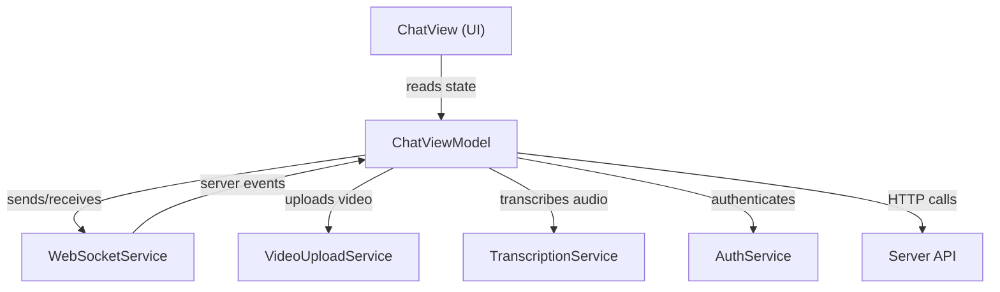
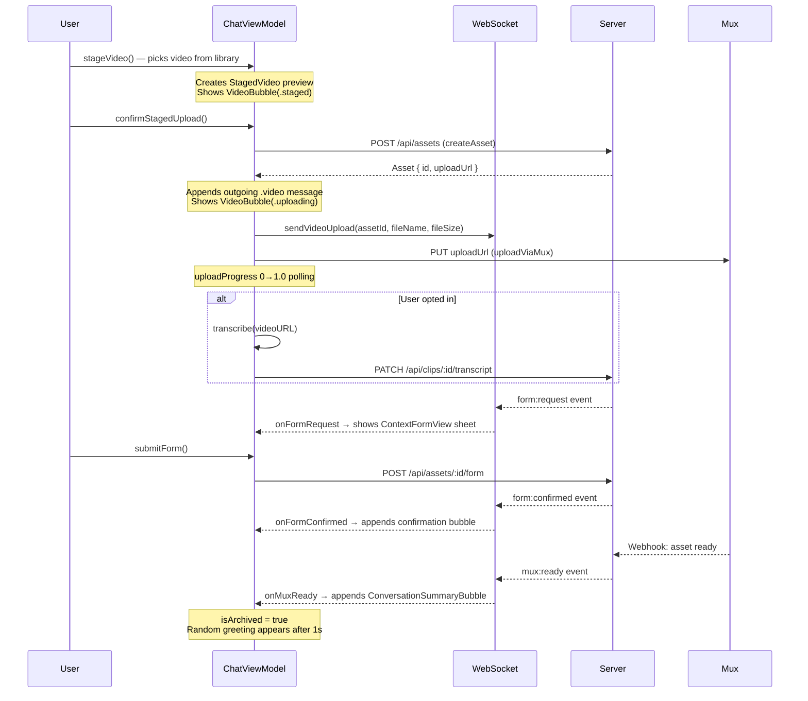

# ChatViewModel.swift — How It Works

> 923 lines, single file. This is the **brain** of the chat screen — it coordinates the entire video upload lifecycle from staging through archive.

---

## Architecture Overview



**Key design pattern:** `@Observable` + `@MainActor` — all state changes happen on the main thread. The UI automatically reacts to any property change.

---

## State Groups (Lines 9–60)

The ~50 `@Published`-equivalent properties break into **5 groups**:

| Group | Properties | Purpose |
|---|---|---|
| **Messages** | `messages`, `isLoadingHistory` | The chat message array that drives the scroll view |
| **Upload** | `currentAssetId`, `isUploading`, `uploadProgress` | Tracks the active upload |
| **Staged Video** | `stagedVideo`, `isProcessingVideo`, `transcribeOnUpload` | Preview before user confirms upload |
| **Archive** | `isArchived`, `archivedAssetId`, `archivedMediasourceId`, etc. | Metadata cached after mux:ready for Slack sharing |
| **Form** | `formFields`, `formThumbnail`, `formOriginalFileName`, `showFormSheet`, etc. | Context for the slug form sheet |

---

## The Upload Lifecycle

This is the core flow. Every upload goes through these phases:



---

## Section-by-Section Breakdown

### 1. Init & Setup (Lines 69–75)

```swift
init(auth: AuthService, ws: WebSocketService) {
    setupWebSocketHandlers()   // Subscribe to 5 server events
    setupConnectionHandlers()  // Monitor reconnect/disconnect
    checkPendingForm()         // Recover form if app was killed mid-upload
}
```

### 2. WebSocket Event Handlers (Lines 79–242)

Five server events are handled:

| Event | Handler | What It Does |
|---|---|---|
| **message** | `onMessage` | Appends any incoming chat message. Downloads thumbnail for Slack bubbles. |
| **upload:complete** | `onUploadComplete` | Fetches full asset detail (clips, metadata) so MetadataView can display it. |
| **form:request** | `onFormRequest` | Stores asset context, builds form fields, shows the ContextFormView sheet. Persists as `PendingForm` for crash recovery. |
| **form:confirmed** | `onFormConfirmed` | Appends the "High Five!" confirmation bubble with mediasource ID and metadata. |
| **mux:ready** | `onMuxReady` | Stores archive metadata, appends `ConversationSummaryBubble`, sets `isArchived = true`, then appends a random witty greeting after 1 second. |

### 3. Connection Handlers (Lines 246–271)

Monitors WebSocket health:
- **`onReconnecting`** — logs reconnect attempts to server error_logs
- **`onConnectionLost`** — logs CRITICAL error when all retries exhausted

### 4. Error Helpers (Lines 275–312)

Two utilities:
- **`appendErrorBubble()`** — shows error as an incoming chat message (user-visible)
- **`reportError()`** — POST to `/api/errors` for server-side logging (fire-and-forget, invisible to user)

### 5. Message History (Lines 316–331)

`loadMessageHistory()` — fetches past messages from REST API on app launch. Currently not called (fresh conversation on each connect).

### 6. Send Text / Slack (Lines 335–385)

`sendTextMessage()` detects `#channel` or `@user` patterns using a regex:
- If **Slack command but no active upload** → tells user to upload first
- If **Slack command with upload** → sends as `.slackPost` type via WebSocket
- Otherwise → sends as plain `.text`

Uses **optimistic UI** — message appears locally before server confirms.

### 7. Create Asset (Lines 389–491)

`createAsset()` — POST to `/api/assets` with retry (up to 3 attempts):
- Gets file size from disk
- On success: stores `currentAssetId`, appends outgoing `.video` message, caches thumbnail/metadata for the `VideoBubble`
- On failure: shows error bubble + reports to server

### 8. Upload Video (Lines 495–529)

`uploadVideo()` — Mux direct upload via `VideoUploadService`:
- Polls `uploader.uploadProgress` every 100ms → drives the progress bar
- On failure: shows error bubble + reports to server

### 9. Transcription (Lines 533–556)

`sendTranscript()` — PATCH to `/api/clips/:id/transcript`:
- Sends both plain text and timestamped segments
- **Non-fatal** — failure is logged but doesn't show error to user

### 10. Form Cancel & Submit (Lines 558–612)

- **`cancelForm()`** — skips the slug form, archives immediately. PendingForm stays on disk so Archive can reopen it later.
- **`submitForm()`** — POST form data. On success: closes sheet, clears PendingForm. On failure: keeps form open, shows error in both sheet and chat.

### 11. Video Staging (Lines 649–770)

The pre-upload preview flow:

- **`stageVideo()`** — Generates thumbnail, formats date, creates `StagedVideo` object. If conversation is archived, calls `startNewConversation()` first.
- **`confirmStagedUpload()`** — The big orchestrator:
  1. Saves thumbnail/metadata for form
  2. Clears staged preview
  3. Creates asset on server
  4. Saves PHAsset identifier for re-upload recovery
  5. Uploads video to Mux
  6. Optionally transcribes audio
  7. Cleans up temp file
- **`cancelStagedVideo()`** — Deletes temp file, clears staged state

### 12. Pending Form Recovery (Lines 772–833)

Survives app kills:
- **`checkPendingForm()`** — On init, checks if a `PendingForm` was saved to disk. Fetches the asset from server to see if form was already submitted. If not, restores the form sheet.
- **`buildFormFields()`** — Creates the 4 standard form fields (slug, type, description, priority)

### 13. Conversation Lifecycle (Lines 835–921)

- **`startNewConversation()`** — Nuclear reset: clears ALL state (30+ properties), appends a fresh greeting message. Called when user selects a new video while archived.
- **`shareToSlack()`** — Optimistic UI for Slack sharing from archive. Adds local message + sends via WebSocket.
- **`downloadSlackThumbnail()`** — Downloads and caches thumbnails for Slack confirmation bubbles.

---

## Key Design Decisions

| Decision | Why |
|---|---|
| **Optimistic UI** | Messages appear locally before server confirms — feels instant |
| **PendingForm persistence** | If user kills the app during upload, the form reopens on next launch |
| **PHAsset identifier storage** | Enables auto-re-upload from Archive without re-picking the video |
| **3-attempt retry on createAsset** | Transient network failures don't kill the upload flow |
| **Fire-and-forget error reporting** | Server knows about failures but they don't cascade to the user |
| **isArchived flag** | After mux:ready, the conversation is "closed" — new video starts fresh |
| **Single file** | All chat logic in one place — no coordination across multiple view models |

---

## Message Type → Bubble Rendering

| MessageType | Rendered By | Visual |
|---|---|---|
| `.text` | `MessageBubble` → `textContent` | Plain gray/blue bubble |
| `.greeting` | `MessageBubble` → `textContent` (default case) | Same as text — no special styling |
| `.video` (outgoing) | `VideoBubble` | Thumbnail card with progress bar |
| `.confirmation` | `MessageBubble` → `confirmationContent` | Metadata card with mediasource ID |
| `.formRequest` | `MessageBubble` → `formRequestContent` | Tappable "open form" bubble |
| `.slackPost` | `MessageBubble` → `slackContent` | Slack-branded bubble with thumbnail |
| `.muxReady` | `ConversationSummaryBubble` | Archive summary card |
