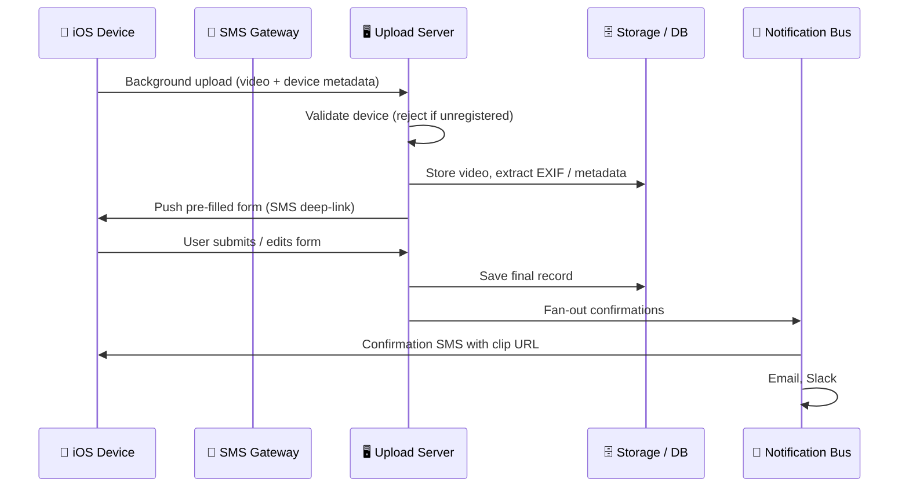
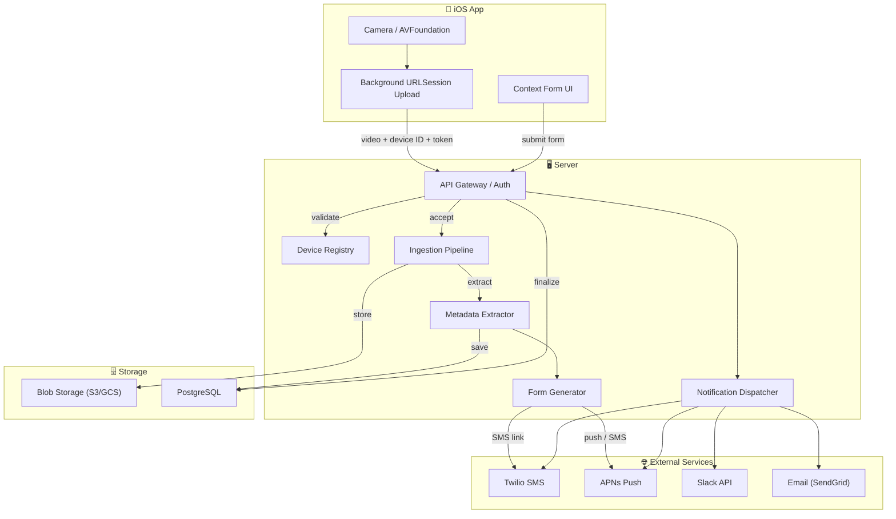
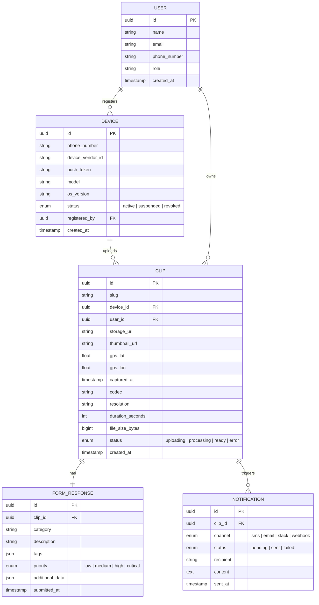

# Direct Video Uploader — Project Specification

> **Phone number:** `800-123-4567`
> **Platform:** iOS (registered work phones only)
> **Goal:** Field workers record video on their phone → video + metadata upload instantly to a server → server sends back a pre-filled form → user confirms → team gets notified.

---

## 1. System Overview



---

## 2. Core User Flow

| Step | Actor | Action |
|------|-------|--------|
| 1 | **User** | Records a video on their registered iOS work phone. |
| 2 | **Phone** | Using TEXT > SEND to server phonenumber . Immediately begins a **background upload** of the video file + device fingerprint data to the server. |
| 3 | **Server** | Receives the upload. **Validates** the device against the registered-device whitelist. If unregistered → **reject** with HTTP 403 and optionally SMS "Access denied." |
| 4 | **Server** | Stores the video. Extracts metadata from the video file (GPS coordinates, timestamps, phone model, codec/recording type). |
| 5 | **Server** | Combines device data + extracted metadata to **pre-populate a context form** and sends it back to the phone (via SMS deep-link or push notification). |
| 6 | **User** | Opens the form, reviews the pre-filled data, **edits or adds** additional context (incident notes, category, tags, etc.), and submits. |
| 7 | **Server** | Saves the finalized record (video + metadata + user context). |
| 8 | **Server** | Sends **confirmation SMS** to the user with a direct URL to the specific clip. |
| 9 | **Server** | Fans out notifications: email to the user, Slack message to `#channel` / `@team`, and any other configured media handlers. |
| 10 | **Server** | If any step fails, sends an **error SMS/email** to the user and alerts the ops channel. |

---

## 3. Device Registration & Security

### 3.1 Registered Device Whitelist

| Attribute | Description |
|-----------|-------------|
| **Phone Number** | E.164 format, e.g. `+18001234567` |
| **Device ID** | `identifierForVendor` (iOS) — stable per-app install |
| **Push Token** | APNs token for push notifications |
| **Registered By** | Admin user who enrolled the device |
| **Status** | `active` · `suspended` · `revoked` |

### 3.2 How it Works

1. **Admin Portal** — An admin enrolls a work phone by entering its phone number. The phone receives an enrollment SMS with a one-time link.
2. **On-Device Enrollment** — User opens the link, the app registers the `identifierForVendor` + APNs token with the server. A client certificate or signed JWT is provisioned.
3. **Every Upload** — The phone sends the device ID + a signed token header. The server checks the whitelist table before accepting any payload.
4. **Rejection** — Unregistered or revoked devices receive an HTTP `403 Forbidden`. No video data is accepted or stored.

> [!IMPORTANT]
> iOS `identifierForVendor` is tied to the app's publisher bundle. It is reset only if the user deletes **all** apps from that publisher and re-installs. For work-managed phones (MDM-enrolled), this makes spoofing extremely difficult — the org controls the device profile.

### 3.3 Additional Hardening (Optional / Phase 2)

- **MDM Integration** — Validate the device is enrolled in the company's MDM (e.g., Jamf, Intune) before accepting uploads.
- **Mutual TLS (mTLS)** — Issue a client certificate during enrollment; the server requires it on every request.
- **Rate Limiting** — Per-device upload rate limits to prevent abuse.

---

## 4. Video Upload Pipeline

### 4.1 Background Upload (iOS)

```
┌──────────────────────────────────────────────────────┐
│  iOS App — Background Upload                          │
│                                                       │
│  1. User taps "Record" → AVFoundation capture         │
│  2. On stop → video saved to temp storage             │
│  3. URLSession background upload task created         │
│     - Automatic retry on network failure              │
│     - Works even if app is suspended / killed         │
│  4. Multipart payload:                                │
│     ├── video file (chunked / resumable)              │
│     ├── device fingerprint (device ID, model, OS)     │
│     └── client auth token (JWT or cert)               │
│  5. Server responds with upload receipt + form URL    │
└──────────────────────────────────────────────────────┘
```

- **iOS API:** `URLSession` with `background` configuration — the OS manages the transfer even when the app is not in the foreground.
- **Resumable Uploads:** Use the `tus` resumable-upload protocol or a custom chunked approach so large videos survive network drops.
- **Compression:** On-device H.265/HEVC compression before upload to reduce bandwidth. Configurable quality preset (low / medium / high).

### 4.2 Server-Side Ingestion

| Stage | Detail |
|-------|--------|
| **Receive** | Accept multipart upload. Validate auth + device whitelist. Stream video to temporary storage. |
| **Persist** | Move video to permanent blob storage (S3, GCS, or local disk). Generate a unique clip ID / URL slug. |
| **Transcode** | (Optional) Create a web-playable MP4/WebM proxy for browser viewing. |
| **Thumbnail** | Extract a poster frame for the clip listing UI. |

---

## 5. Metadata Extraction

The server reads embedded metadata from the uploaded video file using tools like `ffprobe`, `exiftool`, or a programmatic library.

| Metadata Field | Source | Example |
|----------------|--------|---------|
| **GPS Latitude / Longitude** | EXIF / QuickTime `com.apple.quicktime.location.ISO6709` | `40.7128, -74.0060` |
| **Capture Timestamp** | EXIF `DateTimeOriginal` / QuickTime `creation_time` | `2026-03-01T14:32:07-05:00` |
| **Phone Model** | Device fingerprint header + EXIF `Model` | `iPhone 15 Pro` |
| **OS Version** | Device fingerprint header | `iOS 19.3` |
| **Recording Codec** | `ffprobe` stream info | `HEVC / H.265` |
| **Duration** | `ffprobe` format info | `00:01:23` |
| **Resolution** | `ffprobe` stream info | `3840×2160` |
| **File Size** | Upload payload | `245 MB` |
| **Orientation** | EXIF `Rotation` | `Landscape (90°)` |

> [!NOTE]
> GPS data is only available if the user has granted the app (or Camera) location permission. The app should require location permission during onboarding.

---

## 6. Context Form (Pre-Filled & Editable)

After upload + metadata extraction, the server generates a **context form** and delivers it to the phone.

### 6.1 Delivery Mechanism

| Method | How |
|--------|-----|
| **Push Notification** | APNs push with a deep-link to the in-app form (preferred — instant). |
| **SMS** | Send an SMS to `800-123-4567` → user's phone with a short URL that opens the form in the app or a mobile-optimized web page. |

### 6.2 Form Fields

| Field | Pre-Filled? | Editable? | Source |
|-------|:-----------:|:---------:|--------|
| **Clip Thumbnail** | ✅ | ❌ | Server-generated poster frame |
| **Capture Date / Time** | ✅ | ❌ | Video metadata |
| **GPS Location (map pin)** | ✅ | ✅ | Video metadata |
| **Device / User Name** | ✅ | ❌ | Device registry |
| **Category** | ❌ | ✅ | User selects (dropdown) |
| **Incident Description** | ❌ | ✅ | Free text |
| **Tags** | ❌ | ✅ | Multi-select / free-form |
| **Priority** | ❌ | ✅ | Low / Medium / High / Critical |
| **Additional Attachments** | ❌ | ✅ | Photos, documents |

### 6.3 Submit

User taps **Submit** → the form data is sent back to the server → record is finalized → confirmation flow triggers.

---

## 7. Notifications & Confirmations

### 7.1 Notification Matrix

| Event | SMS to User | Email to User | Slack | Custom Handlers |
|-------|:-----------:|:-------------:|:-----:|:---------------:|
| Upload received | ✅ (form link) | — | — | — |
| Form submitted (success) | ✅ (clip URL) | ✅ (clip URL + summary) | ✅ `#uploads` / `@team` | Webhook / API |
| Upload failed | ✅ (retry prompt) | ✅ (error detail) | ✅ `#errors` | Webhook / API |
| Device rejected | ✅ ("Access denied") | ✅ (to admin) | ✅ `#security` | Webhook / API |

### 7.2 SMS Gateway

- **Provider options:** Twilio, AWS SNS, Vonage, or a self-hosted gateway.
- **Inbound number:** `800-123-4567` for receiving any user replies (future: allow users to text in additional context).

### 7.3 Confirmation SMS Content (Example)

```
✅ Video uploaded successfully!
📍 40.7128, -74.0060
🕐 Mar 1, 2026 2:32 PM
🔗 https://uploads.example.com/clips/abc123

— Direct Video Uploader
```

### 7.4 Slack Integration

- Post to a configured `#channel` with: thumbnail, clip URL, user name, location map link, category, description.
- Mention `@team` or specific `@user` based on priority or category routing rules.

---

## 8. Proposed Tech Stack

| Layer | Technology | Rationale |
|-------|-----------|-----------|
| **iOS App** | Swift / SwiftUI | Native background upload support via `URLSession`. Camera via `AVFoundation`. |
| **Server** | Node.js (Express or Fastify) **or** Python (FastAPI) | Fast prototyping. Good ecosystem for media processing and webhooks. |
| **Database** | PostgreSQL | Relational data for devices, users, clips, form responses. PostGIS extension for geospatial queries. |
| **Blob Storage** | AWS S3 / GCS / MinIO (self-hosted) | Scalable video storage with signed-URL access. |
| **Metadata Extraction** | `ffprobe` (FFmpeg) + `exiftool` | Industry-standard tools for video/EXIF metadata. |
| **SMS Gateway** | Twilio | Reliable, well-documented API. Supports inbound + outbound SMS. |
| **Push Notifications** | APNs (Apple Push Notification service) | Native iOS push. |
| **Notifications** | Custom dispatcher → Slack API, SendGrid (email), Twilio (SMS) | Fan-out to multiple channels from a single event. |
| **Admin Portal** | Next.js (React) | Device management, clip dashboard, user management. |
| **Auth** | JWT + Device Certificates | Stateless auth. Certificate pinning for device trust. |

---

## 9. Architecture Diagram



---

## 10. Data Model (Key Entities)



---

## 11. API Surface (Key Endpoints)

| Method | Endpoint | Description |
|--------|----------|-------------|
| `POST` | `/api/upload` | Multipart video upload. Requires device auth. Returns `clipId` + `formUrl`. |
| `GET` | `/api/clips/:id/form` | Get the pre-filled context form for a clip. |
| `POST` | `/api/clips/:id/form` | Submit the completed context form. |
| `GET` | `/api/clips/:id` | View clip details (video player, metadata, form data). |
| `GET` | `/api/clips` | List all clips (admin dashboard, filtered/searchable). |
| `POST` | `/api/devices/enroll` | Enroll a new device (admin-initiated). |
| `GET` | `/api/devices` | List registered devices (admin). |
| `PATCH` | `/api/devices/:id` | Update device status (suspend / revoke). |

---

## 12. Phased Rollout Plan

### Phase 1 — MVP (Weeks 1–4)

- [ ] Server: Upload endpoint with device auth (JWT)
- [ ] Server: Metadata extraction (`ffprobe`)
- [ ] Server: Form generation + pre-fill
- [ ] Server: Confirmation SMS via Twilio
- [ ] iOS App: Camera capture + background upload
- [ ] iOS App: Context form (in-app WebView or native)
- [ ] Admin: Simple device registration (CLI or minimal UI)
- [ ] Storage: S3 bucket + PostgreSQL schema

### Phase 2 — Hardening (Weeks 5–8)

- [ ] Device enrollment flow (SMS invite → on-device registration)
- [ ] Admin portal (Next.js) for device & clip management
- [ ] Slack integration for notifications
- [ ] Email confirmations (SendGrid)
- [ ] Resumable / chunked uploads (`tus` protocol)
- [ ] Error handling: retry logic, dead-letter queue

### Phase 3 — Polish (Weeks 9–12)

- [ ] MDM integration for device trust
- [ ] mTLS client certificates
- [ ] Clip review dashboard with map view (PostGIS)
- [ ] Video transcoding for web playback
- [ ] Webhook support for custom notification handlers
- [ ] Analytics: upload volume, processing times, error rates
- [ ] Rate limiting & abuse prevention

---

## 13. Open Questions & Decisions

| # | Question | Options | Recommendation |
|---|----------|---------|----------------|
| 1 | **Server language?** | Node.js (Express/Fastify) vs. Python (FastAPI) | Node.js — better at streaming large uploads, strong Twilio SDK. |
| 2 | **Form delivery?** | Push notification (in-app) vs. SMS deep-link vs. both | Both — push for immediacy, SMS as fallback. |
| 3 | **Video storage?** | AWS S3 vs. GCS vs. self-hosted MinIO | S3 — most mature, good presigned-URL support. |
| 4 | **Inbound SMS for replies?** | Allow users to text back context? | Phase 2 — nice to have but adds complexity. |
| 5 | **Offline support?** | Queue uploads when phone is offline? | Yes — iOS background URLSession handles this natively. |
| 6 | **Max video length?** | Cap at 5 min? 10 min? Unlimited? | Start with **10 min** cap for MVP to bound file sizes. |
| 7 | **Retention policy?** | How long to keep video files? | 90-day hot storage → archive to Glacier/Coldline. |

---

*Spec created: March 2, 2026*
