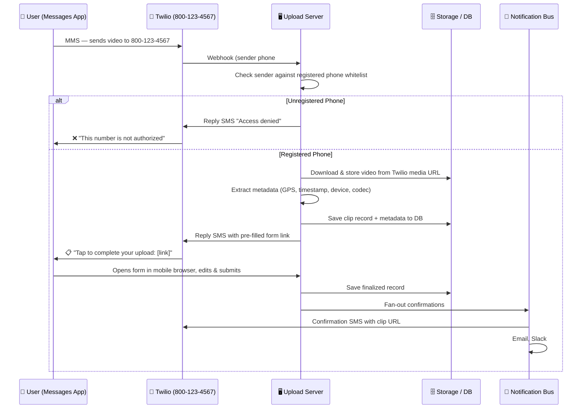
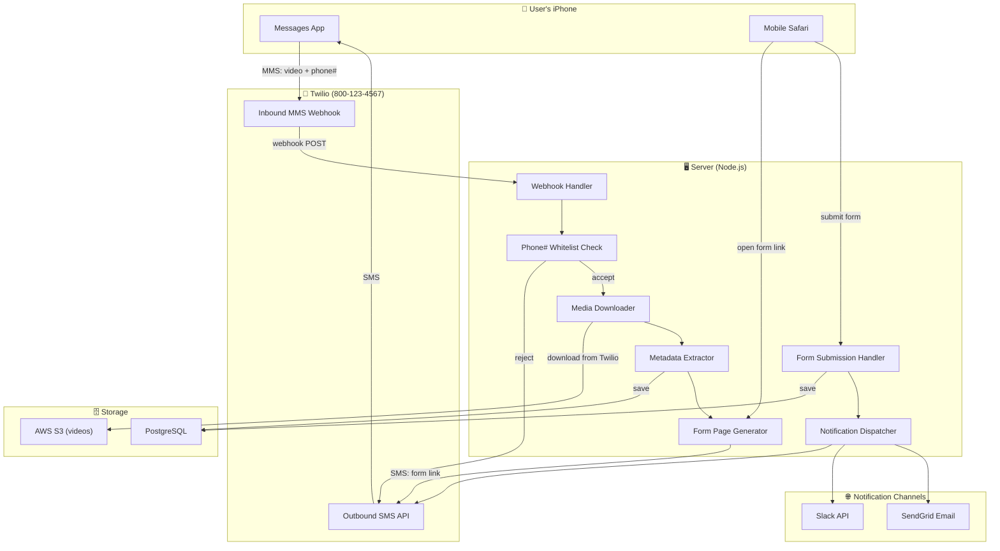

# Direct Video Uploader — Project Specification

> **Server Phone Number:** `800-123-4567` (Twilio-provisioned)
> **Platform:** Any iOS phone with Messages app (no custom app install required)
> **Goal:** Field worker texts a video to the server phone number → server receives it via MMS → extracts metadata → texts back a pre-filled form link → user completes the form → team gets notified.

---

## 1. System Overview



---

## 2. Why MMS-First (and Why It's Powerful)

The key insight: **no custom iOS app is needed**. The user sends a video the same way they'd text it to a friend.

| Advantage | Detail |
|-----------|--------|
| **Zero app install** | Works immediately on any phone with the Messages app. No App Store, no onboarding. |
| **Familiar UX** | Users already know how to attach and send a video via text. Zero training. |
| **Background handled by carrier** | MMS delivery is managed by the phone's native messaging stack — works on cellular, Wi-Fi, even with poor signal (queues and retries automatically). |
| **Caller ID = authentication** | The sender's phone number is provided by the carrier (not the user). It's very hard to spoof in an MMS context — the carrier verifies it. |
| **Metadata rides along** | iOS videos include EXIF/QuickTime metadata (GPS, timestamp, device model) embedded in the file. The server extracts it after download. |

> [!IMPORTANT]
> **MMS file size limit:** Carriers typically cap MMS at **~3.5 MB** (some up to 5 MB). iOS automatically compresses videos sent via MMS, which means long or high-res videos will be heavily compressed or may fail. This is the primary constraint. See **Section 4** for how we handle this and the Phase 2 streaming option.

---

## 3. Core User Flow

| Step | Actor | Action |
|------|-------|--------|
| 1 | **User** | Opens the **Messages** app on their iPhone. |
| 2 | **User** | Starts a new text to **800-123-4567** (the server's Twilio number). |
| 3 | **User** | Taps the **camera/photo icon** → selects a video from their library (or records one) → taps **Send**. |
| 4 | **Carrier / Messages** | Sends the video as an **MMS message** to the Twilio number. The carrier handles compression, queuing, and delivery. |
| 5 | **Twilio** | Receives the MMS. Fires a **webhook** to the server with: sender phone number, media URL(s), message body (if any). |
| 6 | **Server** | Checks the sender's phone number against the **registered-phone whitelist**. |
| 6a | ↳ *If unregistered* | Server replies via SMS: *"❌ This number is not authorized to upload videos."* Done. |
| 6b | ↳ *If registered* | Server proceeds to step 7. |
| 7 | **Server** | Downloads the video file from the Twilio-hosted media URL. Stores it in blob storage (S3). |
| 8 | **Server** | Extracts metadata from the video: GPS coordinates, capture timestamp, device model, codec, duration, resolution. |
| 9 | **Server** | Looks up the sender in the device/user registry → gets user name, email, team, role. |
| 10 | **Server** | Generates a **pre-filled context form** (mobile-optimized web page) combining metadata + user info. |
| 11 | **Server** | Replies via SMS: *"📋 Your video was received! Tap to add details: https://uploads.example.com/form/abc123"* |
| 12 | **User** | Taps the link → opens a **mobile Safari** form with pre-filled fields. Reviews, edits, adds description/tags/priority. Taps **Submit**. |
| 13 | **Server** | Saves the finalized record (video + metadata + user context). |
| 14 | **Server** | Sends **confirmation SMS**: *"✅ Upload complete! View your clip: https://uploads.example.com/clips/abc123"* |
| 15 | **Server** | Fans out notifications: email to user, Slack `#channel` / `@team`, webhook to other handlers. |
| 16 | **Server** | If any step fails → sends **error SMS** to user + alerts ops channel. |

---

## 4. Video Upload Pipeline

### 4.1 Primary Path: MMS via Messages App (MVP)

```
┌─────────────────────────────────────────────────────────┐
│  MMS Upload Path (No App Required)                       │
│                                                          │
│  1. User sends video via Messages to 800-123-4567        │
│  2. Carrier delivers as MMS to Twilio                    │
│  3. Twilio fires webhook to server:                      │
│     ├── From: +1XXXXXXXXXX (sender phone#)               │
│     ├── MediaUrl0: https://api.twilio.com/media/...      │
│     ├── MediaContentType0: video/mp4                     │
│     └── Body: (optional text the user typed)             │
│  4. Server downloads media from Twilio URL               │
│  5. Server stores in S3, extracts metadata               │
│  6. Server replies with form link via SMS                 │
└─────────────────────────────────────────────────────────┘
```

**Twilio Webhook Payload (key fields):**
| Field | Example | Use |
|-------|---------|-----|
| `From` | `+15551234567` | Sender identification + whitelist check |
| `To` | `+18001234567` | Your server number |
| `NumMedia` | `1` | Number of attached media files |
| `MediaUrl0` | `https://api.twilio.com/2010.../Media/...` | URL to download the video |
| `MediaContentType0` | `video/mp4` | File type |
| `Body` | `"Accident on Main St"` | Optional text context from user |

> [!WARNING]
> **MMS size limits:** Most US carriers cap MMS at **3.5–5 MB**. iOS auto-compresses video for MMS, which can significantly reduce quality. For short clips (< 30 seconds) this works well. For longer / higher-quality videos, see the Phase 2 streaming option below.

### 4.2 Phase 2 Option: Direct Streaming Upload (Custom iOS App)

For teams that need **full-resolution, long-form video**, a lightweight companion iOS app can provide a direct-to-server upload path:

```
┌──────────────────────────────────────────────────────────┐
│  Direct Upload Path (iOS App — Phase 2)                   │
│                                                           │
│  1. User opens the "Direct Uploader" app                  │
│  2. Records or selects video → full resolution preserved  │
│  3. URLSession background upload (resumable, chunked)     │
│     - Works even if app is backgrounded or killed         │
│     - Automatic retry on network failure                  │
│  4. Payload: video + device fingerprint + auth token      │
│  5. Server responds with form URL (same flow as MMS)      │
└──────────────────────────────────────────────────────────┘
```

| Comparison | MMS Path (Phase 1) | Direct Upload App (Phase 2) |
|------------|--------------------|-----------------------------|
| **App install required?** | ❌ No | ✅ Yes |
| **Video quality** | Compressed (~3.5 MB max) | Full resolution |
| **Max video length** | ~30 sec (compressed) | Unlimited (configurable) |
| **Resumable upload?** | N/A (carrier handles) | ✅ Yes (`tus` protocol) |
| **User training** | None (just text it) | Minimal (open app, tap record) |
| **Offline queueing** | ✅ (carrier queues MMS) | ✅ (`URLSession` background) |

> [!TIP]
> **Both paths can coexist.** The server processing pipeline (metadata extraction, form generation, notifications) is identical regardless of how the video arrives. The only difference is the ingestion entry point.

### 4.3 Server-Side Ingestion (Shared)

| Stage | Detail |
|-------|--------|
| **Receive** | MMS: download from Twilio media URL. App: accept multipart upload. |
| **Validate** | Check sender phone number (MMS) or device token (App) against whitelist. |
| **Persist** | Store video in S3/GCS. Generate unique clip ID + URL slug. |
| **Extract** | Run `ffprobe` / `exiftool` to read GPS, timestamp, codec, resolution, duration. |
| **Thumbnail** | Extract a poster frame for the form and dashboard. |
| **Transcode** | (Optional) Create a web-optimized MP4 for browser playback. |

---

## 5. Device Registration & Security

### 5.1 MMS-Based Authentication (Phone Number Whitelist)

In the MMS model, authentication is beautifully simple: **the sender's phone number IS their credential**, and it's verified by the carrier, not the user.

| Attribute | Description |
|-----------|-------------|
| **Phone Number** | E.164 format, e.g. `+15551234567` |
| **User Name** | Employee name tied to this number |
| **Email** | For email notifications |
| **Team / Department** | For routing notifications |
| **Status** | `active` · `suspended` · `revoked` |
| **Registered By** | Admin who added this number |

### 5.2 How it Works

1. **Admin Portal** — Admin adds an authorized phone number + employee info to the whitelist.
2. **Every Incoming MMS** — Twilio webhook includes the `From` phone number (carrier-verified). Server checks this against the whitelist.
3. **Registered** → Accept, process, reply with form.
4. **Unregistered** → Reject immediately. Reply: *"Access denied."* Optionally alert the `#security` Slack channel.

> [!NOTE]
> **Why phone-number auth is strong for work phones:**
> - The carrier verifies the sender's number — it's tied to the SIM/eSIM, not user-editable.
> - Spoofing an MMS sender requires carrier-level access or SIM cloning — extremely difficult.
> - Work phones are company-issued with known numbers. The whitelist is a closed set.
> - No passwords, no tokens, no app install — reduces attack surface.

### 5.3 Additional Hardening (Phase 2+)

- **MDM Cross-Reference** — Verify the phone number belongs to an MDM-enrolled device.
- **Two-Factor Confirmation** — After MMS received, server texts back a 6-digit code the user must reply with before processing. Adds assurance without an app.
- **Rate Limiting** — Max uploads per phone per hour/day to prevent abuse.
- **Geo-Fencing** — If GPS metadata is present, reject uploads from unexpected locations.

---

## 6. Metadata Extraction

The server reads embedded metadata from the downloaded video file using `ffprobe` and/or `exiftool`.

| Metadata Field | Source | Example |
|----------------|--------|---------|
| **GPS Latitude / Longitude** | QuickTime `com.apple.quicktime.location.ISO6709` | `40.7128, -74.0060` |
| **Capture Timestamp** | QuickTime `creation_time` / EXIF `DateTimeOriginal` | `2026-03-01T14:32:07-05:00` |
| **Phone Model** | QuickTime `com.apple.quicktime.model` | `iPhone 15 Pro` |
| **Software / OS** | QuickTime `com.apple.quicktime.software` | `iOS 19.3` |
| **Recording Codec** | `ffprobe` stream info | `HEVC / H.265` |
| **Duration** | `ffprobe` format info | `00:01:23` |
| **Resolution** | `ffprobe` stream info | `1920×1080` (post-MMS compression) |
| **File Size** | Downloaded file | `3.2 MB` |
| **Orientation** | EXIF `Rotation` / QuickTime `tkhd` matrix | `Landscape` |
| **Sender Phone** | Twilio webhook `From` field | `+15551234567` |
| **Message Body** | Twilio webhook `Body` field | `"Accident on Main St"` |

> [!NOTE]
> **GPS after MMS compression:** iOS generally preserves GPS metadata in videos sent via MMS, but some carriers may strip it. If GPS is missing from the file, the server falls back to the user's registered location or marks it as "unknown" on the form for the user to fill in manually.

---

## 7. Context Form (Pre-Filled & Editable)

After upload + metadata extraction, the server generates a **mobile-optimized web form** and texts the link to the user.

### 7.1 Delivery

The server replies to the same MMS conversation via SMS:

```
📋 Your video was received!
Tap to add details:
https://uploads.example.com/form/abc123
```

The user taps the link → it opens in **Mobile Safari** (no app needed).

### 7.2 Form Fields

| Field | Pre-Filled? | Editable? | Source |
|-------|:-----------:|:---------:|--------|
| **Video Thumbnail** | ✅ | ❌ | Server-generated poster frame |
| **Capture Date / Time** | ✅ | ❌ | Video metadata |
| **GPS Location (map pin)** | ✅ | ✅ | Video metadata (if available) |
| **Sender Name** | ✅ | ❌ | Phone number → user registry lookup |
| **Initial Notes** | ✅ | ✅ | MMS message body (the text the user typed) |
| **Category** | ❌ | ✅ | User selects from dropdown |
| **Detailed Description** | ❌ | ✅ | Free text |
| **Tags** | ❌ | ✅ | Multi-select or free-form |
| **Priority** | ❌ | ✅ | Low / Medium / High / Critical |
| **Additional Photos** | ❌ | ✅ | Upload from phone via browser |

### 7.3 Form Timeout

- The form link expires after **24 hours**.
- If the user doesn't submit within 2 hours, the server sends a **reminder SMS**.
- If expired, the clip is still stored but marked `pending-context` in the dashboard.

---

## 8. Notifications & Confirmations

### 8.1 Notification Matrix

| Event | SMS to User | Email to User | Slack | Custom Handlers |
|-------|:-----------:|:-------------:|:-----:|:---------------:|
| Video received (MMS accepted) | ✅ (form link) | — | — | — |
| Form submitted (success) | ✅ (clip URL) | ✅ (clip URL + summary) | ✅ `#uploads` / `@team` | Webhook / API |
| Upload failed / processing error | ✅ (error message) | ✅ (error detail) | ✅ `#errors` | Webhook / API |
| Unregistered phone rejected | ✅ ("Access denied") | ✅ (to admin) | ✅ `#security` | Webhook / API |
| Form reminder (2h no submit) | ✅ (reminder + link) | — | — | — |

### 8.2 Confirmation SMS (Example)

```
✅ Video uploaded successfully!
📍 40.7128, -74.0060
🕐 Mar 1, 2026 2:32 PM
🔗 https://uploads.example.com/clips/abc123

— Direct Video Uploader
```

### 8.3 Slack Integration

- Post to a configured `#channel` with: thumbnail, clip URL, user name, location map link, category, description.
- Mention `@team` or specific `@user` based on priority or category routing rules.
- Example Slack message:

```
🎬 New Video Upload
👤 John Smith (+15551234567)
📍 40.7128, -74.0060 (View on Map)
🕐 Mar 1, 2026 2:32 PM
📂 Category: Safety Incident
🔗 View Clip: https://uploads.example.com/clips/abc123
```

### 8.4 Email Notification

- Sent to: user's registered email + any configured team recipients.
- Includes: clip thumbnail (inline), metadata summary, direct link, form response summary.

---

## 9. Proposed Tech Stack

| Layer | Technology | Rationale |
|-------|-----------|-----------|
| **Client (MVP)** | Native iOS Messages app | No app to build. User texts video via MMS. |
| **Client (Phase 2)** | Swift / SwiftUI companion app | For full-res direct uploads when MMS quality isn't enough. |
| **SMS/MMS Gateway** | **Twilio** | Receives inbound MMS (webhook), sends outbound SMS. Supports toll-free & local numbers. Well-documented. |
| **Server** | **Node.js** (Express or Fastify) | Excellent Twilio SDK. Good at handling webhooks + media downloads. Strong ecosystem. |
| **Database** | **PostgreSQL** | Relational data for users, clips, form responses. PostGIS for geo queries. |
| **Blob Storage** | **AWS S3** | Scalable video storage with presigned-URL access for playback. |
| **Metadata Extraction** | `ffprobe` (FFmpeg) + `exiftool` | Industry-standard tools for video/EXIF metadata. |
| **Form UI** | **Mobile-optimized web page** (HTML/CSS/JS) | Served by the same Node.js server. No app install. Opens in Safari. |
| **Notifications** | Twilio (SMS), SendGrid (email), Slack API, custom webhooks | Fan-out from a single notification dispatcher. |
| **Admin Portal** | **Next.js** (React) | Phone whitelist management, clip dashboard, user management. |

---

## 10. Architecture Diagram



---

## 11. Data Model (Key Entities)


---

## 12. API / Endpoint Surface

| Method | Endpoint | Description |
|--------|----------|-------------|
| `POST` | `/webhook/twilio/inbound` | Twilio MMS webhook. Receives incoming video messages. |
| `GET` | `/form/:clipId` | Mobile-optimized pre-filled form page (opened in Safari). |
| `POST` | `/form/:clipId/submit` | Form submission from the user's browser. |
| `GET` | `/clips/:clipId` | View clip details (video player, metadata, form data). |
| `GET` | `/clips` | Admin: list/search all clips. |
| `POST` | `/admin/phones` | Admin: register a new phone number. |
| `GET` | `/admin/phones` | Admin: list all registered phones. |
| `PATCH` | `/admin/phones/:id` | Admin: update phone status (suspend / revoke). |
| `GET` | `/admin/dashboard` | Admin: overview dashboard (upload stats, recent clips). |

---

## 13. Phased Rollout Plan

### Phase 1 — MVP: MMS-First (Weeks 1–4)

- [ ] Provision Twilio phone number (`800-123-4567` or equivalent toll-free)
- [ ] Server: Twilio inbound MMS webhook handler
- [ ] Server: Phone number whitelist check + rejection reply
- [ ] Server: Download video from Twilio media URL → store in S3
- [ ] Server: Metadata extraction (`ffprobe` / `exiftool`)
- [ ] Server: Pre-filled mobile web form (HTML/CSS/JS)
- [ ] Server: Form submission endpoint → save to PostgreSQL
- [ ] Server: Confirmation SMS via Twilio
- [ ] Admin: CLI tool or simple web page for phone whitelist management
- [ ] Database: PostgreSQL schema (registered_phones, clips, form_responses, notifications)

### Phase 2 — Notifications & Dashboard (Weeks 5–8)

- [ ] Slack integration (`#uploads`, `#errors`, `#security` channels)
- [ ] Email confirmations (SendGrid)
- [ ] Admin portal (Next.js): phone management, clip dashboard, map view
- [ ] Form reminder SMS (2h timeout)
- [ ] Error handling: retry logic for failed downloads, dead-letter queue
- [ ] Clip playback page with video player + metadata display

### Phase 3 — Direct Upload App & Polish (Weeks 9–12)

- [ ] iOS companion app for full-resolution direct uploads
- [ ] Resumable / chunked uploads (`tus` protocol)
- [ ] Video transcoding for web playback (FFmpeg)
- [ ] Webhook support for custom notification handlers
- [ ] Analytics: upload volume, processing times, error rates
- [ ] MDM cross-reference for device trust
- [ ] Rate limiting & geo-fencing
- [ ] Retention policy automation (90-day hot → archive)

---

## 14. Open Questions & Decisions

| # | Question | Options | Recommendation |
|---|----------|---------|----------------|
| 1 | **Twilio number type?** | Toll-free (800) vs. local number vs. short code | Toll-free — supports MMS, higher throughput than local, cheaper than short codes. |
| 2 | **MMS video quality acceptable?** | Compressed (~3.5 MB) vs. need full resolution | Start with MMS for MVP. If quality is too low, add the companion app in Phase 2-3. |
| 3 | **Server language?** | Node.js vs. Python (FastAPI) | Node.js — excellent Twilio SDK, good webhook handling. |
| 4 | **Video storage?** | AWS S3 vs. GCS vs. self-hosted MinIO | S3 — most mature, good presigned-URL support. |
| 5 | **Form expiry?** | 24h? 48h? Never? | 24h with a 2h reminder SMS. Clip still stored if form expires. |
| 6 | **Multiple videos per MMS?** | Accept all? Only first? | Accept all — Twilio sends `MediaUrl0`, `MediaUrl1`, etc. Create one clip per video. |
| 7 | **MMS text as initial notes?** | Auto-populate description field? | Yes — if the user typed text with their MMS, pre-fill it as "Initial Notes" on the form. |
| 8 | **Retention policy?** | How long to keep video files? | 90-day hot → archive to S3 Glacier. |
| 9 | **iMessage vs. SMS/MMS?** | iMessage (blue bubble) doesn't go through Twilio | Twilio only receives **SMS/MMS (green bubble)**. The user must send as MMS, not iMessage. This is automatic when texting a non-iMessage number like a Twilio toll-free number. ✅ |

---

> [!CAUTION]
> **iMessage vs. MMS:** When a user texts a Twilio number, iOS automatically uses SMS/MMS (green bubble), not iMessage. This is correct behavior — Twilio can only receive SMS/MMS. Users will see a green bubble, which is expected. No special configuration needed.

---

*Spec created: March 2, 2026 — Updated to MMS-first architecture*
