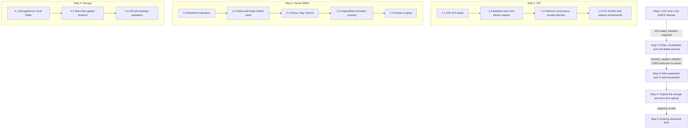
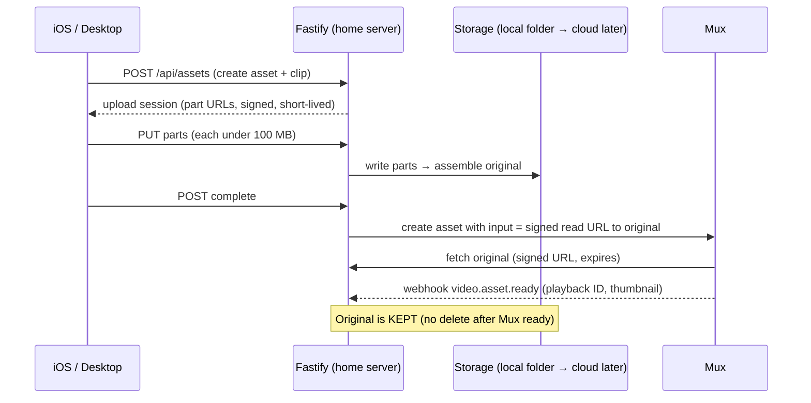

# Fixer Roadmap — iOS Modernization → Web App Expansion

_Drafted: October 19, 2026 · Updated: November 11, 2026_
_Owner: Rod_
_Status: **In progress** — Step 1 verified; Steps 2.1 through 2.5, the Step 3.1 routing foundation, Step 3.2 thumbnails, Step 4.1 local storage, and Steps 4.2a–g are merged to `main`. The owner reported deploying storage safety and testing the existing Mux flow successfully. Encrypted original-file backups, dashboard monitoring, and tracked-session cleanup remain opt-in; their actual deployment and validation are not established here. Step 4.3a iOS client work is in progress on a feature branch. Actual backup and restore validation, cleanup rollout validation, proactive alerts, isolated real-Mux handoff validation, and client rollout remain open._

---

## Locked Decisions (from Rod)

| Topic | Decision |
| --- | --- |
| Hosting | **Home server is live.** Fastify + Postgres 18 run on the MacBook Air behind a Cloudflare Tunnel (`dev.ms-fixer.com`). Cloud Run / Cloud SQL are no longer the primary target. |
| Super Admin | **Rod Griola** (only one). Promotes/demotes any user, sees all videos, can pause, flag, or remove any video. |
| Team Admin | Manages **only their organization's** videos and members. Can promote and demote other Team Admins in that organization and pause members when moderation is implemented. |
| Users | **Every user gets web access** once their account exists. |
| Shared clip links | Signed-in members of the same organization may view each other's shared clips. Regular list views remain limited to the user's own records. |
| Transcript writes | Owners may finish transcripts for `ACTIVE` and `PAUSED` videos; flagged and removed videos reject transcript writes. Step 2.5 is merged; the matching server deployment remains unconfirmed. |
| Permanent user deletion | **Super Admin only**, including deletion of associated data. |
| iOS role | **Upload only.** All management (users, moderation, sharing, downloads) happens in the desktop web app. |
| Original video | The native original file is **stored by us**, not just by Mux. Mux is for playback only. **Local folder on the home server for testing**, cloud object storage later. |
| "URL downloads" | Means **expiring download links** to the native original, for a person or a server. It does **not** mean importing videos from external URLs. (Removed from the plan.) |

---

## Current State (Oct 19 audit; iOS baseline updated Nov 6, 2026)

| Area | Finding | Impact on plan |
| --- | --- | --- |
| Home server | Postgres 18 running via `brew services`, loopback-only (`127.0.0.1` / `::1:5432`) ✅ | Matches the Home Server Plan. That doc needs a status update (done separately). |
| iOS language mode | `SWIFT_VERSION = 6.0` already set | Strict concurrency is **already on**. Step 1 is cleanup, not a migration. |
| iOS observation | No `ObservableObject` / `@Published` found; observable app state uses `@Observable` | No broad observation migration is needed. |
| iOS deployment target | `project.yml` and the generated Debug/Release app settings now agree on `18.6` | Build and test on iOS 18.6 as well as iOS 27. |
| iOS escape hatches | 2× `@unchecked Sendable`, 3× `nonisolated(unsafe)` (including two date formatters), 2× `DispatchQueue.main.async*`, 2× `MainActor.run` in views, 1 Combine `NotificationCenter` publisher | The real Step 1 work. |
| iOS tests | Swift Testing target and shared scheme added; 41 tests pass on iOS 27 Simulator; the Step 1 physical-device checklist passed | Minimum-version testing remains open. |
| iOS hot spot | `ChatViewModel.swift` is 1,582 lines | Don't touch in Step 1. |
| iOS ↔ roles | iOS `User` model doesn't decode `role` | New roles won't break the app. ✅ |
| Server roles | `SUPER_ADMIN`, `ADMIN`, and `USER` are deployed; one Team Admin has no organization | Assign that account an organization before deploying team scoping. |
| Server auth | Role guards and HTTP team scoping were deployed on Nov 7, 2026 (per Rod); Step 2.4 socket scoping is merged. The web app is reported deployed, but the matching server version is unconfirmed | Verify server and dashboard versions and the Step 2.2 rollout gates; then check socket scoping on the home server. |
| User status | `UserStatus { ACTIVE, SUSPENDED }` already exists | "Pause a member" maps to `SUSPENDED`. Label it **Paused** in the UI. No enum change needed. |
| Video moderation | Step 2.2 moderation and durable reconciliation are merged to `main`; the matching server deployment and real-Mux checks are unconfirmed | Verify migrations, legacy-upload draining, and real-Mux behavior before relying on pause or removal. |
| Migrations | Existing baseline migrations were applied on the home server; the post-deployment status of the Step 2.2 moderation and reconciliation migrations is unconfirmed | Check migration status on the home server. Cloud Build and Render are no longer used; their legacy scripts still need safe migration workflows if reused. |
| Original files | iOS uploads **straight to Mux** (direct-upload PUT). The original never reaches our server. Mux doesn't give back the byte-exact original | Keeping originals means changing the upload pipeline (Step 4). |
| Legacy local path | `Clip.storageUrl` and an `uploads/` folder exist. The merged coordinator cleans legacy files after Mux readiness or permanent removal | Step 4 must retain and manage original files explicitly instead. |
| ⚠️ Public uploads folder | The uploads route is unauthenticated. The merged code adds moderation/reference checks, but known active files remain reachable by URL without authentication | Replace it with authenticated or signed access **before** originals are stored (Step 4.1); confirm the running server version separately. |
| Thumbnails | The Mux reconciler writes `Clip.thumbnailUrl`; the Step 3.2 work exposes it in scoped lists and renders list-sized images only when playback is available. | Deploy the matching dashboard and server together; active Mux image URLs remain public. |
| Mux settings | Previously issued uploads can request automatic public playback; uploads from the merged code omit the playback policy and retain `cors_origin: '*'` | Drain or cancel legacy uploads, verify Mux cleanup, and test with real Mux before relying on moderation. |
| Web app | The merged Step 3.1 foundation adds role-gated hash routes and an owner-videos view while preserving existing admin tools. Active theme: `theme-a-editorial.css`; three alternates sit unused | Finish the remaining Step 3.1 work and verify the feature is deployed with a matching server. See the Themes note below. |

---

## Implementation Review (November 6, 2026)

- **Deployment versus SDK:** The selected minimum is **iOS 18.6**; the app must also build and be tested with the iOS 27 SDK/runtime. Raising the minimum intentionally drops support for iOS 17 and iOS 18.0–18.5.
- **Baseline before refactoring:** Debug and Release builds with Xcode 27.2 and the iOS 27.2 SDK succeed without signing, but have five distinct existing warnings: two main-actor isolation warnings in `Theme.swift` and three deprecated export API warnings in `VideoTrimView.swift`. The new baseline suite passes 18 tests on iOS 27.0 Simulator. Existing `ios/baseline-artifacts/phase0/` captures predate this migration and do not replace a fresh physical-device baseline.
- **Preserve behavior:** The current Debug server defaults are localhost for the simulator and a LAN address for devices. Switching the default to the home server is a separate behavior change and requires an explicit decision; preserve the existing defaults during this baseline phase.
- **Fixtures:** Use synthetic or sanitized server-contract fixtures; do not commit real user data, credentials, or tokens. Capturing sanitized responses from the dev server remains a separate validation task.
- **Test isolation:** App-hosted tests can restore an existing Keychain session and contact its configured server, so use a disposable simulator. Date tests compile the same production source into the test target with separate formatter instances; they cover formatting behavior, not production formatter thread safety. The existing `VideoMetadataExtractor.extract` can access the shared formatter off the main actor.
- **Release gates:** Test both the oldest supported iOS version and iOS 27, and complete the physical-device checklist. A successful simulator build or unit test run alone does not satisfy those gates.

### Pre-existing Risks Requiring Follow-up

- **Trimmed re-uploads:** The app uploads the trimmed file but stores the source Photos identifier. Archive re-upload can fetch that source without reapplying the selected trim, potentially uploading footage the user excluded. Verify and fix this before using sensitive footage in retry tests. See [VideoLibraryView.swift](ios/DirectVideoUploader/Views/Chat/VideoLibraryView.swift) and [ArchiveRowView.swift](ios/DirectVideoUploader/Views/Archive/ArchiveRowView.swift).
- **Transcription privacy:** The implementation tries Apple's server-based speech recognition first and falls back to on-device recognition when supported; it is not guaranteed to stay on-device. Decide whether local-only recognition is required, and review disclosure and consent before release. See [TranscriptionService.swift](ios/DirectVideoUploader/Services/TranscriptionService.swift).
- **Trim accessibility:** The trim handles use drag gestures without explicit VoiceOver adjustable actions. Verify the flow with VoiceOver and Dynamic Type, and involve the accessibility specialist before changing it.

---

# Step 1: Fixer iOS Modernization (iOS 18.6+ / Swift 6)

**Objective:** Raise the floor to iOS 18.6, remove concurrency escape hatches, and replace workarounds with iOS 18 APIs. Preserve current behavior on supported devices.

> **Scope note:** iOS is upload-only going forward. Step 1 still preserves the current feature set exactly. Trimming or redesigning screens is a later iOS UI phase. No admin/management features get added to iOS.

**Definition of done:**
- Zero concurrency warnings in a clean build.
- No `@unchecked Sendable` / `nonisolated(unsafe)` without a written justification next to it.
- Regression checklist (1.4) passes on a physical device.

### 1.1 Project & Tooling Target Bump

- [x] `project.yml`: `deploymentTarget.iOS: "17.0"` → `"18.6"`
- [x] Regenerate with XcodeGen. Confirm the effective app target is `18.6` for both Debug and Release, with no conflicting project/target overrides
- [x] Keep `SWIFT_VERSION = 6.0`. A separate `SWIFT_STRICT_CONCURRENCY` setting is not needed because Swift 6 mode already includes it
- [x] Remove target-level `DEVELOPMENT_TEAM: xxxxxxxxxx` from `project.yml` so the target inherits the existing base-level team
- [x] Remove iOS 18.6-and-earlier availability branches only when their behavior is covered by tests and the relevant specialist reviews *(Nov 6, 2026: the three remaining checks — iOS 16 on-device speech, iOS 18 `symbolEffect` — were always true at 18.6; no `#available` remains)*
- [x] Decide separately whether to point the Debug server default at `https://dev.ms-fixer.com` *(Nov 6, 2026: yes — Debug defaults to dev for simulator and device; the login-screen override and `DVU_SERVER_URL` still take priority for a local server)*
- [x] **Optional decision:** Swift 6.2 "approachable concurrency" (`SWIFT_DEFAULT_ACTOR_ISOLATION = MainActor`). *(Nov 6, 2026: adopted, with `SWIFT_APPROACHABLE_CONCURRENCY = YES`, for both targets. Value types, Codable models and background helpers are marked `nonisolated`; previously off-main async work (`OriginalVideoLoader`, `PassthroughExporter`, `VideoMetadataExtractor`, speech recognition) is `@concurrent`; system callbacks are `@Sendable`. Zero warnings; 41/41 tests pass. Needs a full device regression pass because isolation mistakes here surface as runtime crashes, not compile errors.)*
- [x] Commit: "iOS 18.6 deployment target and baseline tests" *(landed in `8206766`)*

XcodeGen 2.46 rewrites the app product's existing `explicitFileType` metadata to `lastKnownFileType`; the pre-existing value was retained after regeneration. Check it when regenerating the project again.

### 1.2 Remove Concurrency Escape Hatches

| File | Current | Target |
| --- | --- | --- |
| `Services/VideoUploadService.swift:226` | `UploadDelegate: … @unchecked Sendable` | Final class, immutable `let` closures. Put mutable buffers behind `Mutex` (`Synchronization`, iOS 18+). Drop `@unchecked`. |
| `Services/TranscriptionService.swift:153` | `ResumeGuard: @unchecked Sendable` (stops a continuation resuming twice) | `Mutex<Bool>`, or restructure so only one callback can resume |
| `Views/Chat/VideoTrimView.swift:643` | `nonisolated(unsafe) let pollSession` polls export progress | iOS 18 async export API (1.3). Removes the polling loop. |
| `App/DVUDateFormatting.swift` | Two shared `ISO8601DateFormatter` instances use `nonisolated(unsafe)` | Audit concurrent access and replace with safe isolation, or document a verified justification. |
| `Views/Chat/VideoTrimView.swift:175,180` | `await MainActor.run { … }` in view tasks | Move the work into `TrimViewModel` (`@MainActor`) and drop the hops |
| `Views/Form/ContextFormView.swift:324` | `DispatchQueue.main.asyncAfter(0.5)` | Use a task cancelled on disappear; return on cancellation instead of performing the delayed action. |
| `Views/Onboarding/OnboardingWalkthroughView.swift:93` | `DispatchQueue.main.async` | Direct call, or `Task { @MainActor in … }` if a deferral is really needed |
| `Views/Profile/ProfileView.swift:50` | Combine `willEnterForeground` publisher | `@Environment(\.scenePhase)` + `.onChange` |
| `Services/WebSocketService.swift:489,522` | `NWPathMonitor` on a private queue + `MainActor.run` | Acceptable as is. Optionally wrap in an `AsyncStream<NWPath>`. |
| `Views/Chat/VideoLibraryView.swift:287` | `Task.detached` for temp-file delete | **Keep.** Legitimate off-main file I/O. |

- [x] Mark the immutable `Codable` models (`ChatMessage`, `Asset`, `Clip`, `User`, `FormResponse`, …) as `Sendable`
- [x] `SentUploadInfo` holds a `UIImage`, so keep it main-actor-only
- [x] Grep gate: `@unchecked|nonisolated\(unsafe\)|DispatchQueue\.main|MainActor\.run` should return only justified hits *(zero hits, Nov 6, 2026)*

**Done (Nov 6, 2026):** `UploadDelegate` and the transcription resume guard use `Mutex` (checked `Sendable`); `DVUDateFormatting` uses `Date.ISO8601FormatStyle`; `ContextFormView` focus uses a cancellable `.task`; the walkthrough defers with `Task { @MainActor in }`; redundant `MainActor.run` hops removed from `VideoTrimView` and the `WebSocketService` ping watchdog (both already main-actor); `Theme`'s dynamic color reads `UIScreen` only on the main thread. `NWPathMonitor` and `Task.detached` file delete kept as planned. Clean Debug and Release builds have zero Swift warnings; 41/41 tests pass; concurrency review found no issues.

### 1.3 Adopt iOS 18 APIs That Replace Workarounds

Only APIs that **remove** code or risk.

- [x] `AVAssetExportSession.export(to:as:)` + `states(updateInterval:)` replaces the polling loop in `PassthroughExporter` / `VideoTrimView`
- [x] `Synchronization.Mutex` replaces the hand-rolled `@unchecked Sendable` guards
- [x] Review `withCheckedContinuation` wrappers. Remaining: background upload delegate (no async API for background sessions), `OriginalVideoLoader` (`PHAssetResourceManager`), `TranscriptionService` recognition (`ResumeGate`) and `SFSpeechRecognizer.requestAuthorization` (no async API). Each resumes exactly once (concurrency review).
- [x] **Keep** the background `URLSession` + delegate upload. Step 4 changes *where* it uploads to, not *how*

### 1.4 Test Target & Regression

- [x] Add a `DirectVideoUploaderTests` target (Swift Testing) and a shared test scheme to `project.yml`
- [ ] Tests:
  - [x] JSON decoding of `User`, `Asset`, `Clip`, `ChatMessage`, and `MessagesResponse` using synthetic server-contract fixtures
  - [ ] Verify sanitized fixtures captured from `dev.ms-fixer.com` against those contracts
  - [x] `MessagePolicyCoordinator` / `MessageCatalog`
  - [x] `DVUDateFormatting`
- [x] Configure CI to run the Swift tests on an available iOS 18.6+ iPhone simulator
- The iOS CI job uses GitHub's `xcode-27` preview runner and selects an available
  iPhone using CoreSimulator runtime version metadata, including device-specific
  runtimes. It is configured to exercise the iOS 27 SDK and real background-upload
  tests. The preview runner may have limited capacity; it does not replace testing
  on the oldest supported iOS version.
- [ ] Verify the CI job on GitHub and run the suite on an iOS 18.6 simulator or device
- [ ] ~~Before 1.2, capture a fresh baseline (screen recordings of key flows) in `ios/baseline-artifacts/`~~ *(skipped: 1.2 shipped first; device regression covers it)*

**Manual regression on a physical device, after each sub-step:**
- [ ] Login (phone + PIN + company code), Keychain restore, legacy token migration
- [x] Permission prompts and denied states: Photos, Camera, Location, Speech, Mic
- [x] Onboarding (fresh install)
- [ ] Library pick: PHAsset fast path and Transferable fallback
- [ ] Trim → passthrough export → upload
- [ ] Upload: create asset (POST) → Mux direct upload (background PUT). Background the app mid-upload
- [ ] Re-upload a trimmed video from Archive and verify that no excluded footage is uploaded
- [ ] Transcription: verify server-first and on-device fallback behavior, and resolve the privacy decision before claiming local-only processing
- [ ] WebSocket connect / reconnect (airplane mode), `upload:progress`, `message:new`
- [ ] Context form → Mux ready → summary bubble → Slack share
- [ ] Archive / metadata / profile / appearance (light & dark)
- [ ] VoiceOver and Dynamic Type, including adjusting trim handles

### 1.5 Upload Fidelity, Onboarding Permissions & Archive Re-upload Safety

**Decisions (Nov 6, 2026):**
- **Untrimmed uploads** send the camera's untouched original file and its metadata, without conversion or compression.
- **Trimmed uploads** send a passthrough (no re-encode) copy cut from that original, named `<original>-edited.<ext>`, with the original's metadata. The `-edited` filename is what the web app stores.
- **Before creating an upload,** save a trimmed copy to Photos as a new item; the original is untouched. Keep the preview for retry or cancellation if the save fails.
- **Photo Library access is recommended, not required;** Speech Recognition is optional.
- **Without access,** ask at the first upload; if declined, upload the current version with a notice that Photos edits may be included.
- Fix Archive permission handling and the trimmed re-upload issue in this phase.

**Current behavior (traced Nov 6, 2026; no code changed):**
- `VideoUploadService` uploads the given file byte-for-byte; it is not the cause.
- Tapping **Next** always runs `PassthroughExporter`, even with no trim, so every upload is a re-packaged `-edited` copy. Its metadata is not explicitly copied, and the upload's metadata is re-read from that copy.
- `PhotosPicker` is created without `photoLibrary:`, so `itemIdentifier` is likely `nil`. The direct Photos path is then skipped, and the `loadTransferable` fallback uses the default `.automatic` encoding, which may transcode. When the direct path runs, it requests `version = .current` (the Photos-edited version) and disallows iCloud downloads.
- Archive re-upload fetches the edited `.current` version and ignores the trim.
- Nothing currently retrieves the untouched original.

**Implemented (workspace; latest device checks pending):** `OriginalVideoLoader` reads the `.video` resource (iCloud allowed, with progress); full-length selections upload that file unchanged; trims are passthrough copies with the original's metadata and the trimmed duration. Trims are saved to Photos before creating a server asset, with the copy and potential location/iCloud sync disclosed before upload; a failed save or asset creation leaves the preview available for retry. Archive retries now always require selecting and confirming the video. Scoped, fingerprint-verified photo links remain stored locally but are not used to auto-select, because they cannot prove which upload another device last submitted. Older links are also preserved without auto-selection. The earlier device checks predate these changes and must be repeated.

**Why access is recommended:** The system `PhotosPicker` runs out of process and can supply a selected video without broad library access. Access is needed to read the untouched original via `PHAssetResource` (`.video`); Archive retries use the representation selected in the picker. A trim also requires permission to add its copy to Photos before upload. For videos never edited in Photos, the current version equals the original. The App Review specialist should review the wording against Guideline 5.1.1(iv).

**Without access (decided Nov 6, 2026):** Without access, or with Limited access to a video outside the selection, the app cannot fetch the `PHAsset`, so it cannot tell whether a video was edited in Photos. Ask for access at the first upload. If the person declines, upload the current version (`.current` encoding, no transcode) and show a notice that Photos edits may be included.

**Proposed behavior**
- One **Permissions** screen in the app's theme after login, reusing the Profile permission-row design.
  - **Photo Library** is marked *Recommended* and explains that access lets the app upload originals and re-upload from Archive.
  - **Speech Recognition** is marked *Optional*.
  - A single neutral **Continue** button shows the system prompt for each undecided permission (Photo Library first); people decline in the system dialog. There is no skip/close and no "Allow" label (App Review Guideline 5.1.1(iv), decided Nov 6, 2026). Persist that the screen was seen with `@AppStorage`; both permissions stay available from Profile.
  - Presented from `ChatView` after the walkthrough and guide close (or at launch when onboarding is already complete), never over another sheet.
- Show the screen once to new and existing users while either permission is still undecided (`.notDetermined`).
- **Limited:** Explain that originals are available only for shared videos, other picker selections may include Photos edits, and Archive re-upload requires selecting a video; offer to manage the selection or open Settings.
- **Denied** and **Restricted:** Show **Open Settings** on the Permissions screen and in Profile. Recheck status whenever the app becomes active.

**Tasks**
- [x] Device check: confirm `itemIdentifier` is `nil` without `photoLibrary:`, whether `.automatic` transcodes, and whether passthrough export keeps metadata; test an iCloud-only video and one edited in Photos
- [x] Picker: create with `photoLibrary: .shared()` and `preferredItemEncoding: .current`
- [x] Original retrieval: with access, write the `.video` `PHAssetResource` to a temp file via `PHAssetResourceManager` with network access allowed (iCloud) and progress; use the original filename and `PHAsset` metadata (`OriginalVideoLoader`). A failed original load shows an error and never falls back to an edited copy.
- [x] Trim: skip export when the range is the full duration and upload the original; otherwise export from the original, copy its metadata explicitly, and verify on device *(device verification pending)*
- [x] Save the trimmed copy to Photos before creating a server asset (`PHAssetCreationRequest`); request add-only access if read/write access is not granted. On failure, retain the preview for retry or cancellation. If Photos succeeds without returning an identifier, require explicit confirmation that Archive recovery will be manual.
- [x] `PermissionManager`: inject the authorization provider (`PermissionAuthorizing`) for tests; make it the sole source of Speech authorization, including `TranscriptionService`; refresh status app-wide when the app becomes active (`ContentView`). Concurrency review: no issues.
- [x] Extract a shared `PermissionRow` from `ProfileView`; build `PermissionsView` and its presentation in `ChatView`. Accessibility review applied: status as VoiceOver value, contrast-safe `Theme.purpleText`/`purpleFill`, stacked layout and scaled icon at accessibility text sizes, 44 pt targets, header traits.
- [x] Archive retry (revised): require a manual Photos selection and explicit confirmation; upload the selected representation rather than silently substituting an original. Reject known duration mismatches (±1 s); an unknown duration does not prove a match.
- [x] Preserve legacy links without trusting them; new account/server-scoped links include a SHA-256 fingerprint and byte count. A selected representation is linked only when it matches the Photos original, but even verified local links are not auto-selected until the server can establish authoritative attempt identity.
- [x] Swift Testing: full-range trim detection, duration matching (legacy no-auto-retry rule), metadata merge and trimmed-duration rules (`UploadFidelityTests`)
- [x] Swift Testing: permission status mapping, row states, presentation decision, undecided-only requests and `TranscriptionService` authorization (`PermissionTests`, fake authorizer). 41/41 tests pass on the iOS 27 simulator; Debug and Release builds pass.
- [ ] Repeat the device matrix after the latest Photos-first and scoped-recovery changes: Allow Full, Limited, Don't Allow, Speech Allow/Don't Allow, change in Settings, and an existing installation. Exercise untrimmed, trimmed, iCloud-only and Photos-edited videos, cancellation and retry, and Archive recovery. Compare bytes and metadata. *(The previous implementation passed on device Nov 6, 2026.)*

### 1.6 Accessibility

**Objective:** Meet Apple's Human Interface Guidelines and the App Store Accessibility Nutrition Labels for VoiceOver, Voice Control, Larger Text, Sufficient Contrast, Differentiate Without Color and Reduced Motion. Preserve the visual design.

**Definition of done:**
- Every interactive control has a hit area of at least 44×44 pt and a meaningful VoiceOver label.
- Every flow, including trimming, can be completed with VoiceOver, Voice Control and Switch Control.
- Text scales with Dynamic Type up to AX5 without clipping.
- Text and icons meet WCAG AA contrast (4.5:1 for text, 3:1 for large text and icons) in light and dark mode.
- The accessibility specialist reviews every SwiftUI change, as the project rules require.

**Audit (Nov 7, 2026, from the code; sizes are estimates).** 25 controls are below 44 pt.

| Priority | Screen | Controls | Estimated hit area |
| --- | --- | --- | --- |
| High | Chat input (`InputBar:20, :43`) | Attach (+), Send | ~32×38 |
| High | Staged video (`VideoBubble:63, :180, :192`) | Remove ✕, Transcribe toggle, Upload | ~24×28, ~28×28, ~32×38 |
| High | Trim (`VideoTrimView:481, :503, :121`) | Left/right trim handles, Next | 18×60, 18×60, ~55×22 |
| High | Library footer (`VideoLibraryView:198`) | Confirm ✓ | ~32×38 |
| Medium | Trim (`VideoTrimView:107, :530`) | Cancel, playhead | ~55×22, 24×68 |
| Medium | Chat (`ChatButtonStyle:11`, `ChatHeaderView:59`) | Metadata/View pills, Instructions | ~100×31, ~24×24 |
| Medium | Archive (`ArchiveRowView:468, :263`, `ArchiveListView:54, :100`) | Re-upload/View/Slack/Details pills, Copy transcript, Refresh, Retry | ~⅓ row×31, ~14×15, ~22×24, ~35×15 |
| Medium | Context form (`ContextFormView:206`) | Priority buttons | ~70×35 |
| Medium | Onboarding (`OnboardingWalkthroughView:25`) | Skip | ~28×15 |
| Low | Onboarding, Slack, Login (Debug only) | Open Full Guide, Share to Slack (~43 tall), server Save/Reset/edit | Mostly ~31 tall or less |

Other issues found on the same controls:
- Icon-only buttons have no `accessibilityLabel`: Attach, Send, Remove, Upload, Instructions (read aloud as "service dog"), Copy, Refresh and the ✕ close buttons.
- **Trim handles and playhead can't be used with VoiceOver or Switch Control.** They only respond to drag gestures.
- **Missing traits and values:**
  - The video play/pause tap area isn't announced as a button.
  - The Transcribe toggle and the Priority buttons have no on/off or selected state.
  - Archive rows don't say whether they're expanded or collapsed.
- Archive "Details" can't be tapped but is still announced as a button.
- The trim screen's Next button reads ">>" aloud.

Compliant: system toolbars, tab bar, alerts and confirmation dialogs, the full-width primary buttons (Sign In, Continue, Send form, Next, Logout, Got it), `PermissionRow` and Profile rows.

**Plan**

*Phase A: touch targets and labels (no visual change)*
- [x] Add a shared 44×44 hit area with a required label to the icon-only buttons. *(Done as the `tapTarget()` modifier in `ChatButtonStyle.swift` instead of an `IconButton` type. It enlarges the hit area without changing visuals; labels are added at each call site.)*
- [x] Add `.frame(minHeight: 44)` once in `ChatActionButton` and once in `archiveButton`, which fixes 8 call sites.
- [x] Use `.toolbar` for the trim screen's Cancel/Next, or give them a 44 pt minimum height. Label Next as "Next".
- [x] Fix the remaining text buttons: Skip, Retry, Open Full Guide, Share to Slack, Priority, and the Debug server controls.
- [x] Add `.contentShape(Rectangle())` to every `.buttonStyle(.plain)` row so taps on empty space register (Archive row).
- [x] Size minimum targets with `@ScaledMetric` so they grow with text size.

*Phase B: VoiceOver and Voice Control semantics*
- [x] Trim: make each trim handle and the playhead adjustable with `.accessibilityAdjustableAction`, in steps of about 0.5 s or 1 s, announcing the time as the value. Hide the filmstrip tap-to-seek from VoiceOver. Widen the handles' hit areas, and decide which handle wins where they overlap at the 1 s minimum. *(Done. Steps are 0.5 s under 1 min, 1 s under 5 min, else 5 s. Handle hit areas are 44 pt and extend outward, so they never overlap; handles win over the playhead. Drags are relative to touch-down so the wider target doesn't jump.)*
- [ ] Add traits and values:
  - Video tap: the button trait and a Play/Pause label. *(Done with the trim work.)*
  - Transcribe: toggle semantics. *(Done in Phase A.)*
  - Priority: the selected trait. *(Done in Phase A.)*
  - Archive rows: an expanded/collapsed value.
  - Disabled "Details": `.disabled(true)`.
- [ ] Group composite rows (message bubbles, Archive rows, Metadata rows) into single elements with a label and value, and add custom actions for secondary buttons.
- [ ] Announce status changes such as upload progress milestones, upload complete or failed, transcription done and reconnecting. Use `AccessibilityNotification.Announcement`, throttled.
- [ ] Manage focus: when a sheet opens, move VoiceOver focus to its title; after an error, move focus to the error message.
- [ ] Voice Control: make sure each visible label matches its spoken name (no "plus.circle.fill").

*Phase C: Dynamic Type and layout*
- [ ] Map each `Theme` font token to a text style (`.system(.body)` or `relativeTo:`), and cap the size only where the layout truly requires it.
- [ ] At accessibility sizes, switch horizontal layouts to vertical with `ViewThatFits` or `dynamicTypeSize.isAccessibilitySize`, as `PermissionRow` already does. Pay particular attention to the chat input, Archive pills, context form and trim toolbar.
- [ ] Scale fixed icon frames with `@ScaledMetric`.

*Phase D: color, motion and preferences*
- [ ] Contrast check of every `Theme` color pair in light and dark mode. Known issues: `secondaryText` on the always-black picker footer, and brand `purple` used as text. Use `purpleText` and `purpleFill`.
- [ ] Differentiate Without Color: status dots, the upload error state and the Priority selection need a symbol or text as well as color.
- [ ] Reduce Motion: skip `symbolEffect` bounces and animated transitions when `accessibilityReduceMotion` is on.
- [ ] Respect Increase Contrast (`colorSchemeContrast`) and Reduce Transparency (`.ultraThinMaterial` overlays).

*Phase E: verification*
- [ ] Run Xcode Accessibility Inspector audits on every screen in light and dark mode at AX5.
- [ ] Add a UI test smoke check that calls `XCUIApplication().performAccessibilityAudit()` on the main screens (iOS 17+) in CI.
- [ ] Manual device passes:
  - VoiceOver: login, then pick, trim, upload, form, Archive re-upload, Slack share.
  - Voice Control and Switch Control: the same flow.
  - Larger Text at AX5.
  - Bold Text.
  - Reduce Motion.
- [ ] Fill in the App Store Connect Accessibility Nutrition Labels once each item above passes.

**Order:** Phase A and the trim part of Phase B first, because they block core upload flows. Then Phase C, which affects the whole app (do it after the "upload only" UI redesign if that comes first). Then D and E.

> **Later (not Step 1):** split `ChatViewModel.swift` and redesign the iOS UI around "upload only".
> Step 4.3a removes the app-wide ATS exceptions; validate media and upload paths on a physical device.

---

# Step 2: Roles, Moderation & Soft Delete (Server)

**Objective:** The **server** decides who can see and do what. This step also adds reversible "pause" and the flag/remove workflow.

**Definition of done:**
- Every dashboard/admin route declares its allowed roles.
- Team scoping happens server-side.
- Paused/removed content is hidden by default.
- A role × endpoint test matrix passes in CI.

### 2.0 Prerequisite — Versioned Migrations (TASKS.md 0.5)

- [x] Baseline migration: `migrations/20260928133253_init` (from `main`) matches `schema.prisma` and is applied on the home server (`prisma migrate status`: up to date)
- [x] Commit `server/prisma/migrations/`
- [x] Home server uses `prisma migrate deploy` only (runbook). Removed the `db:push` npm script
- [ ] Before reusing the legacy Cloud Build or Render workflows, replace their `db push --accept-data-loss` commands and verify the database migration baseline. The Render script also seeds demo accounts.
- [x] Take a `pg_dump` before the first real migration (`scripts/pg-backup.sh`)

**Legacy cloud workflows:** The owner confirmed on Nov 7, 2026 that Cloud Build and Render
are no longer used. Their configuration files remain in the repository and must be
reviewed and migrated safely before either workflow is reused.

### 2.1 Roles & Super Admin Seed

| Role | Scope | Can |
| --- | --- | --- |
| `SUPER_ADMIN` (Rod) | Everything | Promote/demote users between `USER` and `ADMIN`, pause/unpause users, see all videos, pause/flag/remove videos, manage teams/orgs, server health & logs, create share links for any video |
| `ADMIN` (Team Admin) | Own team only | See team videos, pause/unpause team videos, flag team videos for removal, add members, **promote and demote Team Admins within the team**, pause/unpause team members, create share links for team videos |
| `USER` | Own records | Web access: view own videos, transcripts, form data, profile/PIN. Upload from iOS (and desktop in Step 4). Create share links for own videos *(confirm)* |

- [x] Migration `20261107150000_add_super_admin_role`: `ALTER TYPE "UserRole" ADD VALUE 'SUPER_ADMIN'`
- [x] **Seed Rod as Super Admin from an env var** (`SUPER_ADMIN_PHONE`): `npm run bootstrap:super-admin` (`server/src/scripts/bootstrap-super-admin.js`, idempotent). Rod's account removed from `seed.js`
- [x] Apply the migration and bootstrap the Super Admin on the home server
- [x] Role helpers in `server/src/lib/roles.js` (`isAdminRole`, `isSuperAdmin`, `checkRoleChange`). Every former `role === 'ADMIN'` check (server + dashboard) now also accepts SUPER_ADMIN
- [ ] Existing `ADMIN` accounts become team-scoped Team Admins (lands with 2.3). Tell them first. One current ADMIN has no organization
- [x] Promotion to `ADMIN` requires `companyCode`, and `PATCH /api/admin/users/:id` can't clear an admin's organization. The legacy unassigned admin still needs assignment.
- [x] `PATCH /api/admin/users/:id/role` `{ role: 'USER' | 'ADMIN' }` with guardrails:
  - Only SUPER_ADMIN can change roles outside their own organization (team admins get **404**)
  - Team Admin **can** promote and demote other Team Admins in their organization *(decided)*
  - Nobody can grant `SUPER_ADMIN` through the API (env/script only)
  - A SUPER_ADMIN's role can't be changed through the API, so the last one can't be demoted. Pausing is guarded in 2.2
  - Nobody can change their own role

### 2.2 Pause, Flag & Remove (Soft Delete)

**Members:**
- [x] Pause = `User.status = SUSPENDED` (shown as **Paused**)
- [x] Add `pausedAt`, `pausedById`
- [x] Paused users can't log in (the `authenticate` check already enforces `status`). Their videos stay visible to admins; active WebSocket sessions are disconnected on pause.

**Videos:** add a moderation state that is separate from processing `status`:

| `Asset.moderation` | Set by | Visible to | Reversible |
| --- | --- | --- | --- |
| `ACTIVE` (default) | — | Owner, team admins, super admin | — |
| `PAUSED` | Team Admin, Super Admin | Team admins, super admin (greyed out). Stays in owner's list marked **Paused**, with playback and share links disabled *(decided)* | Yes, unpause |
| `FLAGGED_FOR_REMOVAL` | Team Admin, Super Admin | Super admin removal queue | Yes, Super Admin can restore |
| `REMOVED` | **Super Admin only** | Nobody (audit row kept) | No. Mux and legacy local cleanup must be verified; failures remain visible for retry |

- [x] Fields: `moderation`, `moderatedAt`, `moderatedById`, `moderationReason`
- [x] Asset lists default to active for admins; owners continue to see their active and paused assets. Admins can opt in to paused assets; only Super Admin can view flagged assets. The iOS Archive keeps older paused assets visible, labels them **Paused**, and suppresses playback, sharing, and retry actions.
- [x] Removal marks a tombstone, reconciles Mux and legacy local media, and supports retry from the Super Admin audit log when cleanup fails.
- [ ] Deploy and verify removal against real Mux. Share-link revocation is deferred until Step 5; Step 4 must wire original-file storage into removal.
- [x] Audit log table records actor, target, action, reason, and time; Super Admin can view the log.

**Implementation/rollout status:** The durable reconciliation fix is merged to `main`; the
owner reports the web app deployed. The matching server version, production migration status,
legacy-upload draining, and real-Mux validation have not been confirmed. The iOS Archive
keeps paused assets visible and suppresses their playback, sharing, and retry actions.

The merged fix uses durable per-asset revisions and PostgreSQL advisory locks to reconcile
late webhooks, missed webhooks, moderation changes, Mux playback creation and deletion, and
legacy local files. New uploads do not request automatic public IDs. A playback creation with
an unknown outcome stays unavailable until a Super Admin obtains confirmation from Mux and
records it; incomplete cleanup remains visible and retryable. Hard user deletion requires
verified media cleanup, and Nuclear Reset is blocked while any asset record remains.

**Production verification remains open:** Confirm that old server instances were stopped,
legacy direct-upload URLs were drained or cancelled and verified, required migrations were
applied, and real-Mux staging checks and reconciliation are healthy. Do not rely on pause or
removal until these gates pass. A `PENDING` or `ERROR` response does not prove that an
old public Mux URL has stopped working. The merged local route blocks moderated or unreferenced
files but remains unauthenticated for active files. Public URLs, already-playing streams, caches,
and downloaded copies are not private or instantly revocable. See
`HOME_SERVER_RUNBOOK.md` for the full rollout and recovery procedure.

**Step 2.5:** Owners can save transcripts on `ACTIVE` and `PAUSED` assets; both
transcript endpoints return 404 for `FLAGGED_FOR_REMOVAL` and `REMOVED` assets. This policy
passed GitHub CI and is merged to `main` per the owner; the matching server deployment is
unconfirmed.

### 2.3 API Authorization & Team Scoping

**Deployment status (Nov 7, 2026):** Rod reports that Step 2.3 was deployed. Step 2 as a
whole is not complete.

- [x] `requireRole` replaces `authorizeAdmin` and the inline admin check.
- [x] `userScope(user)` and `teamScope(user)` produce Prisma filters: Super Admin sees all,
  Team Admin sees their organization, and User sees their own records. An unassigned Team
  Admin sees only their own records and cannot manage a team.
- [x] Apply scoping to dashboard lists, statistics, asset details, Mux status, and shared
  clip pages. Out-of-scope record IDs return **404**. Transcript updates remain owner-only.
- [x] Same-organization members may view a shared clip link; viewer authorization reloads
  the current account and organization instead of trusting an old cookie.
- [x] Restrict global diagnostics, cleanup, organization changes, and permanent user
  deletion to Super Admin. Team Admins can create members only in their own organization.
- [x] **Decided: team = Organization** (`companyCode`). The free-text `User.team` field is a label only
- [ ] SKIP >> Before rollout, assign the existing unassigned Team Admin to an organization and notify
  affected admins that their global access will become team-scoped.

**iOS compatibility (workspace only):** Pending-form metadata is stored per account and
server, and failed lookups or submissions leave it intact. Recovery verifies ownership,
the active session, and the particular saved record before restoring or clearing it.
Legacy `pending-form.json` files lack account/server provenance: they are preserved, not
automatically restored or deleted, and the app directs users to add details manually in
Archive. The app requests complete protection for a legacy file when it encounters one;
Archive also offers an explicitly confirmed action to remove that local copy. Older uploads
that need details or upload recovery remain visible beyond the usual seven-day window, with
both actions available when needed. Archive owns the details sheet independently of its
filtered rows. Form submissions are coordinated by account, server, and asset. Saved forms
are cleared only after a response identifies the expected asset; redirects and invalid
receipts are rejected. Leaving an unfinished form requires explicit confirmation, and a
failed send keeps the entered values open. Requests have a bounded timeout; a timeout
does not prove the server failed to save the details. Scoped recovery and transcript
requests also reject redirects. The new pending-form file requests complete file protection;
hardware enforcement must be checked on a physical device. Submission coordination is
within one app process; simultaneous submissions on different devices remain last-write-wins.
If the user explicitly skips a form, its recovery record stays in Archive instead of
automatically reopening on a later launch.

Transcript delivery targets the uploaded clip and reports success only after a matching
server receipt, so it cannot silently save to a replacement clip. **Deploy the server
update before distributing the iOS update**: older servers lack the new clip-specific
route, so the updated app reports transcript delivery failure until the server is updated.
Their legacy route can ignore a clip ID supplied in the request body. There is no Archive
transcript-retry action yet. A matching receipt does not prove that the clip is still the
current upload attempt; retained older clips and delayed Mux events need attempt-aware
coordination before concurrent retries are safe. The existing retry path can return a
waiting Mux upload URL while an earlier transfer is still active; do not re-upload while
the original transfer may still be running. Already-started background transfers are not
guaranteed to retract bytes already sent. The workspace app now requests cancellation of
all tracked transfers on logout and retains their temporary files until the transfer
callbacks finish; physical-device verification remains required.

**Additional client release blockers found in review:**

- Photos-first trimming and account/server-scoped, fingerprint-verified photo associations are implemented in the workspace; physical-device validation remains required. Failed saves and asset creation retain the preview. Cancelling an already-submitted Photos
  transaction may still leave a copy in Photos. Legacy associations are preserved but
  never auto-selected, including earlier scoped v2 links whose provenance cannot be proved.
  Every Archive retry requires selecting and confirming a Photos representation. A v3 local
  link is retained only when that representation matches the original bytes, preserving its
  metadata, but it is not used for automatic retry because another device can change the
  server upload. An explicitly confirmed repair preserves a corrupt scoped file separately.
  A force-quit or indeterminate
  Photos result can still make a later save duplicate a copy; asset creation retries can
  also duplicate server assets after a lost response.
- Temporary video copies request **complete until first user authentication** protection,
  the selected tradeoff for background uploads. After the first unlock following a restart,
  these files can remain accessible while the device is locked. The simulator cannot verify
  the protection class; verify the class and locked-device behavior on physical hardware.
  Scoped association and pending-form files separately request complete protection.
- If iOS terminates the app during a background transfer, its completion is not reattached
  to the original job, so a requested transcript may not resume after relaunch.
- Trim source readers and exports retain a temporary-file lease through cancellation; the
  handoff waits for the trim cover's dismissal and discards superseded results. Validate
  teardown and dismissal on a physical device.
- A waiting Mux URL may also retain metadata from the earlier attempt, including location,
  when a different video is selected. Upload attempts and their metadata are not yet
  versioned or bound to the selected bytes; do not rely on manual replacement until that
  server-side behavior is resolved. An active Chat upload is now tracked within the same app
  process and account/server scope to suppress its Archive retry, including while a
  cancellation drains after logout. Archive rechecks its latest fetched asset before
  retry side effects, tracks observed changes and reversions, and validates again immediately
  before starting the background PUT. A detected change stops the retry and asks for a refresh;
  this can include an update caused by the retry's own server request. The earlier URL-creation
  POST may already have sent metadata and created or reused a waiting clip even if the final
  guard rejects the PUT. These checks do not
  protect against another device, a terminated app, an unfetched server change, or a transfer
  that the server still considers active.
- Archive can observe the retry's own server-created processing clip before its URL response
  and abort the PUT. Until server-issued attempts can be distinguished safely, this fail-closed
  case may leave a processing record without uploaded bytes and delay another retry. An observed
  replacement during the PUT can also be followed by a stale completion notice; the post-upload
  refresh currently holds the transfer barrier and temporary file until it finishes. Resolve
  these cases before relying on recovery.
- Chat may continue to present an earlier failure while an Archive retry is in progress, and a
  later Mux-ready event does not yet clear every locally recorded failure by verified attempt.
  Reconcile these states without attributing another attempt's success to the failed upload.
- A repeated live form request, such as one caused by re-upload, can reopen a form whose
  details were already submitted. Since the server currently upserts form data, submitting
  that form can overwrite the existing details. Verify completion before presenting it.
- The background video PUT validates the initial destination as HTTPS and app-wide ATS
  exceptions are removed, but its separate session can still follow HTTPS redirects and
  handle cookies. Validate the full Mux and proxy path
  and establish a redirect-safe background-transfer strategy before client release.
- In-progress authentication hardening binds restored sessions and WebSocket work to
  their account, HTTPS server, and session generation. Existing unbound sessions require
  a fresh sign-in. Keychain and durable sign-out failures are surfaced, but first-unlock,
  crash-durability, and physical-device behavior still require validation.
- The app has no app-owned privacy manifest in the workspace. Review required-reason API
  declarations and bundled SDK manifests with the App Review specialist before submission.
- Temporary video cleanup depends on normal completion, and protected association staging
  cleanup runs on a later write. Design task-aware cleanup for abandoned files without
  deleting files still needed by background transfers.
- The root recovery-protection alert and the legacy-form confirmation dialog do not expose
  a reliable dismissal-completion signal to the shared presentation gate. VoiceOver focus,
  queued announcements, and competing sheets need a lifecycle-safe solution before release.

**Validation:** The Step 2.3 server coverage suite passed 209 tests in 24 files, including
the disposable PostgreSQL authorization and Socket.IO tests. The latest full iOS 27 simulator suite passed
227 tests in 29 suites, including the real background PUT, Photos-link, and retry-intent
regressions; Swift source and test hashes were unchanged during the run. The Release simulator
build also passed. The admin production build and iOS launch-screen guard also passed.
Physical-device validation remains required, including VoiceOver focus and announcements
across tabs and sheets, keyboard validation, form dismissal, upload and recovery, staging,
locked/unlocked file protection, and actual Socket.IO redirect behavior. Testing on the oldest
supported iOS version also remains open.

**Isolation is not complete:** Step 2.4 socket scoping is merged, but the matching server
deployment and home-server verification are unconfirmed. Mux playback URLs are public, and
active `/uploads/` files remain unauthenticated (4.1). Do not treat HTTP
and socket scoping as end-to-end media isolation. Dashboard sign-in still uses phone and PIN without
a company code; the planned web-login policy remains part of Step 3. Stored auth tokens
are not bound to their issuing server across launches, and existing transport and logout
hardening still need a separate review. Cloud Build and Render are no longer used, per
the owner; their legacy scripts retain destructive schema-push behavior and must be
reviewed before any reuse. The Render build script also seeds demo accounts.

### 2.4 Real-Time (Socket.IO) Scoping

**Implementation/rollout status:** Merged to `main`; the owner reports the web app deployed.
Confirm the matching server version and complete the Step 2.2 legacy-upload, migration, and
real-Mux validation gates before relying on it. If the server still needs updating, follow the
home-server runbook and deploy matching server and dashboard versions together.

- [x] Audit server emits. The existing rich upload, form, and Mux notifications were already
  owner-targeted, rather than global dashboard broadcasts; keep their iOS payloads owner-only.
- [x] Authenticate socket connections against current database status, role, and organization;
  disconnect expired sessions and invalidate affected sockets on authorization changes.
- [x] Join `user:<id>`, `team:<companyCode>`, and `super` rooms using server-checked identity.
  Active-asset changes send a **payload-free** refresh to current team admins and super admins;
  unassigned owners' changes go only to super admins. The dashboard rechecks access and clears
  stale scoped data when its socket is invalidated.
- [x] Exercise delivery, reauthorization, suspension, expiration, and cross-team isolation with
  real Socket.IO clients; verify dashboard refresh and scope changes in a browser.
- [ ] Confirm the matching server and dashboard versions and verify the behavior on the home server.

Refresh delivery is best-effort; the dashboard also polls. Rooms, socket tracking, and
revocation are process-local and assume the current single-process deployment. Multiple
server instances would need a shared adapter and coordinated authorization invalidation.
Authorization changes made directly in the database bypass socket invalidation; restart the
server after such changes so existing connections must authenticate again.

### 2.5 Tests

- [x] Role × endpoint matrix covers three roles across two teams plus an unassigned admin,
  using production JWT authentication and database-backed identity. Tests cover each
  registered application route and separately exercise inline health, metrics, and docs guards.
- [x] Escalation and guardrail tests (2.1): `admin-role-routes.test.js`, `roles.test.js`, `bootstrap-super-admin.test.js`
- [x] HTTP authorization integration tests use a disposable PostgreSQL database for multiple
  organizations, role scopes, shared clips, stale cookies, and destructive-operation guards.
  CI provisions that database and runs migrations before the coverage suite.
- [x] Socket.IO integration tests cover owner-only payloads and scoped dashboard refreshes,
  including HTTP-triggered events, team changes, and suspension against PostgreSQL.
- [x] Moderation visibility tests cover active, paused, flagged, and removed assets across
  lists, details, clips, legacy uploads, Mux status, and transcript writes.
- [x] Run the complete Step 2.5 matrix in GitHub CI; the owner reports CI passed and the branch was merged.

The full server coverage suite passed locally with 778 tests on the Step 2.5 branch.
Mux is mocked in these tests; this is not a real-Mux rollout check. Run PostgreSQL-backed
tests against a migrated disposable `dvu_scope_test_*` database with matching
`DATABASE_URL` and `TEST_DATABASE_URL`, as provisioned by CI.

---

# Step 3: Role-Separated Web UI & Thumbnails

**Objective:** One web app with three experiences. Every user gets web access. The client only hides UI; the server enforces.

### 3.1 Routing & Layouts

**Foundation status:** Role-gated routes and an owner-videos view were merged into `main`
after the owner reported CI and CodeQL passed. The foundation preserves the existing admin
dashboard and phone-and-PIN sign-in; company-code enforcement was intentionally deferred.
Deployment of this foundation and its matching server version has not been independently confirmed.

- [x] Add TanStack Router with hash-based deep links compatible with the existing static server.
- [x] Split authentication and route-gated Super Admin, Team Admin, and User views.
- [x] Accept `USER` sign-in and show their active and paused uploads from `/api/assets/mine`.
- [ ] Require the same phone + PIN + company code as iOS after agreeing the rollout for existing unassigned accounts.

| Layout | Contents |
| --- | --- |
| **Super Admin** | Team switcher, global stats, all users (promote/demote/pause), all videos, **Removal queue** (flagged items → restore / remove), audit log, triad/server health, error log, dev tools (`QuickActions`, `EndpointTable`) |
| **Team Admin** | Team stats, team members (add / promote / pause), team videos (pause / flag), share links |
| **User** | "My Videos" grid, video detail (player, transcript, form data, download/share), profile & PIN |

- [x] Shared header, login, 403/404 pages, and toasts.
- [ ] Dedicated video detail page, richer player and transcript access, profile and PIN management, and original downloads. Available clips currently open in the existing clip viewer.
- [ ] Moderation actions require a confirm dialog and an optional reason

The foundation keeps existing admin tools for both admin roles rather than completing the
target layouts above. The server remains the authorization boundary. Owner asset responses
now include a playback-availability flag; deploy the matching server and dashboard together.
Before rollout, verify that the Cloudflare Access policy permits the intended web users.
The Step 2.2 migration, legacy-upload, and real-Mux checks remain open.

**Themes:** the admin app has four theme files in `admin/src/`. Only one is active:

| File | Name | Status |
| --- | --- | --- |
| `theme-a-editorial.css` | Editorial | **Active** (imported in `main.tsx`) |
| `theme-b-lavender.css` | Lavender | Unused |
| `theme-c-newsroom.css` | Newsroom | Unused |
| `theme-d-dark.css` | "Midnight Studio" dark | Commented out in `main.tsx` |

- [ ] Decide: keep Editorial (and optionally D as a dark mode), then delete the rest so the new layouts are only styled once

### 3.2 Thumbnails

- [x] Render `clip.thumbnailUrl` in owner and scoped admin asset lists. Suppress thumbnail
  URLs whenever playback is unavailable, including for Super Admins.
- [x] Request Mux list images as `thumbnail.webp?width=320&fit_mode=smartcrop`.
- [x] Use `loading="lazy"` with fixed aspect-ratio boxes and a fallback for missing or failed images.
- [x] Status fallbacks:
  - `UPLOADING`: indeterminate progress; the dashboard does not receive a reliable percentage
  - `PROCESSING`: shimmer that respects reduced-motion preferences
  - `ERROR`: error tile
  - `PAUSED`: dimmed placeholder and badge, without requesting the thumbnail
- [x] Refresh owner lists on `mux:ready` / `upload:complete`, and admin lists on scoped
  `dashboard:asset-changed` signals.
- [ ] Optional hover preview: `animated.webp?width=320&end=4`.

The thumbnail feature requires deploying the matching dashboard and server together. Mux
thumbnail URLs are public while playback is active; hiding them from API responses does
not make previously exposed URLs private or instantly revoke them.
Local validation passed the dashboard tests, typecheck, isolated build, and PostgreSQL-backed
authorization, reconciliation, and socket tests. The owner reports CI and CodeQL passed
before merge. Mux was mocked; real-Mux validation and matching server deployment remain
unconfirmed.

---

# Step 4: Original-File Storage & Store-First Upload

**Objective:** Keep every **native original** in our storage. Mux becomes playback-only. Use a **local folder on the home server** for testing, and make moving to cloud storage a config change.

### Target flow

### 4.1 StorageDriver Abstraction + Local Driver

- [x] Server driver registry and local driver contract:
  - `getCapacitySnapshot`, `createUpload`, `assertStorageLocation`, `hasUpload`, `uploadPart`,
    `listParts`, `listPartNumbers`, `recoverUpload`, `withCompletionLock`, `completeUpload`, `abortUpload`
  - `getReadStream(range)`, `delete(key)`, `stat(key)`
  - Drivers must publish parts through the supplied `commitPart` callback, and
    `listPartNumbers` must list committed parts without reading their content.
- [x] `local` driver: root folder from env `STORAGE_LOCAL_ROOT`; development-only
  fallback is `server/.local-storage`, while production requires an explicit absolute path.
  - Recommend an **external SSD** path, not the Air's internal disk
  - Layout: `originals/<ownerId>/<assetId>/<clipId>/<storageId>.<opaqueId>`. A
    `.dvu-storage-id` marker binds new originals to the configured local root; legacy
    keys without a storage ID require manual recovery before removal can be confirmed.
    The marker alone does not distinguish an independently mounted copy of that root.
  - Upload parts are written to private temporary storage, limited to 50 MB each, and
    assembled atomically with computed size/SHA-256 and optional expected-value checks.
- [ ] Add a general-purpose `signedReadUrl(key, ttl)` for future original sharing; the
  experimental Mux-only capability below is not a general download link.
- [ ] Replace `Clip.storageUrl` (a public path) with `storageKey` + `storageDriver` + `sha256` + `sizeBytes`
- [ ] **Replace the guarded but unauthenticated `/uploads/` route.** All original-file access must go through authenticated or signed routes
- [ ] Stop deleting originals in the `mux:ready` webhook (`mux-webhooks.js:145`)
- [x] Implement the separate opt-in tracked-session restart/expiry sweep and an
  operator procedure for ambiguous or orphaned local-driver data (Step 4.2g).
  The legacy orphan job excludes assets with any original session or a
  cancelled original-upload intent; administrative empty-asset cleanup also
  excludes cancelled intents.
- [ ] Validate tracked cleanup and manual review of untracked directories and
  ambiguous locks on the intended storage before enabling production originals.
- [ ] Disk guardrails:
  - [x] Experimental capacity reservations and free-space checks before admission
    and writes, with explicit server-configured thresholds.
  - [x] Opt-in Super Admin dashboard shows original storage used and per-volume
    thresholds, plus original and database backup job/freshness status.
  - [ ] Proactive alert below a threshold.
- [ ] Backups: originals are **not** covered by the nightly `pg_dump`. The selected
  policy is hourly encrypted copies to a separate external drive and Backblaze B2,
  retaining deleted originals until an operator removes them. Configure both targets
  and verify recovery before enabling uploads; see Step 4.2e.
- [ ] Future `s3` driver (Cloudflare R2 / S3 / GCS): implements the same interface using real presigned multipart URLs. Clients don't change

### 4.2a Upload-Session Persistence Foundation

- [x] Persist upload sessions, expected integrity metadata, part sizes/checksums, expiry,
  completion state, and original storage metadata in PostgreSQL.
- [x] Add an internal service for session creation/retry, resume, part recording,
  completion, abort, expiry, and interrupted-completion recovery.
- [x] Serialize completion and recovery for each upload, including across local server
  processes, so a resume request cannot reopen an active completion.
- [x] Verify completed size and SHA-256 before attaching original metadata to a clip.
- [x] Apply the migration and pass the server coverage suite against an isolated
  PostgreSQL 18 test database.
- [ ] Confirm server CI and CodeQL results on the PR.
- [x] Add authenticated upload-session routes and a client-facing contract in the
  experimental Step 4.2b slice below.

### 4.2b Experimental Server Upload Routes

- [x] Add owner-authenticated create, resume, sign, complete, and abort routes, plus
  short-lived signed streaming PUTs. Routes are disabled unless explicitly enabled.
- [x] Require a whole-file size and SHA-256, limit originals to 500 MiB and individual
  parts to 50 MiB, and verify integrity before attaching an original to its clip.
- [x] Keep the existing Mux upload path for ordinary assets; serialize competing paths
  and reserve assets that have original sessions for the original-upload flow.
- [x] Exclude original sessions from legacy orphan cleanup. Permanent removal verifies
  and deletes the original and its parts, or reports pending/error instead of synced.
- [x] Exercise authentication, signed URLs, real HTTP streaming, concurrency, retries,
  expiry, storage-location failures, and moderation cleanup with an isolated PostgreSQL
  database. See [upload-session API](docs/UPLOAD_SESSION_API.md) for the contract.
- [ ] Keep the feature **off on production and the shared home server** until backups,
  proactive monitoring, cleanup validation, and isolated real-Mux validation are complete.
- [ ] Add client integration.

### 4.2c Experimental Server-Only Mux Handoff

- [x] Queue newly completed originals transactionally when the separate handoff flag is
  enabled; leave previously completed originals untouched until an owner explicitly retries.
- [x] Persist a unique operation and attempt before creating a Mux asset without a public
  playback ID. The existing reconciliation coordinator publishes playback only when ready.
- [x] Use a narrow, expiring signed `GET`/`HEAD` source capability with Range support,
  active-account and moderation checks, and durable read leases.
- [x] Bound retries for known pre-create failures and Mux rate-limit rejections. Preserve
  uncertain creates, late references, and conflicting webhooks instead of blindly retrying.
- [x] Provide audited Super Admin confirmation for verified absent Mux creates and
  verified closed read leases. Removal remains pending/error until unresolved work and
  readers are addressed.
- [ ] Verify the actual Mux source fetch, webhook delivery, TTL, tunnel behavior, and
  proxy logs on an **isolated** backend and non-production Mux environment. The home
  server's dev hostname shares production and is not isolated.
- [ ] Design and verify recovery for an already-linked Mux asset that fails processing
  or outlives its source URL; the original is retained, but re-ingest is not yet supported.
- [ ] Preserve correlation for contradictory late webhooks after an owner's hard deletion;
  unmatched events currently return 503 and are logged, but cannot be retained locally.
- [ ] Keep both flags off on the shared home server until that validation and the storage
  and client rollout prerequisites are complete. See [the API guide](docs/UPLOAD_SESSION_API.md).

### 4.2d Experimental Storage Safety

- [x] Require explicit global root-budget and filesystem free-space settings before
  enabling upload sessions. Ordinary direct-to-Mux uploads remain unchanged; an
  untracked retained original cannot be replaced by that path.
- [x] Reserve capacity across processes for in-progress sessions and concurrent writes;
  count retained originals and other files in the root. Reject unsafe admissions and
  writes without deleting originals.
- [x] Preserve reservations through failed cleanup, recover interrupted completion,
  and fail closed for unknown legacy sizes or mismatched/unverified roots.
- [x] Cover exact thresholds, concurrent processes, retry and cleanup failures, and
  migration backfill in local PostgreSQL tests.
- [ ] Verify CI, deployment, actual disk/mount behavior, monitoring, and the remaining
  original-storage rollout prerequisites before enabling either experimental flag.

### 4.2e Original-File Backups

- [x] Add an opt-in hourly workflow for encrypted external-drive and B2 copies,
  without mirroring source deletions or replacing existing backup objects.
- [x] Validate storage identities, mount boundaries, encryption configuration,
  B2 lifecycle rules, and checksums; exercise encrypted local destinations in CI.
- [ ] Provision the actual separate drive, B2 prefix, protected keys, and LaunchAgent.
- [ ] Verify the real B2 and external-drive backups and perform recovery drills;
  database and original-file snapshots are not automatically consistent.
- [ ] Add independent failure/freshness alerts and complete the remaining rollout gates.

### 4.2f Storage and Backup Dashboard Monitoring

- [x] Add opt-in, Super Admin-only checks for source and backup volume capacity,
  original-file backup verification, and local/offsite database backup jobs.
- [x] Record independent job outcomes and detect missed, stale, interrupted at
  the freshness limit, or partially failed backups. The guarded database offsite
  wrapper refuses to run without a recent, recorded local archive and serializes
  monitored database jobs.
- [x] Provide a common check interface and subscriber hook for future monitored
  services and notification providers.
- [ ] Configure the real volumes, thresholds, monitoring state, and LaunchAgents;
  verify failure/recovery and restore procedures on the home server.
- [ ] Add independently delivered failure/freshness alerts. The dashboard alone
  cannot notify an operator while it is closed or the server is down.

### 4.2g Tracked Upload-Session Cleanup and Recovery

- [x] Add an independently opt-in, bounded worker for expired tracked sessions
  and interrupted completion, including when upload intake is disabled.
- [x] Preserve originals and backups, defer live or unverified writes and locks,
  release reservations only after staged cleanup, and report untracked directories
  for manual review rather than deleting them.
- [x] Exercise PostgreSQL/local-filesystem recovery, moderation serialization,
  partial failures, capacity leases, bounded inventory, and Mux handoff settings.
- [ ] Verify rollout, actual storage/mount behavior, operator log review, and
  recovery on an isolated environment before enabling it on the home backend.
- [ ] Add independent failure and freshness alerts; the worker currently logs
  outcomes only and cannot report while the server is down.

### 4.2 Upload Protocol (Why Parts)

- [ ] ⚠️ **The Cloudflare plan caps request bodies at 100 MB** (Free/Pro). A single PUT of a large video through `dev.ms-fixer.com` will fail. The upload protocol must send **parts under 100 MB** (e.g. 50 MB)
- [ ] Model the protocol on S3 multipart:
  1. Create session
  2. PUT each part to a signed part URL
  3. Complete
- [x] Experimental local driver: part URLs are HMAC-signed Fastify routes. S3/R2 driver later: real presigned URLs that bypass the tunnel entirely
- [x] Experimental server resume: clients can ask which parts already arrived. Client integration for "Mode B" remains open.
- [x] Experimental server handoff: after verifying size/checksum, create the Mux asset
  with `inputs: [{ url: signedReadUrl }]`; real-Mux and tunnel validation remain open.

### 4.3 Clients

- [ ] **iOS** (Step 4.3a, in progress): add an opt-in original-storage path using
  bounded file-backed background `URLSession` parts. Preserve the existing
  direct-to-Mux path as the default; the selected mode must not change for an
  existing job.
  - Persist a same-install, account- and server-scoped nonsecret journal and use
    content-bound, owner-scoped server reservations for recovery. Reinstall and
    cross-device recovery are out of scope.
  - Keep protected staged originals for the same account after sign-out, and keep
    expired or aborted uploads until the user retries or explicitly discards them.
    Stop or park outstanding work at sign-out; do not delete completed local state
    before dependent form, photo-linkage, and transcription work is resolved.
  - Server safeguards and iOS staging, journal, and transport foundations are in
    progress; the opt-in upload flow is not yet wired or available, and the
    background transport cannot be instantiated. Before enabling it, protect live
    and orphaned legacy Mux sessions from premature background-event acknowledgement,
    reconcile scheduled attempts against live tasks and server parts at startup, and
    provide a durable resolution for unidentified or late completion events.
    Local callback ordering alone does not identify an OS wake. Recover or
    quarantine staged inbox records after a crash instead of deleting potentially
    complete events, and resolve attachment changes before trusting task inventory.
    This unreleased journal format includes a job-incarnation identifier; if any
    earlier experimental installation created older records or tasks, migrate and
    reconcile them before enabling recovery rather than deleting staged files.
  - Finish scope-wide sign-out fencing, safe cancellation when credentials have
    already changed, recovery of reservations or sessions created during a
    cancellation race without creating new work, and terminal local cleanup that
    cannot lose queued delegate events. Cancellation or an expired URL alone must
    not be treated as proof that a background task is terminal. The server-side
    cancellation fence returns the complete bounded session list on success;
    quota, overflow, and unavailable responses must leave cancellation pending.
    A read-only, owner-scoped endpoint pages over-limit histories after fencing;
    the iOS coordinator still needs to walk those pages and abort or reconcile
    all returned and locally known sessions. Monitor retained fences before
    rollout; the rolling quota does not cap lifetime storage.
  - Survival and reattachment require physical-device validation. iOS can delay
    background work until a short-lived URL expires and force-quitting cancels
    outstanding background tasks; reopening is required after a force-quit.
  - Before real content, protect sensitive job journals and atomic copies with
    complete file protection, separately review the minimized background-event
    inbox, and verify locked-device persistence and unlock reconciliation.
    Bound control-plane response bytes before buffering, reject ambiguous JSON,
    surface quota and overflow errors without treating them as cleanup, and
    verify production API pinning and key rotation. The original-upload control
    session excludes shared HTTP credentials; the existing general bearer
    transport still uses the shared credential store and needs separate review.
  - The owner reported that closing the current app mid-upload caused a failure and that
    manual retry succeeded. This does not demonstrate uninterrupted background transfer
    or test the new store-first path.
  - Preserve progress, transcription, form, and WebSocket workflows while
    distinguishing upload-start events from verified storage and playable status.
  - Disclose that existing metadata may include location, completed originals and
    backups are retained, and cancelling cannot recall bytes already received.
  - Test only synthetic content and accounts against an isolated HTTPS backend
    with a verified no-redirect path and signed-query suppression in all logs;
    do not enable the shared backend.
- [ ] **Desktop web**: drag-and-drop, multi-file queue, same part protocol, context form on web, `source: 'web'` on the asset
- [ ] Keep direct-to-Mux as the default until the new path and all rollout gates
  are proven; upload-session and Mux-handoff flags remain independently opt-in.

---

# Step 5: Expiring Download Links (Native Original)

**Objective:** Let an authorized user create a link that gives a person **or a server** a download of the native original. The link has an expiry date and can be revoked.

- [ ] `ShareLink` table:
  - `id`, `assetId` / `clipId`, `tokenHash` (store only the hash, never the raw token), `createdById`
  - `expiresAt`, `maxDownloads?`, `downloadCount`, `revokedAt`, `lastAccessedAt`, `note` (e.g. "for CNN ingest server")
- [ ] Create: `POST /api/assets/:id/share-links { expiresIn }`
  - Presets: 1 h / 24 h / 7 d, max 30 d
  - Allowed: SUPER_ADMIN (any video), ADMIN (team videos), USER (own videos, *confirm*). 
- [ ] Public download: `GET /d/:token`
  - Validate: not expired, not revoked, asset `ACTIVE`, download limit not reached
  - Local driver: stream the file with **HTTP Range** support (resumable, works with `curl`/`wget` for servers) and `Content-Disposition: attachment; filename="<original>"`
  - Cloud driver later: 302 redirect to a short-lived presigned URL
- [ ] Machine-friendly: plain URL, no cookies or JS, so `curl -O` works. Optionally offer a SHA-256 for verification
- [ ] Rate-limit `/d/*` and log every download (IP, user agent) for the owner and admins
- [ ] Links die automatically when a video is paused, flagged, or removed, or when its owner is paused *(confirm owner rule)*
- [ ] Web UI: "Share original" dialog (expiry picker, copy link), list of active links per video with revoke

> Mux static MP4 renditions are **not needed**. Downloads come from our stored original.

---

## Sequencing Note

Until Step 4 ships, **new uploads keep no original**. They only exist in Mux, which doesn't return the byte-exact file. That's fine while pre-production. If real content starts flowing sooner, consider moving **Step 4.1–4.2 ahead of Step 3**. It only depends on Step 2.0 (migrations), not on the new UI.

---

## Open Questions

- [ ] **Team = Organization?** Or a sub-group within an org? (2.3)
- [ ] Can a Team Admin demote another Team Admin, or only promote? (2.1)
- [ ] Does a paused video disappear from the **owner's** own list, or only show as paused? (2.2)
- [ ] Can regular USERs create share links for their own videos? (5)
- [ ] When a user is paused, do their existing share links stop working? (5)
- [ ] Theme: keep Editorial only, or Editorial + Midnight dark mode? (3.1)
- [x] Originals backup target: encrypted external drive **and** Backblaze B2, hourly,
  with manual retention after source deletion. (4.1)
- [ ] Which cloud storage later: Cloudflare R2 (no egress fees, same Cloudflare account) vs S3 vs GCS?
