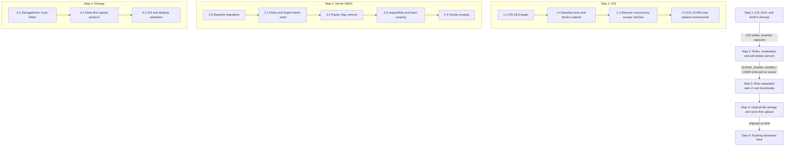
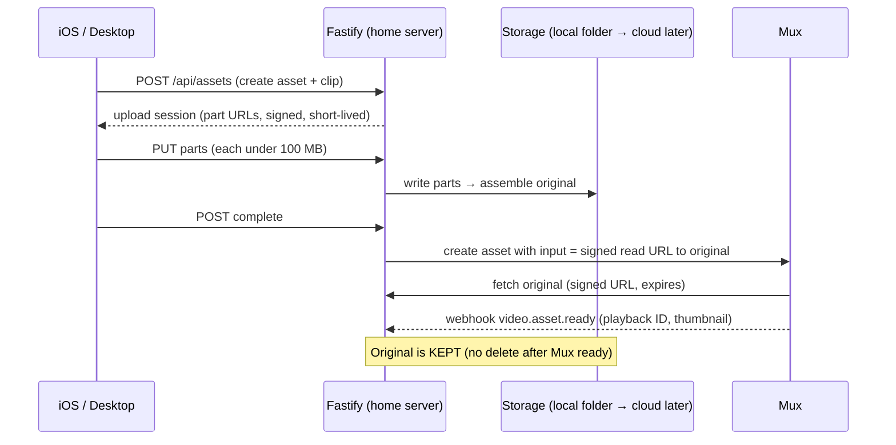

# Fixer Roadmap — iOS Modernization → Web App Expansion

_Drafted: October 19, 2026 · Updated: November 6, 2026_
_Owner: Rod_
_Status: **In progress** — Step 1 baseline_

---

## Locked Decisions (from Rod, Oct 19)

| Topic | Decision |
| --- | --- |
| Hosting | **Home server is live.** Fastify + Postgres 18 run on the MacBook Air behind a Cloudflare Tunnel (`dev.ms-fixer.com`). Cloud Run / Cloud SQL are no longer the primary target. |
| Super Admin | **Rod Griola** (only one). Promotes/demotes any user, sees all videos, can pause, flag, or remove any video. |
| Team Admin | Manages **only their team's** videos and members. Can **promote** members and **pause** them. Pause = soft delete (reversible). |
| Users | **Every user gets web access** once their account exists. |
| iOS role | **Upload only.** All management (users, moderation, sharing, downloads) happens in the desktop web app. |
| Original video | The native original file is **stored by us**, not just by Mux. Mux is for playback only. **Local folder on the home server for testing**, cloud object storage later. |
| "URL downloads" | Means **expiring download links** to the native original, for a person or a server. It does **not** mean importing videos from external URLs. (Removed from the plan.) |

---

## Current State (Oct 19 audit; iOS baseline updated Nov 6, 2026)

| Area | Finding | Impact on plan |
| --- | --- | --- |
| Home server | Postgres 18 running via `brew services`, loopback-only (`127.0.0.1` / `::1:5432`) ✅ | Matches the Home Server Plan. That doc needs a status update (done separately). |
| iOS language mode | `SWIFT_VERSION = 6.0` already set | Strict concurrency is **already on**. Step 1 is cleanup, not a migration. |
| iOS observation | No `ObservableObject` / `@Published` found; observable app state uses `@Observable` | No broad observation migration is needed. |
| iOS deployment target | `project.yml` and the generated Debug/Release app settings now agree on `18.6` | Build and test on iOS 18.6 as well as iOS 27. |
| iOS escape hatches | 2× `@unchecked Sendable`, 3× `nonisolated(unsafe)` (including two date formatters), 2× `DispatchQueue.main.async*`, 2× `MainActor.run` in views, 1 Combine `NotificationCenter` publisher | The real Step 1 work. |
| iOS tests | Swift Testing target and shared scheme added; 18 baseline tests pass on iOS 27.0 Simulator | Physical-device and minimum-version testing remain open. |
| iOS hot spot | `ChatViewModel.swift` is 1,582 lines | Don't touch in Step 1. |
| iOS ↔ roles | iOS `User` model doesn't decode `role` | New roles won't break the app. ✅ |
| Server roles | `UserRole { USER, ADMIN }`. `ADMIN` skips company filtering (`admin.js:148`), so it already acts like a super admin | Existing ADMINs lose global access when roles split. |
| Server auth | `authorizeAdmin` decorator + inline `role !== 'ADMIN'` check (`index.js:240`) | Replace both with `requireRole()`. |
| User status | `UserStatus { ACTIVE, SUSPENDED }` already exists | "Pause a member" maps to `SUSPENDED`. Label it **Paused** in the UI. No enum change needed. |
| Video soft delete | No moderation state on `Asset`. Deletes are hard deletes | Add a moderation state (Step 2.2). |
| Migrations | `prisma/migrations/` not committed (TASKS.md 0.5 open) | **Prerequisite** for every schema change. |
| Original files | iOS uploads **straight to Mux** (direct-upload PUT). The original never reaches our server. Mux doesn't give back the byte-exact original | Keeping originals means changing the upload pipeline (Step 4). |
| Legacy local path | `Clip.storageUrl` + an `uploads/` folder exist. The Mux webhook **deletes** the local file after `mux:ready` (`mux-webhooks.js:145`) | Reuse the idea, but keep the file instead of deleting it. |
| ⚠️ Public uploads folder | `index.js:267` serves `uploads/` with `@fastify/static` and **no auth**. Through the tunnel, anything placed there is publicly downloadable by URL | Must be removed or put behind auth **before** originals are stored (Step 4.1). |
| Thumbnails | Webhook already writes `Clip.thumbnailUrl` (`image.mux.com/<id>/thumbnail.png?width=640`) | Thumbnails are frontend-only work. |
| Mux settings | `playback_policy: public`, `cors_origin: '*'` | Fine for playback. Downloads come from our storage, so Mux static MP4s aren't needed. |
| Admin web app | One `App.tsx`, no router. Active theme: `theme-a-editorial.css` (imported in `main.tsx`). Three alternates sit unused | See the Themes note in Step 3. |

---

## Implementation Review (November 6, 2026)

- **Deployment versus SDK:** The selected minimum is **iOS 18.6**; the app must also build and be tested with the iOS 27 SDK/runtime. Raising the minimum intentionally drops support for iOS 17 and iOS 18.0–18.5.
- **Baseline before refactoring:** Debug and Release builds with Xcode 27.2 and the iOS 27.2 SDK succeed without signing, but have five distinct existing warnings: two main-actor isolation warnings in `Theme.swift` and three deprecated export API warnings in `VideoTrimView.swift`. The new baseline suite passes 18 tests on iOS 27.0 Simulator. Existing `ios/baseline-artifacts/phase0/` captures predate this migration and do not replace a fresh physical-device baseline.
- **Preserve behavior:** The current Debug server defaults are localhost for the simulator and a LAN address for devices. Switching the default to the home server is a separate behavior change and requires an explicit decision; preserve the existing defaults during this baseline phase.
- **Fixtures:** Use synthetic or sanitized server-contract fixtures; do not commit real user data, credentials, or tokens. Capturing sanitized responses from the dev server remains a separate validation task.
- **Test isolation:** App-hosted tests can restore an existing Keychain session and contact its configured server, so use a disposable simulator. Date tests compile the same production source into the test target with separate formatter instances; they cover formatting behavior, not production formatter thread safety. The existing `VideoMetadataExtractor.extract` can access the shared formatter off the main actor.
- **Release gates:** Test both the oldest supported iOS version and iOS 27, and complete the physical-device checklist. A successful simulator build or unit test run alone does not satisfy those gates.

### Pre-existing Risks Requiring Follow-up

- **Trimmed re-uploads:** The app uploads the trimmed file but stores the source Photos identifier. Archive re-upload can fetch that source without reapplying the selected trim, potentially uploading footage the user excluded. Verify and fix this before using sensitive footage in retry tests. See [VideoLibraryView.swift](ios/DirectVideoUploader/Views/Chat/VideoLibraryView.swift) and [ArchiveRowView.swift](ios/DirectVideoUploader/Views/Archive/ArchiveRowView.swift).
- **Transcription privacy:** The implementation tries Apple's server-based speech recognition first and falls back to on-device recognition when supported; it is not guaranteed to stay on-device. Decide whether local-only recognition is required, and review disclosure and consent before release. See [TranscriptionService.swift](ios/DirectVideoUploader/Services/TranscriptionService.swift).
- **Trim accessibility:** The trim handles use drag gestures without explicit VoiceOver adjustable actions. Verify the flow with VoiceOver and Dynamic Type, and involve the accessibility specialist before changing it.

---

# Step 1: Fixer iOS Modernization (iOS 18.6+ / Swift 6)

**Objective:** Raise the floor to iOS 18.6, remove concurrency escape hatches, and replace workarounds with iOS 18 APIs. Preserve current behavior on supported devices.

> **Scope note:** iOS is upload-only going forward. Step 1 still preserves the current feature set exactly. Trimming or redesigning screens is a later iOS UI phase. No admin/management features get added to iOS.

**Definition of done:**
- Zero concurrency warnings in a clean build.
- No `@unchecked Sendable` / `nonisolated(unsafe)` without a written justification next to it.
- Regression checklist (1.4) passes on a physical device.

### 1.1 Project & Tooling Target Bump

- [x] `project.yml`: `deploymentTarget.iOS: "17.0"` → `"18.6"`
- [x] Regenerate with XcodeGen. Confirm the effective app target is `18.6` for both Debug and Release, with no conflicting project/target overrides
- [x] Keep `SWIFT_VERSION = 6.0`. A separate `SWIFT_STRICT_CONCURRENCY` setting is not needed because Swift 6 mode already includes it
- [x] Remove target-level `DEVELOPMENT_TEAM: xxxxxxxxxx` from `project.yml` so the target inherits the existing base-level team
- [ ] Remove iOS 18.6-and-earlier availability branches only when their behavior is covered by tests and the relevant specialist reviews
- [ ] Decide separately whether to point the Debug server default at `https://dev.ms-fixer.com`; retain the current local defaults until then
- [ ] **Optional decision:** Swift 6.2 "approachable concurrency" (`SWIFT_DEFAULT_ACTOR_ISOLATION = MainActor`). Recommendation: **not now.** The code already uses explicit `@MainActor`.
- [ ] Commit: "iOS 18.6 deployment target and baseline tests"

XcodeGen 2.46 rewrites the app product's existing `explicitFileType` metadata to `lastKnownFileType`; the pre-existing value was retained after regeneration. Check it when regenerating the project again.

### 1.2 Remove Concurrency Escape Hatches

| File | Current | Target |
| --- | --- | --- |
| `Services/VideoUploadService.swift:226` | `UploadDelegate: … @unchecked Sendable` | Final class, immutable `let` closures. Put mutable buffers behind `Mutex` (`Synchronization`, iOS 18+). Drop `@unchecked`. |
| `Services/TranscriptionService.swift:153` | `ResumeGuard: @unchecked Sendable` (stops a continuation resuming twice) | `Mutex<Bool>`, or restructure so only one callback can resume |
| `Views/Chat/VideoTrimView.swift:643` | `nonisolated(unsafe) let pollSession` polls export progress | iOS 18 async export API (1.3). Removes the polling loop. |
| `App/DVUDateFormatting.swift` | Two shared `ISO8601DateFormatter` instances use `nonisolated(unsafe)` | Audit concurrent access and replace with safe isolation, or document a verified justification. |
| `Views/Chat/VideoTrimView.swift:175,180` | `await MainActor.run { … }` in view tasks | Move the work into `TrimViewModel` (`@MainActor`) and drop the hops |
| `Views/Form/ContextFormView.swift:324` | `DispatchQueue.main.asyncAfter(0.5)` | Use a task cancelled on disappear; return on cancellation instead of performing the delayed action. |
| `Views/Onboarding/OnboardingWalkthroughView.swift:93` | `DispatchQueue.main.async` | Direct call, or `Task { @MainActor in … }` if a deferral is really needed |
| `Views/Profile/ProfileView.swift:50` | Combine `willEnterForeground` publisher | `@Environment(\.scenePhase)` + `.onChange` |
| `Services/WebSocketService.swift:489,522` | `NWPathMonitor` on a private queue + `MainActor.run` | Acceptable as is. Optionally wrap in an `AsyncStream<NWPath>`. |
| `Views/Chat/VideoLibraryView.swift:287` | `Task.detached` for temp-file delete | **Keep.** Legitimate off-main file I/O. |

- [x] Mark the immutable `Codable` models (`ChatMessage`, `Asset`, `Clip`, `User`, `FormResponse`, …) as `Sendable`
- [x] `SentUploadInfo` holds a `UIImage`, so keep it main-actor-only
- [x] Grep gate: `@unchecked|nonisolated\(unsafe\)|DispatchQueue\.main|MainActor\.run` should return only justified hits *(zero hits, Nov 6, 2026)*

**Done (Nov 6, 2026):** `UploadDelegate` and the transcription resume guard use `Mutex` (checked `Sendable`); `DVUDateFormatting` uses `Date.ISO8601FormatStyle`; `ContextFormView` focus uses a cancellable `.task`; the walkthrough defers with `Task { @MainActor in }`; redundant `MainActor.run` hops removed from `VideoTrimView` and the `WebSocketService` ping watchdog (both already main-actor); `Theme`'s dynamic color reads `UIScreen` only on the main thread. `NWPathMonitor` and `Task.detached` file delete kept as planned. Clean Debug and Release builds have zero Swift warnings; 41/41 tests pass; concurrency review found no issues.

### 1.3 Adopt iOS 18 APIs That Replace Workarounds

Only APIs that **remove** code or risk.

- [x] `AVAssetExportSession.export(to:as:)` + `states(updateInterval:)` replaces the polling loop in `PassthroughExporter` / `VideoTrimView`
- [x] `Synchronization.Mutex` replaces the hand-rolled `@unchecked Sendable` guards
- [x] Review `withCheckedContinuation` wrappers. Remaining: background upload delegate (no async API for background sessions), `OriginalVideoLoader` (`PHAssetResourceManager`), `TranscriptionService` recognition (`ResumeGate`) and `SFSpeechRecognizer.requestAuthorization` (no async API). Each resumes exactly once (concurrency review).
- [x] **Keep** the background `URLSession` + delegate upload. Step 4 changes *where* it uploads to, not *how*

### 1.4 Test Target & Regression

- [x] Add a `DirectVideoUploaderTests` target (Swift Testing) and a shared test scheme to `project.yml`
- [ ] Tests:
  - [x] JSON decoding of `User`, `Asset`, `Clip`, `ChatMessage`, and `MessagesResponse` using synthetic server-contract fixtures
  - [ ] Verify sanitized fixtures captured from `dev.ms-fixer.com` against those contracts
  - [x] `MessagePolicyCoordinator` / `MessageCatalog`
  - [x] `DVUDateFormatting`
- [x] Configure CI to run the Swift tests on an available iOS 18.6+ iPhone simulator
- [ ] Verify the CI job on GitHub and run the suite on an iOS 18.6 simulator or device
- [ ] Before 1.2, capture a fresh baseline (screen recordings of key flows) in `ios/baseline-artifacts/`

**Manual regression on a physical device, after each sub-step:**
- [ ] Login (phone + PIN + company code), Keychain restore, legacy token migration
- [x] Permission prompts and denied states: Photos, Camera, Location, Speech, Mic
- [x] Onboarding (fresh install)
- [ ] Library pick: PHAsset fast path and Transferable fallback
- [ ] Trim → passthrough export → upload
- [ ] Upload: create asset (POST) → Mux direct upload (background PUT). Background the app mid-upload
- [ ] Re-upload a trimmed video from Archive and verify that no excluded footage is uploaded
- [ ] Transcription: verify server-first and on-device fallback behavior, and resolve the privacy decision before claiming local-only processing
- [ ] WebSocket connect / reconnect (airplane mode), `upload:progress`, `message:new`
- [ ] Context form → Mux ready → summary bubble → Slack share
- [ ] Archive / metadata / profile / appearance (light & dark)
- [ ] VoiceOver and Dynamic Type, including adjusting trim handles

### 1.5 Upload Fidelity, Onboarding Permissions & Archive Re-upload Safety

**Decisions (Nov 6, 2026):**
- **Untrimmed uploads** send the camera's untouched original file and its metadata, without conversion or compression.
- **Trimmed uploads** send a passthrough (no re-encode) copy cut from that original, named `<original>-edited.<ext>`, with the original's metadata. The `-edited` filename is what the web app stores.
- **After a trimmed upload succeeds,** save the trimmed copy to Photos as a new item; the original is untouched.
- **Photo Library access is recommended, not required;** Speech Recognition is optional.
- **Without access,** ask at the first upload; if declined, upload the current version with a notice that Photos edits may be included.
- Fix Archive permission handling and the trimmed re-upload issue in this phase.

**Current behavior (traced Nov 6, 2026; no code changed):**
- `VideoUploadService` uploads the given file byte-for-byte; it is not the cause.
- Tapping **Next** always runs `PassthroughExporter`, even with no trim, so every upload is a re-packaged `-edited` copy. Its metadata is not explicitly copied, and the upload's metadata is re-read from that copy.
- `PhotosPicker` is created without `photoLibrary:`, so `itemIdentifier` is likely `nil`. The direct Photos path is then skipped, and the `loadTransferable` fallback uses the default `.automatic` encoding, which may transcode. When the direct path runs, it requests `version = .current` (the Photos-edited version) and disallows iCloud downloads.
- Archive re-upload fetches the edited `.current` version and ignores the trim.
- Nothing currently retrieves the untouched original.

**Implemented (Nov 6, 2026; uncommitted, device checks pending):** `OriginalVideoLoader` reads the `.video` resource (iCloud allowed, with progress); full-length selections upload that file unchanged; trims are passthrough copies with the original's metadata and the trimmed duration; trimmed copies are saved to Photos after upload; Archive re-upload uses originals with a duration match, otherwise the picker. Verified: Debug and Release builds, 25/25 tests on iOS 27, launch-screen check. Concurrency review fixes: cancellable iCloud download, superseded loads can't overwrite state, unique trim export folders, temp cleanup on cancelled uploads, no double Archive re-upload. Accessibility review fixes: VoiceOver announcements for the edits notice and the auto-opened picker, combined progress element, light-mode contrast for the Archive notice (`Theme.warningText`). Deferred (pre-existing, app-wide): Dynamic Type for `Theme` fonts, 44 pt targets for the confirm and Archive buttons, `secondaryText` contrast on the always-black picker footer.

**Why access is recommended, not required:** The system `PhotosPicker` runs out of process and always shows the full library, so choosing videos needs no permission. Access is needed to read the untouched original via `PHAssetResource` (`.video`) and for automatic Archive re-upload. For videos never edited in Photos, the current version equals the original. The App Review specialist should review the wording against Guideline 5.1.1(iv).

**Without access (decided Nov 6, 2026):** Without access, or with Limited access to a video outside the selection, the app cannot fetch the `PHAsset`, so it cannot tell whether a video was edited in Photos. Ask for access at the first upload. If the person declines, upload the current version (`.current` encoding, no transcode) and show a notice that Photos edits may be included.

**Proposed behavior**
- One **Permissions** screen in the app's theme after login, reusing the Profile permission-row design.
  - **Photo Library** is marked *Recommended* and explains that access lets the app upload originals and re-upload from Archive.
  - **Speech Recognition** is marked *Optional*.
  - A single neutral **Continue** button shows the system prompt for each undecided permission (Photo Library first); people decline in the system dialog. There is no skip/close and no "Allow" label (App Review Guideline 5.1.1(iv), decided Nov 6, 2026). Persist that the screen was seen with `@AppStorage`; both permissions stay available from Profile.
  - Presented from `ChatView` after the walkthrough and guide close (or at launch when onboarding is already complete), never over another sheet.
- Show the screen once to new and existing users while either permission is still undecided (`.notDetermined`).
- **Limited:** Explain that originals and Archive re-upload work only for selected videos; offer to manage the selection or open Settings.
- **Denied** and **Restricted:** Show **Open Settings** on the Permissions screen and in Profile. Recheck status whenever the app becomes active.

**Tasks**
- [x] Device check: confirm `itemIdentifier` is `nil` without `photoLibrary:`, whether `.automatic` transcodes, and whether passthrough export keeps metadata; test an iCloud-only video and one edited in Photos
- [x] Picker: create with `photoLibrary: .shared()` and `preferredItemEncoding: .current`
- [x] Original retrieval: with access, write the `.video` `PHAssetResource` to a temp file via `PHAssetResourceManager` with network access allowed (iCloud) and progress; use the original filename and `PHAsset` metadata (`OriginalVideoLoader`). A failed original load shows an error and never falls back to an edited copy.
- [x] Trim: skip export when the range is the full duration and upload the original; otherwise export from the original, copy its metadata explicitly, and verify on device *(device verification pending)*
- [x] Save trimmed copy to Photos after a successful upload (`PHAssetCreationRequest`); add `NSPhotoLibraryAddUsageDescription` and request add-only access if read/write access is not granted; a save failure must not fail the upload. The new item's identifier is linked to the upload for Archive re-upload.
- [x] `PermissionManager`: inject the authorization provider (`PermissionAuthorizing`) for tests; make it the sole source of Speech authorization, including `TranscriptionService`; refresh status app-wide when the app becomes active (`ContentView`). Concurrency review: no issues.
- [x] Extract a shared `PermissionRow` from `ProfileView`; build `PermissionsView` and its presentation in `ChatView`. Accessibility review applied: status as VoiceOver value, contrast-safe `Theme.purpleText`/`purpleFill`, stacked layout and scaled icon at accessibility text sizes, 44 pt targets, header traits.
- [x] Archive retry: use the original resource, not `.current`; request access when undecided; with Limited or denied access, or when the original is not found, open the picker instead of showing an error
- [x] Trimmed re-upload (revised): instead of persisting trim ranges, trimmed copies are saved to Photos and linked to the upload. Automatic retry only uses a Photos video whose length matches the uploaded clip's `duration` (±1 s), so a legacy record pointing at an untrimmed source falls back to the picker. Limit: a trim removing less than about 1 s isn't detected.
- [x] Swift Testing: full-range trim detection, duration matching (legacy no-auto-retry rule), metadata merge and trimmed-duration rules (`UploadFidelityTests`)
- [x] Swift Testing: permission status mapping, row states, presentation decision, undecided-only requests and `TranscriptionService` authorization (`PermissionTests`, fake authorizer). 41/41 tests pass on the iOS 27 simulator; Debug and Release builds pass.
- [x] Device matrix (fresh install for each case): Allow Full, Limited, Don't Allow, Speech Allow/Don't Allow, Continue without deciding, change in Settings while backgrounded, upgrade from a build where onboarding was already completed; in each Photo Library state, upload untrimmed, trimmed, iCloud-only and Photos-edited videos, and Archive re-upload. Compare uploaded bytes and metadata with the original exported from Photos. *(Passed on device, Nov 6, 2026.)*

> **Follow-up (accessibility):** `Theme` fonts use fixed `.system(size:)`, so text app-wide doesn't scale with Dynamic Type. Map each font token to a text style (`relativeTo:`) as an app-wide change.

> **Later (not Step 1):** split `ChatViewModel.swift`, iOS UI redesign around "upload only", and remove `NSAllowsArbitraryLoads: true` now that the server is HTTPS via the tunnel.

---

# Step 2: Roles, Moderation & Soft Delete (Server)

**Objective:** The **server** decides who can see and do what. This step also adds reversible "pause" and the flag/remove workflow.

**Definition of done:**
- Every dashboard/admin route declares its allowed roles.
- Team scoping happens server-side.
- Paused/removed content is hidden by default.
- A role × endpoint test matrix passes in CI.

### 2.0 Prerequisite — Versioned Migrations (TASKS.md 0.5)

- [ ] Baseline migration from the **home-server** database (now production-like): `prisma migrate diff --from-empty --to-schema-datamodel` → `migrations/0_init`, then `prisma migrate resolve --applied 0_init`
- [ ] Commit `server/prisma/migrations/`
- [ ] From now on: `prisma migrate deploy` only. Retire `db push` (the Home Server Plan Phase 3 still says `db push`)
- [ ] Take a `pg_dump` before the first real migration

### 2.1 Roles & Super Admin Seed

| Role | Scope | Can |
| --- | --- | --- |
| `SUPER_ADMIN` (Rod) | Everything | Promote/demote any user to any role, pause/unpause any user, see all videos, pause/flag/remove any video, manage teams/orgs, server health & logs, create share links for any video |
| `ADMIN` (Team Admin) | Own team only | See team videos, pause/unpause team videos, flag team videos for removal, add members, **promote USER → ADMIN within the team**, pause/unpause team members, create share links for team videos |
| `USER` | Own records | Web access: view own videos, transcripts, form data, profile/PIN. Upload from iOS (and desktop in Step 4). Create share links for own videos *(confirm)* |

- [ ] Migration: `ALTER TYPE "UserRole" ADD VALUE 'SUPER_ADMIN'`
- [ ] **Seed Rod as Super Admin from an env var** (`SUPER_ADMIN_PHONE`), not a phone number hardcoded in source. A bootstrap script promotes that account on deploy
- [ ] Existing `ADMIN` accounts become team-scoped Team Admins. Tell them first
- [ ] Every `ADMIN` must belong to a team. Reject ADMIN promotion for users with no team
- [ ] Guardrails:
  - Only SUPER_ADMIN can create or demote ADMINs outside their own team
  - Team Admin can't demote another Team Admin *(confirm)*
  - Nobody can grant `SUPER_ADMIN` through the API (env/script only)
  - The last SUPER_ADMIN can't be demoted or paused

### 2.2 Pause, Flag & Remove (Soft Delete)

**Members:**
- [ ] Pause = `User.status = SUSPENDED` (shown as **Paused**)
- [ ] Add `pausedAt`, `pausedById`
- [ ] Paused users can't log in (the `authenticate` check already enforces `status`). Their videos stay visible to admins

**Videos:** add a moderation state that is separate from processing `status`:

| `Asset.moderation` | Set by | Visible to | Reversible |
| --- | --- | --- | --- |
| `ACTIVE` (default) | — | Owner, team admins, super admin | — |
| `PAUSED` | Team Admin, Super Admin | Team admins, super admin (greyed out). Hidden from owner's list *(confirm)* | Yes, unpause |
| `FLAGGED_FOR_REMOVAL` | Team Admin, Super Admin | Super admin removal queue | Yes, Super Admin can restore |
| `REMOVED` | **Super Admin only** | Nobody (audit row kept) | No. Original file and Mux asset are deleted |

- [ ] Fields: `moderation`, `moderatedAt`, `moderatedById`, `moderationReason`
- [ ] All list queries default to `moderation = ACTIVE`. Admin views can opt in to see paused/flagged items
- [ ] Removal job: delete the stored original (Step 4), delete the Mux asset, revoke share links (Step 5), keep the DB row as a tombstone
- [ ] Audit log table: who did what to which user/video, and when. Super Admin can view it

### 2.3 API Authorization & Team Scoping

- [ ] One decorator, `requireRole('SUPER_ADMIN', 'ADMIN')`. It replaces `authorizeAdmin` and the inline check at `index.js:240`
- [ ] `teamScope(request)` returns the Prisma `where`:
  - SUPER_ADMIN → `{}` (or the selected team)
  - ADMIN → own team
  - USER → `{ userId }`
- [ ] Apply it to every list/detail query in `admin.js` and `assets.js`. Remove the ad-hoc filter at `admin.js:148`
- [ ] Out-of-scope IDs return **404**, not 403
- [ ] **Open question: what is a "team"?** The schema has both `Organization` (`companyCode`) and a free-text `User.team` field. Assumption: **team = Organization**. If a team is a sub-group inside an org, it needs a real `Team` table instead of the free-text field

### 2.4 Real-Time (Socket.IO) Scoping

- [ ] Audit every dashboard `emit`. Right now any dashboard socket may receive every org's events
- [ ] Rooms: `team:<id>`, `user:<id>`, `super`. Emit to the narrowest room

### 2.5 Tests

- [ ] Role × endpoint matrix (3 roles × 2 teams × each route → 200/403/404)
- [ ] Escalation and guardrail tests (2.1)
- [ ] Moderation visibility tests (paused/flagged/removed hidden correctly)
- [ ] Update `admin-routes.test.js` / `assets-routes.test.js`

---

# Step 3: Role-Separated Web UI & Thumbnails

**Objective:** One web app with three experiences. Every user gets web access. The client only hides UI; the server enforces.

### 3.1 Routing & Layouts

- [ ] Add a router (TanStack Router pairs with the existing TanStack Query)
- [ ] Split `App.tsx` into `AuthProvider` + role route trees
- [ ] Web login = the same phone + PIN + company code as iOS. Confirm that `USER` logins are accepted by the dashboard (today the dashboard expects admins)

| Layout | Contents |
| --- | --- |
| **Super Admin** | Team switcher, global stats, all users (promote/demote/pause), all videos, **Removal queue** (flagged items → restore / remove), audit log, triad/server health, error log, dev tools (`QuickActions`, `EndpointTable`) |
| **Team Admin** | Team stats, team members (add / promote / pause), team videos (pause / flag), share links |
| **User** | "My Videos" grid, video detail (player, transcript, form data, download/share), profile & PIN |

- [ ] Shared: header, login, 403/404, toasts, video detail page
- [ ] Moderation actions require a confirm dialog and an optional reason

**Themes:** the admin app has four theme files in `admin/src/`. Only one is active:

| File | Name | Status |
| --- | --- | --- |
| `theme-a-editorial.css` | Editorial | **Active** (imported in `main.tsx`) |
| `theme-b-lavender.css` | Lavender | Unused |
| `theme-c-newsroom.css` | Newsroom | Unused |
| `theme-d-dark.css` | "Midnight Studio" dark | Commented out in `main.tsx` |

- [ ] Decide: keep Editorial (and optionally D as a dark mode), then delete the rest so the new layouts are only styled once

### 3.2 Thumbnails

- [ ] Render `clip.thumbnailUrl`. Make sure the asset list endpoints `select` it
- [ ] List-sized images: `thumbnail.webp?width=320&fit_mode=smartcrop`. Optional hover preview: `animated.webp?width=320&end=4`
- [ ] `loading="lazy"` with fixed aspect-ratio boxes
- [ ] Status fallbacks:
  - `UPLOADING`: progress
  - `PROCESSING`: shimmer
  - `ERROR`: error tile
  - `PAUSED`: dimmed with a badge
- [ ] Live refresh on socket `mux:ready` / `upload:complete`

---

# Step 4: Original-File Storage & Store-First Upload

**Objective:** Keep every **native original** in our storage. Mux becomes playback-only. Use a **local folder on the home server** for testing, and make moving to cloud storage a config change.

### Target flow

### 4.1 StorageDriver Abstraction + Local Driver

- [ ] Server interface `StorageDriver`:
  - `createUpload`, `uploadPart`, `completeUpload`, `abortUpload`
  - `getReadStream(range)`, `signedReadUrl(key, ttl)`
  - `delete(key)`, `stat(key)`
- [ ] `local` driver: root folder from env `STORAGE_LOCAL_ROOT`
  - Recommend an **external SSD** path, not the Air's internal disk
  - Layout: `originals/<teamId>/<assetId>/<clipId>/<originalFileName>`
- [ ] Replace `Clip.storageUrl` (a public path) with `storageKey` + `storageDriver` + `sha256` + `sizeBytes`
- [ ] **Remove the public `/uploads/` static route** (`index.js:267`). All file access goes through authenticated or signed routes
- [ ] Stop deleting originals in the `mux:ready` webhook (`mux-webhooks.js:145`)
- [ ] Update `upload-cleanup.js` so it only removes **incomplete** uploads
- [ ] Disk guardrails:
  - Free-space check before accepting an upload
  - Super Admin dashboard shows storage used
  - Alert below a threshold
- [ ] Backups: originals are **not** covered by the nightly `pg_dump`. Decide on a copy target (second drive, or the future cloud bucket)
- [ ] Future `s3` driver (Cloudflare R2 / S3 / GCS): implements the same interface using real presigned multipart URLs. Clients don't change

### 4.2 Upload Protocol (Why Parts)

- [ ] ⚠️ **The Cloudflare plan caps request bodies at 100 MB** (Free/Pro). A single PUT of a large video through `dev.ms-fixer.com` will fail. The upload protocol must send **parts under 100 MB** (e.g. 50 MB)
- [ ] Model the protocol on S3 multipart:
  1. Create session
  2. PUT each part to a signed part URL
  3. Complete
- [ ] Local driver: part URLs are HMAC-signed Fastify routes. S3/R2 driver later: real presigned URLs that bypass the tunnel entirely
- [ ] Resumable: client can ask which parts already arrived and only send the missing ones (covers the "Mode B" goal in `IOS_UPLOAD_TRANSPORT_MODES_CHECKLIST.md`)
- [ ] After complete: server verifies size/checksum, then creates the Mux asset with `input: [{ url: signedReadUrl }]` (short TTL). Mux pulls the original through the tunnel. Downloads aren't subject to the 100 MB upload cap

### 4.3 Clients

- [ ] **iOS** (after Step 1): `VideoUploadService` uploads parts to our server instead of one PUT to Mux
  - Each part is its own background `URLSession` upload task from a file slice, so it still survives app suspension
  - Progress, transcription, form, and WebSocket flow stay the same
- [ ] **Desktop web**: drag-and-drop, multi-file queue, same part protocol, context form on web, `source: 'web'` on the asset
- [ ] Keep the old direct-to-Mux path behind a server flag until the new path is proven

---

# Step 5: Expiring Download Links (Native Original)

**Objective:** Let an authorized user create a link that gives a person **or a server** a download of the native original. The link has an expiry date and can be revoked.

- [ ] `ShareLink` table:
  - `id`, `assetId` / `clipId`, `tokenHash` (store only the hash, never the raw token), `createdById`
  - `expiresAt`, `maxDownloads?`, `downloadCount`, `revokedAt`, `lastAccessedAt`, `note` (e.g. "for CNN ingest server")
- [ ] Create: `POST /api/assets/:id/share-links { expiresIn }`
  - Presets: 1 h / 24 h / 7 d, max 30 d
  - Allowed: SUPER_ADMIN (any video), ADMIN (team videos), USER (own videos, *confirm*)
- [ ] Public download: `GET /d/:token`
  - Validate: not expired, not revoked, asset `ACTIVE`, download limit not reached
  - Local driver: stream the file with **HTTP Range** support (resumable, works with `curl`/`wget` for servers) and `Content-Disposition: attachment; filename="<original>"`
  - Cloud driver later: 302 redirect to a short-lived presigned URL
- [ ] Machine-friendly: plain URL, no cookies or JS, so `curl -O` works. Optionally offer a SHA-256 for verification
- [ ] Rate-limit `/d/*` and log every download (IP, user agent) for the owner and admins
- [ ] Links die automatically when a video is paused, flagged, or removed, or when its owner is paused *(confirm owner rule)*
- [ ] Web UI: "Share original" dialog (expiry picker, copy link), list of active links per video with revoke

> Mux static MP4 renditions are **not needed**. Downloads come from our stored original.

---

## Sequencing Note

Until Step 4 ships, **new uploads keep no original**. They only exist in Mux, which doesn't return the byte-exact file. That's fine while pre-production. If real content starts flowing sooner, consider moving **Step 4.1–4.2 ahead of Step 3**. It only depends on Step 2.0 (migrations), not on the new UI.

---

## Open Questions

- [ ] **Team = Organization?** Or a sub-group within an org? (2.3)
- [ ] Can a Team Admin demote another Team Admin, or only promote? (2.1)
- [ ] Does a paused video disappear from the **owner's** own list, or only show as paused? (2.2)
- [ ] Can regular USERs create share links for their own videos? (5)
- [ ] When a user is paused, do their existing share links stop working? (5)
- [ ] Theme: keep Editorial only, or Editorial + Midnight dark mode? (3.1)
- [ ] Originals backup target while on the local driver (second drive vs early cloud bucket)? (4.1)
- [ ] Which cloud storage later: Cloudflare R2 (no egress fees, same Cloudflare account) vs S3 vs GCS?
