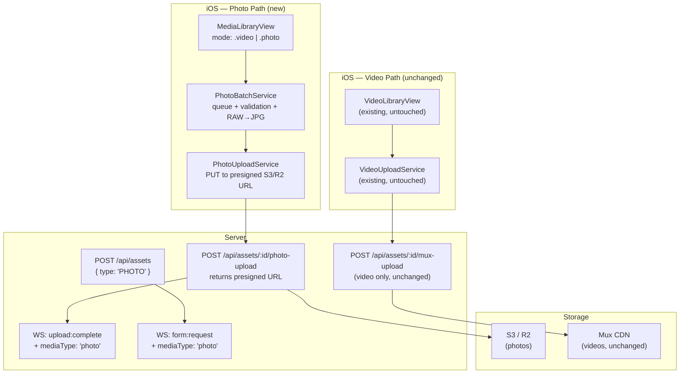
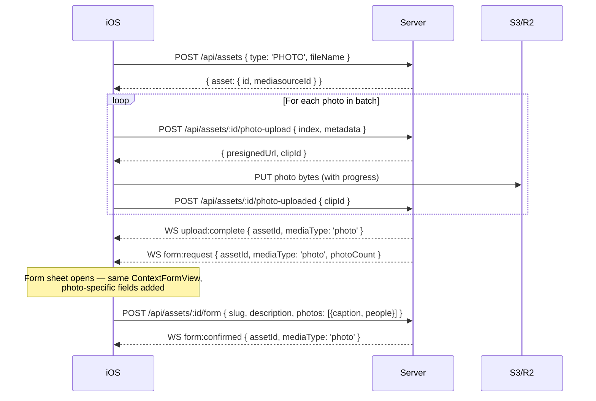

# Photo Upload Integration — Revised Plan (v2)

> This revision incorporates the [second-opinion review](file:///Users/rodczaro/Desktop/00-Vibecode/Direct-Video-Uploader/photo_upload_analysis_2nd_opinion.md) findings and the user's latest requirements from `first-file.md`. Changes from v1 are marked with 🔄.

---

## Decisions Locked (from review feedback)

These were open questions in v1. Locking them before implementation:

| Decision | Answer | Rationale |
|---|---|---|
| **Photo form lifecycle** | ✅ Same flow as video: `form:request` → user fills → `form:confirmed` | Reuses existing server + iOS infrastructure. Photos get the same archive + "needs details" flow. |
| **WebSocket events for v1** | ✅ Reuse `upload:complete`, `form:request`, `message:new` with `mediaType` in payload | Avoids contract drift across three clients (iOS, server, admin dashboard). New events only if needed later. |
| **Queue strategy** | ✅ Sequential upload only for v1 | Simplest to implement, progress bar is accurate, error handling is clear. |
| **Staged media refactor** | 🔄 Additive — new `StagedPhotoBatch` alongside existing `StagedVideo`. No renaming. | Safest path per review finding #3. Consolidation deferred. |

---

## Architecture — Option B+C (Unchanged Direction, Revised Details)



---

## 🔄 Revised Touchpoint Matrix

### Finding #1 — WebSocket Contract (No New Events)

Current events stay stable. Media type is added as a payload field:

| Event | Current Payload | v2 Addition |
|---|---|---|
| `upload:complete` | `{ assetId }` | `+ mediaType: 'video' \| 'photo'` |
| `form:request` | `{ assetId, metadata, ... }` | `+ mediaType: 'video' \| 'photo'` |
| `form:confirmed` | `{ assetId, formType, ... }` | `+ mediaType: 'video' \| 'photo'` |
| `message:new` | `{ content, messageType }` | No change needed |

**iOS `WebSocketService.swift`**: No new `on*` handlers. Existing `onUploadComplete`, `onFormRequest`, `onFormConfirmed` closures already receive `[String: Any]` — the new `mediaType` field is accessible immediately.

**Admin `use-socket.ts`**: Existing `upload:complete` listener triggers `onAssetChangeRef.current?.()` which refreshes the asset list. Photos will be included automatically since they're also Assets. No listener changes needed.

**Server `handler.js`**: `notifyUserSockets` in `utils.js` already passes arbitrary payload fields through. Adding `mediaType` is server-side only — zero client changes for the event plumbing.

### Finding #2 — Photo Form Lifecycle (Locked)



**Photo-specific form fields** (per user requirements):

| Field | Scope | Required? |
|---|---|---|
| Slug / Assignment Name | Per asset (whole batch) | ✅ Yes |
| Description | Per asset (whole batch) | ✅ Yes |
| Section Caption | Per photo | No |
| People in Image | Per photo | No |

The form sheet shows the shared slug/description at top, then a scrollable list of photo thumbnails with per-photo caption and people fields. Same `buildFormFields()` pattern, extended.

### Finding #3 — Staged Media (Additive, No Rename)

🔄 **Changed from v1.** No renaming `StagedVideo` → `StagedMedia`. Keep existing types untouched.

| Existing (unchanged) | New (additive) |
|---|---|
| `StagedVideo` struct | `StagedPhotoBatch` struct |
| `ChatViewModel.stagedVideo: StagedVideo?` | `ChatViewModel.stagedPhotos: StagedPhotoBatch?` |
| `ChatViewModel.confirmStagedUpload()` | `ChatViewModel.confirmPhotoUpload()` |
| `VideoBubble` view | `PhotoBatchBubble` view (new) |

`ChatView.swift` branching is minimal — the `+` button action sets a mode flag, which determines whether to show the library in video or photo mode. The library returns different types to different staging methods.

### Finding #4 — Admin Dashboard (Backend + UI Paired)

🔄 **Changed from v1.** Backend payload and UI changes are in the same phase.

| Backend change | UI change (same phase) |
|---|---|
| `GET /api/admin/assets` raw SQL adds `asset_type` column to SELECT | `AssetList.tsx` adds type badge (📹 / 📷) |
| `GET /api/assets/mine` includes `assetType` in response | Archive list shows photo/video grouping |
| `admin/src/lib/types.ts` — `Asset` type adds `assetType?: 'VIDEO' \| 'PHOTO'` | Filter/sort by type in asset list |

### Finding #5 — Create Asset Contract (Explicit Step)

🔄 **Changed from v1.** This is now Phase 1, Step 1 — not implied.

**iOS `Asset.swift`:**
```swift
// Before
struct CreateAssetRequest: Codable {
    let fileName: String
}

// After
struct CreateAssetRequest: Codable {
    let fileName: String
    let type: String?  // "VIDEO" (default) or "PHOTO"
}
```

**Server `assets.js` — `POST /api/assets`:**
```javascript
// Before
const { fileName } = request.body || {};

// After  
const { fileName, type } = request.body || {};
const assetType = type === 'PHOTO' ? 'PHOTO' : 'VIDEO';  // default VIDEO
```

**Prisma schema:**
```prisma
enum AssetType {
  VIDEO
  PHOTO
}

model Asset {
  // ... existing fields ...
  assetType  AssetType  @default(VIDEO) @map("asset_type")
}
```

> [!IMPORTANT]
> This migration is non-breaking — existing assets default to `VIDEO`. No data migration needed.

---

## 🔄 Photo-Specific Features (From User Requirements)

### Library Picker — Mode Toggle

The user wants the library to **switch between video and photo filtering**, replacing the existing video/collection toggle.

```
┌─────────────────────────────┐
│  Library            ✕       │
│  ┌──────────┬──────────┐    │
│  │  Videos  │  Photos  │    │  ← segmented control replaces
│  └──────────┴──────────┘    │     collection picker
│                             │
│  ┌─────┐ ┌─────┐ ┌─────┐   │
│  │     │ │     │ │     │   │  ← PHPicker filtered by mode
│  │ 📷  │ │ 📷  │ │ 📷  │   │
│  │     │ │     │ │     │   │
│  └─────┘ └─────┘ └─────┘   │
│  ┌─────┐ ┌─────┐ ┌─────┐   │
│  │     │ │     │ │     │   │
│  ...                        │
│                             │
│  ⓘ 3 photos queued  GPS ✓  │  ← footer shows count + GPS
│                         ☑️  │
└─────────────────────────────┘
```

- **Video mode**: `matching: .videos`, `maxSelectionCount: 1` → existing flow, trim sheet
- **Photo mode**: `matching: .images`, `maxSelectionCount: 20` → batch flow, no trim

### Per-Photo Metadata — Caption + People

Each photo in the batch gets:

| Field | How populated | Stored |
|---|---|---|
| Section Caption | User types in form (optional) | `Clip.caption` (new field) |
| People in Image | 🤖 Auto-detected via Vision + user edits | `Clip.peopleInImage` (new JSON field) |

### People Identification

> [!NOTE]
> **Apple Vision framework** can detect faces in images on-device. It does **not** identify who they are — it only finds face bounding boxes. For name-based identification, you'd need either:
>
> 1. **Core ML + a trained model** — requires a face dataset of your newsroom staff (privacy concerns)
> 2. **User-provided labels** — Vision detects face count, user manually types names
> 3. **Third-party API** — e.g., AWS Rekognition (sends images off-device)
>
> **Recommendation for v1:** Use Vision to detect face count and show "N faces detected" in the form. Let the user type names manually in a comma-separated field. Defer auto-identification to a future phase.

### Separate Photo Archive

The user wants photo archive separate from video archive. Implementation:

| Component | Change |
|---|---|
| `ArchiveListView.swift` | Add segmented control: "Videos" / "Photos" |
| `GET /api/assets/mine` | Accept `?type=VIDEO` or `?type=PHOTO` query param, or return all and filter client-side |
| Archive rows | Photo rows show thumbnail grid instead of single video thumbnail |

---

## Prisma Schema Additions (Full)

```prisma
enum AssetType {
  VIDEO
  PHOTO
}

model Asset {
  // ... all existing fields unchanged ...
  assetType    AssetType  @default(VIDEO) @map("asset_type")
  photoCount   Int        @default(0) @map("photo_count")  // batch size
}

model Clip {
  // ... all existing fields unchanged ...
  // New fields for photos (null for videos):
  format          String?    // "JPEG", "HEIC" — null for videos
  width           Int?       // pixel width
  height          Int?       // pixel height
  caption         String?    // per-photo section caption
  peopleInImage   Json?      @map("people_in_image")  // ["name1", "name2"]
}
```

---

## Finding #6 — Acceptance Matrix

### Format Validation

| Test Case | Input | Expected Result |
|---|---|---|
| JPEG photo | `.jpg` from camera roll | ✅ Upload at original quality, no re-encode |
| HEIC photo | `.heic` from camera roll | ✅ Upload at original quality, no conversion |
| ProRAW (DNG) | `.dng` from iPhone Pro | ✅ Convert to JPEG quality 1.0, then upload |
| RAW (CR2/NEF) | Imported `.cr2` or `.nef` | ✅ Convert to JPEG quality 1.0, then upload |
| PNG file | `.png` screenshot | ❌ Rejected post-selection, toast: "PNG not supported" |
| TIFF file | `.tiff` scan | ❌ Rejected post-selection, toast: "TIFF not supported" |

### Queue Behavior

| Test Case | Expected Result |
|---|---|
| 5 photos selected, upload all | Progress: "Uploading 1 of 5... 2 of 5..." → batch complete |
| Upload interrupted (network loss) | Current photo pauses (`waitsForConnectivity`), resumes on reconnect |
| 1 photo fails in batch of 5 | Skip failed, continue remaining, report failure at end |
| User cancels mid-batch | Stop current upload, discard remaining, report partial completion |
| App backgrounded during upload | Background URLSession continues (same as video) |
| RAW in batch | "Processing 2 of 5..." phase before "Uploading 2 of 5..." |

### Form Behavior

| Test Case | Expected Result |
|---|---|
| Submit without slug | ❌ Blocked, same validation as video form |
| Submit without description | ❌ Blocked, same validation as video form |
| Skip caption/people fields | ✅ Allowed (optional per-photo fields) |
| App killed before form submit | PendingForm restored on relaunch (same recovery as video) |

---

## Implementation Phases

### Phase 1 — Foundation (Server + Schema)

| Step | What | Files |
|---|---|---|
| 1 | Add `AssetType` enum + `assetType` field to Prisma schema | `schema.prisma` |
| 2 | Add `photoCount`, `caption`, `peopleInImage`, `format`, `width`, `height` to schema | `schema.prisma` |
| 3 | Run migration | `prisma migrate dev` |
| 4 | Update `POST /api/assets` to accept `{ type: 'PHOTO' }` | `assets.js` |
| 5 | Add `POST /api/assets/:id/photo-upload` route (presigned URL) | `assets.js` or new `photos.js` |
| 6 | Add `POST /api/assets/:id/photo-uploaded` confirmation route | Same |
| 7 | Add storage client (S3 / R2 presigned URL generation) | New `lib/storage.js` |
| 8 | Update `notifyUserSockets` calls to include `mediaType` | `assets.js`, `utils.js` |
| 9 | Update `CreateAssetRequest` in iOS to include `type` | `Asset.swift` |
| 10 | Add `photoUploadURL`, `photoUploadedURL` to `ServerConfig` | `ServerConfig.swift` |

**Verification gate:** `curl POST /api/assets { type: 'PHOTO' }` creates asset with `asset_type = 'PHOTO'`. Presigned URL route returns valid S3 URL.

### Phase 2 — iOS Photo Pipeline

| Step | What | Files |
|---|---|---|
| 1 | Build `PhotoBatchService` — queue, validation, RAW conversion, progress | New file |
| 2 | Build `PhotoUploadService` — presigned URL PUT with delegate progress | New file |
| 3 | Extend `MediaLibraryView` with video/photo mode toggle + PHPicker config | Modify `VideoLibraryView.swift` or new file |
| 4 | Add UTI validation post-selection (reject PNG/TIFF, detect RAW) | Inside library view |
| 5 | Add `StagedPhotoBatch` struct | New file |
| 6 | Add `stagePhotos()`, `confirmPhotoUpload()`, `photoQueue` to `ChatViewModel` | `ChatViewModel.swift` |
| 7 | Build `PhotoBatchBubble` chat view (thumbnail grid + progress) | New file |
| 8 | Wire `+` button to show mode toggle in library | `ChatView.swift` |
| 9 | Add Vision face detection for people count | Inside `PhotoBatchService` |

**Verification gate:** Select 3 JPEG + 1 RAW + 1 PNG. RAW converts to JPEG, PNG rejected. 4 photos upload sequentially with progress bar "Uploading 2 of 4...". Assets visible in admin dashboard.

### Phase 3 — Form + Archive + Polish

| Step | What | Files |
|---|---|---|
| 1 | Extend `ContextFormView` with per-photo caption/people fields | `ContextFormView.swift` |
| 2 | Extend `POST /api/assets/:id/form` to accept per-photo metadata | `assets.js` |
| 3 | Add photo archive section with segmented control | `ArchiveListView.swift` |
| 4 | Build photo archive row (thumbnail grid, caption, people) | New or modified `ArchiveRowView.swift` |
| 5 | Update admin dashboard — type badge, photo count column | `AssetList.tsx`, `types.ts` |
| 6 | Update admin `GET /api/admin/assets` SQL to include `asset_type` | `admin.js` |
| 7 | (Optional) Consolidate `StagedVideo` + `StagedPhotoBatch` if patterns converge | Refactor phase |

**Verification gate:** Full flow — pick photos → progress bar → form with per-photo fields → archive with separate tab → admin shows type badge.

### Phase 4 — Edge Cases + Hardening

| Step | What |
|---|---|
| 1 | Background upload continuation (same `URLSessionConfiguration.background` as video) |
| 2 | PendingForm recovery for photo batches |
| 3 | Retry failed individual photos in a batch |
| 4 | HEIC EXIF preservation verification |
| 5 | Large batch stress test (20 photos) |
| 6 | Network interruption mid-batch test |

---

## Open Questions (Need Your Input)

| # | Question | Options |
|---|---|---|
| 1 | **Storage backend** — which service for photo storage? | S3 / Cloudflare R2 / Backblaze B2 |
| 2 | **People identification** — Vision face detection + manual names for v1? Or skip entirely? | Vision + manual / Skip for v1 |
| 3 | **Max photos per batch** — 10? 20? Unlimited? | Suggest 20 (PHPicker limit is configurable) |
| 4 | **Photo archive** — separate tab in existing archive, or entirely separate screen? | Tab in existing / New screen |
| 5 | **HEIC handling** — send as `.heic` to storage, or convert to JPEG first? Some systems can't read HEIC. | Keep HEIC / Convert to JPEG |
